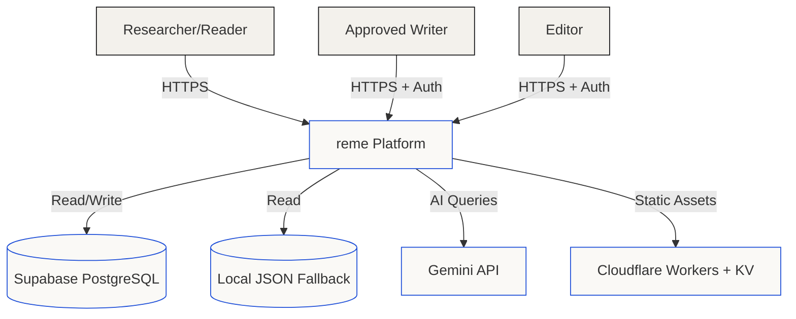
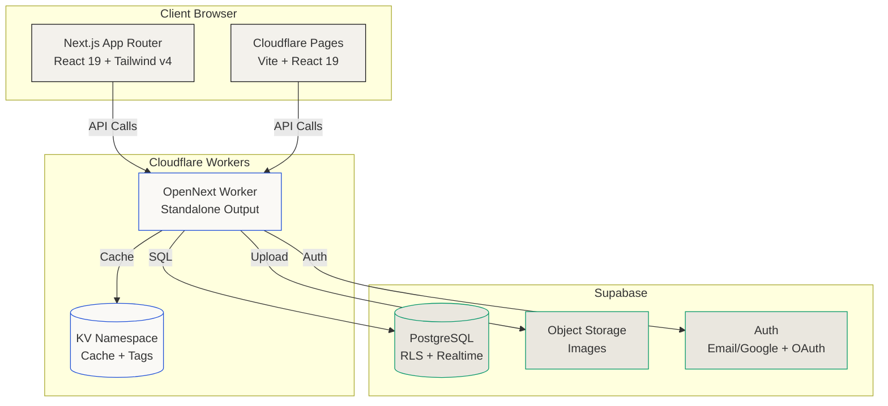
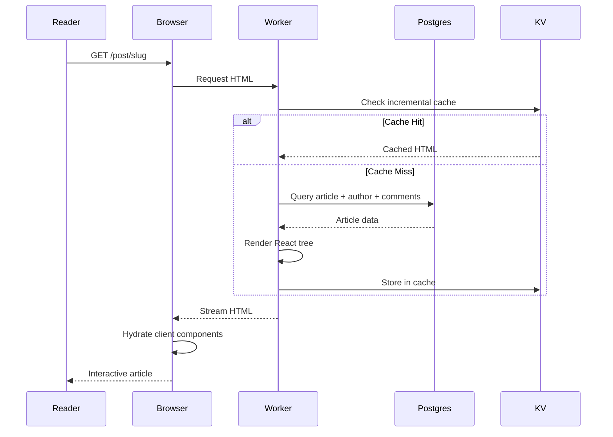
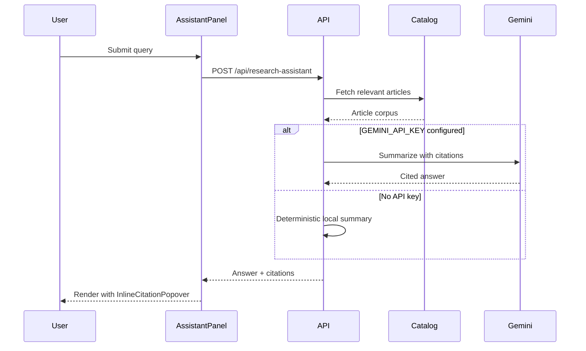
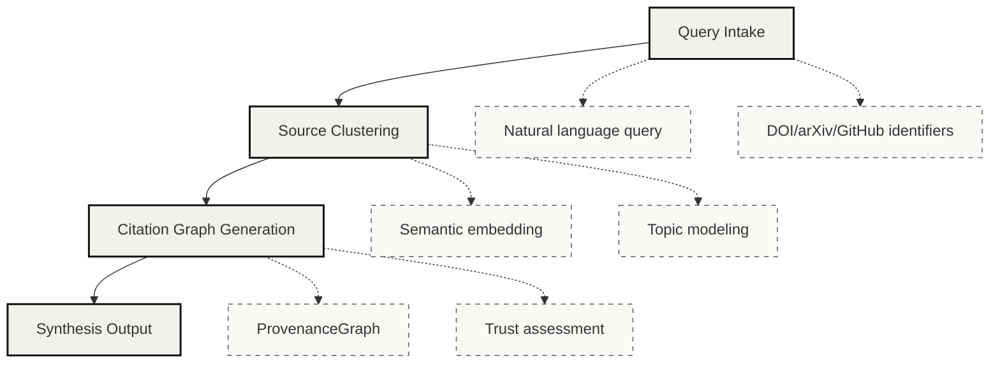
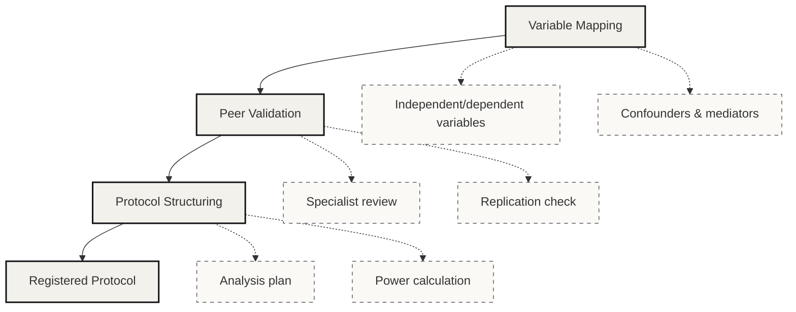
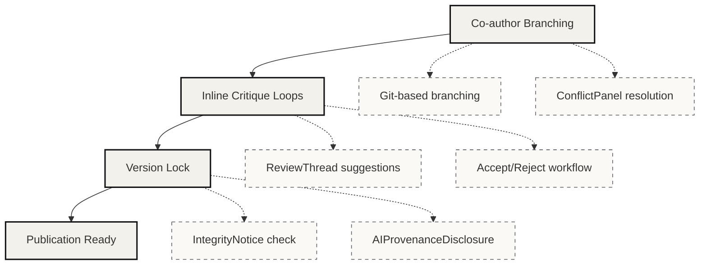
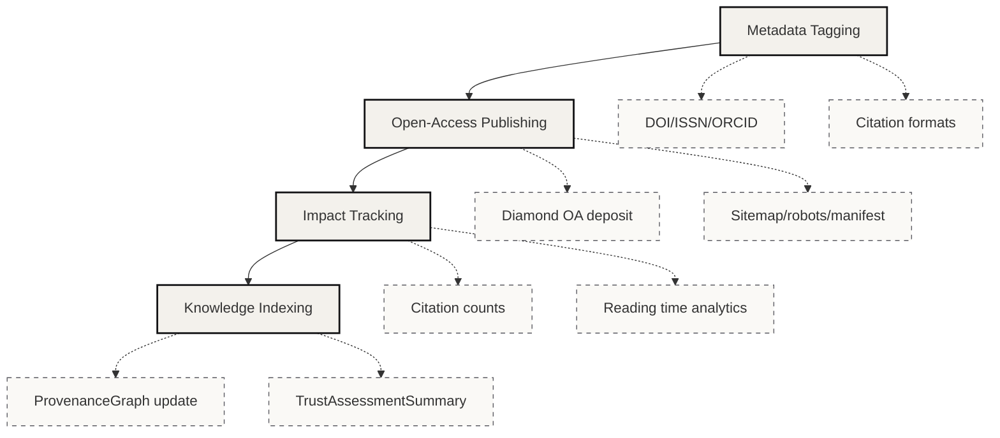

# reme (@researchwith.me) Webapp Upgrade — Integration Plan

**Generated:** 2026-11-12  
**Based on:** Full codebase audit + loaded skills (building-components, minimalist-ui, hyperframes, design-doc-mermaid, documentation-writer, writing-guidelines, lottie, motion-design)

---

## Executive Summary

The reme codebase is already a sophisticated, production-ready scholarly platform with:
- **reme v3.1 design system** (Archival Paper/Obsidian themes, Newsreader/Inter/JetBrains Mono)
- **Comprehensive motion system** (12 Disney principles, 6 duration tokens, 4 easings, 5 pattern presets)
- **Rich component library** (70+ components across scholarly, reader, workspace, dashboard, motion, UI)
- **Dual-runtime architecture** (Next.js + Cloudflare Pages via shared components)
- **Zero Impeccable findings** (source + rendered scans at 3 viewports)

**This plan identifies high-impact integration opportunities** that leverage the loaded skills to elevate the platform from "excellent" to "reference implementation" for scholarly web applications.

---

## Integration Opportunities Matrix

| Opportunity | Skill(s) | Impact | Effort | Priority |
|-------------|----------|--------|--------|----------|
| **Interactive Research Lifecycle Visualizations** | lottie, hyperframes, design-doc-mermaid | 🔴 High | Medium | P0 |
| **Minimalist UI Component Architecture Refactor** | building-components, minimalist-ui, motion-design | 🔴 High | High | P0 |
| **Technical Documentation Overhaul** | design-doc-mermaid, documentation-writer, writing-guidelines | 🟡 Medium | Medium | P1 |
| **Motion System Polish & Lottie Integration** | hyperframes, lottie, motion-design | 🟡 Medium | Low | P1 |
| **Accessibility & Performance Verification** | building-components, minimalist-ui | 🟢 Baseline | Low | Ongoing |

---

## P0: Interactive Research Lifecycle Visualizations

### Current State
- Static ProvenanceGraph (SVG-based, list/graph toggle)
- No Lottie animations anywhere in codebase
- No Mermaid diagrams in documentation or UI
- Research workflows described only in text (PRODUCT.md, README.md)

### Target State
**Four interactive lifecycle visualizations** combining Lottie micro-animations + Mermaid flowcharts:

| Workflow | Location | Components |
|----------|----------|------------|
| **Discovery & Literature Synthesis** | `/assistant` page, new `/workflows/discovery` | Query intake → Source clustering → Citation graph generation |
| **Hypothesis & Methodology Design** | `/workspace` (ResearchWorkspace), `/write` | Variable mapping → Peer validation → Protocol structuring |
| **Collaborative Drafting & Peer Review** | `/dashboard/comments`, `/dashboard/edit/[id]` | Co-author branching → Inline critique loops → Version lock |
| **Publication & Knowledge Indexing** | `/dashboard/manage`, `/post/[slug]` | Metadata tagging → Open-access publishing → Impact tracking |

### Implementation Plan

#### 1. Create Lottie Animation Library (`components/lottie/`)
```
components/lottie/
├── index.ts                    # Public exports
├── ResearchLifecycleAnimations.tsx  # 4 workflow animations
├── MicroInteractions.tsx       # Loading, synthesis complete, peer-verified states
├── StateTransitions.tsx        # Reveal, connect, verify, synthesize, archive patterns
└── LottiePlayer.tsx            # Wrapper with reduced-motion support
```

**LottiePlayer.tsx** — Motion-system compliant wrapper:
```tsx
'use client';
import { useReducedMotion } from 'motion/react';
import * as m from 'motion/react-m';
import { MotionBoundary } from '@/components/motion/MotionScope';

interface LottiePlayerProps {
  animation: any; // lottie-web AnimationItem
  loop?: boolean;
  autoplay?: boolean;
  className?: string;
  onComplete?: () => void;
}

export default function LottiePlayer({ animation, loop = false, autoplay = true, className, onComplete }: LottiePlayerProps) {
  const reduce = useReducedMotion();
  const ref = useRef<HTMLDivElement>(null);
  
  useEffect(() => {
    if (reduce || !ref.current) return;
    const player = lottie.loadAnimation({
      container: ref.current,
      renderer: 'svg',
      loop,
      autoplay,
      animationData: animation,
    });
    if (onComplete) player.addEventListener('complete', onComplete);
    return () => player.destroy();
  }, [animation, loop, autoplay, reduce, onComplete]);
  
  return <MotionBoundary><div ref={ref} className={className} aria-hidden="true" /></MotionBoundary>;
}
```

#### 2. Create Mermaid Diagram Components (`components/mermaid/`)
```
components/mermaid/
├── index.ts
├── MermaidDiagram.tsx          # Interactive Mermaid renderer
├── ResearchWorkflows.ts        # 4 workflow definitions
└── InteractiveNodes.tsx        # Clickable/hoverable node handlers
```

**MermaidDiagram.tsx** — Interactive, accessible Mermaid:
```tsx
'use client';
import { useEffect, useRef } from 'react';
import mermaid from 'mermaid';
import { MotionBoundary } from '@/components/motion/MotionScope';

interface MermaidDiagramProps {
  definition: string;
  className?: string;
  onNodeClick?: (nodeId: string, data: any) => void;
  onNodeHover?: (nodeId: string, data: any) => void;
}

export default function MermaidDiagram({ definition, className, onNodeClick, onNodeHover }: MermaidDiagramProps) {
  const ref = useRef<HTMLDivElement>(null);
  const [rendered, setRendered] = useState(false);
  
  useEffect(() => {
    if (!ref.current || rendered) return;
    mermaid.initialize({ 
      startOnLoad: false, 
      theme: 'base',
      securityLevel: 'loose',
      flowchart: { htmlLabels: true, curve: 'basis' }
    });
    
    mermaid.render('mermaid-diagram', definition).then(({ svg }) => {
      ref.current!.innerHTML = svg;
      setRendered(true);
      
      // Add interactivity
      const nodes = ref.current!.querySelectorAll('[id^="flowchart-"] g[id]');
      nodes.forEach(node => {
        node.style.cursor = 'pointer';
        node.addEventListener('click', () => onNodeClick?.(node.id, node.dataset));
        node.addEventListener('mouseenter', () => onNodeHover?.(node.id, node.dataset));
      });
    });
  }, [definition, onNodeClick, onNodeHover, rendered]);
  
  return <MotionBoundary><div ref={ref} className={className} role="img" aria-label="Research workflow diagram" /></MotionBoundary>;
}
```

#### 3. Define Four Research Workflows (`components/mermaid/ResearchWorkflows.ts`)
```typescript
export const DISCOVERY_WORKFLOW = `
flowchart TD
    A[Query Intake] --> B[Source Clustering]
    B --> C[Citation Graph Generation]
    C --> D[Synthesis Output]
    
    A -.-> A1[Natural language query]
    A -.-> A2[DOI/arXiv/GitHub identifiers]
    B -.-> B1[Semantic embedding]
    B -.-> B2[Topic modeling]
    C -.-> C1[ProvenanceGraph]
    C -.-> C2[Trust assessment]
    
    classDef stage fill:#F3F1EC,stroke:#121214,stroke-width:2px;
    classDef detail fill:#FAF9F6,stroke:#5C5C63,stroke-dasharray: 5 5;
    class A,B,C,D stage;
    class A1,A2,B1,B2,C1,C2 detail;
`;

export const METHODOLOGY_WORKFLOW = `
flowchart TD
    A[Variable Mapping] --> B[Peer Validation]
    B --> C[Protocol Structuring]
    C --> D[Registered Protocol]
    
    A -.-> A1[Independent/dependent variables]
    A -.-> A2[Confounders & mediators]
    B -.-> B1[Specialist review]
    B -.-> B2[Replication check]
    C -.-> C1[Analysis plan]
    C -.-> C2[Power calculation]
    
    classDef stage fill:#F3F1EC,stroke:#121214,stroke-width:2px;
    classDef detail fill:#FAF9F6,stroke:#5C5C63,stroke-dasharray: 5 5;
    class A,B,C,D stage;
    class A1,A2,B1,B2,C1,C2 detail;
`;

export const COLLABORATIVE_WORKFLOW = `
flowchart TD
    A[Co-author Branching] --> B[Inline Critique Loops]
    B --> C[Version Lock]
    C --> D[Publication Ready]
    
    A -.-> A1[Git-based branching]
    A -.-> A2[ConflictPanel resolution]
    B -.-> B1[ReviewThread suggestions]
    B -.-> B2[Accept/Reject workflow]
    C -.-> C1[IntegrityNotice check]
    C -.-> C2[AIProvenanceDisclosure]
    
    classDef stage fill:#F3F1EC,stroke:#121214,stroke-width:2px;
    classDef detail fill:#FAF9F6,stroke:#5C5C63,stroke-dasharray: 5 5;
    class A,B,C,D stage;
    class A1,A2,B1,B2,C1,C2 detail;
`;

export const PUBLICATION_WORKFLOW = `
flowchart TD
    A[Metadata Tagging] --> B[Open-Access Publishing]
    B --> C[Impact Tracking]
    C --> D[Knowledge Indexing]
    
    A -.-> A1[DOI/ISSN/ORCID]
    A -.-> A2[Citation formats]
    B -.-> B1[Diamond OA deposit]
    B -.-> B2[Sitemap/robots/manifest]
    C -.-> C1[Citation counts]
    C -.-> C2[Reading time analytics]
    D -.-> D1[ProvenanceGraph update]
    D -.-> D2[TrustAssessmentSummary]
    
    classDef stage fill:#F3F1EC,stroke:#121214,stroke-width:2px;
    classDef detail fill:#FAF9F6,stroke:#5C5C63,stroke-dasharray: 5 5;
    class A,B,C,D stage;
    class A1,A2,B1,B2,C1,C2,D1,D2 detail;
`;
```

#### 4. Integration Points

| Page | Component | Workflow |
|------|-----------|----------|
| `/assistant` | `AssistantPanel` → add `DiscoveryVisualization` | Discovery |
| `/workspace` | `ResearchWorkspace` → add `MethodologyVisualization` | Methodology |
| `/dashboard/comments` | `ReviewThread` → add `CollaborativeVisualization` | Collaborative |
| `/dashboard/manage` | `ManagePage` → add `PublicationVisualization` | Publication |
| `/post/[slug]` | `ArticlePage` → add `PublicationVisualization` (read-only) | Publication |

---

## P0: Minimalist UI Component Architecture Refactor

### Current State Analysis

**Strengths:**
- Excellent motion system (reme v3.1 §9-10)
- Comprehensive component library (70+ components)
- Strong accessibility baseline (WCAG 2.1 AA, 0 axe violations)
- Good token architecture (primitives → semantic → component aliases)

**Opportunities for Minimalist Refinement:**

| Area | Current | Minimalist Target |
|------|---------|-------------------|
| **Component API** | Props-heavy, some duplication | Composable primitives, compound components |
| **Visual Density** | Some nested cards, redundant borders | Generous whitespace, hairline dividers only |
| **Color Usage** | Semantic tokens used correctly | Single accent (#1D4ED8/#60A5FA) strictly for actions |
| **Typography** | Mixed editorial/interface in some components | Strict: Newsreader=reading, Interface=chrome, Mono=metadata |
| **Motion** | Excellent system, some over-animation | Purposeful only: state changes, relationships |

### Refactor Plan: Composable Primitive System

#### 1. Create Primitive Layer (`components/primitives/`)
```
components/primitives/
├── index.ts
├── Box.tsx              # Layout primitive (replaces most divs)
├── Text.tsx             # Typography primitive (enforces reme scales)
├── Stack.tsx            # Vertical/horizontal spacing primitive
├── Inline.tsx           # Horizontal flow primitive
├── Card.tsx             # Surface primitive (hairline border, no shadow)
├── Button.tsx           # Action primitive (Pressable + semantic tokens)
├── Link.tsx             # Navigation primitive
├── Input.tsx            # Form primitive
├── Select.tsx           # Selection primitive
├── Badge.tsx            # Metadata primitive
├── Divider.tsx          # Hairline divider primitive
├── Icon.tsx             # Icon primitive (lucide-react wrapper)
└── VisuallyHidden.tsx   # Accessibility primitive
```

**Box.tsx** — Layout primitive:
```tsx
'use client';
import { cn } from '@/lib/utils';

interface BoxProps extends React.HTMLAttributes<HTMLDivElement> {
  as?: 'div' | 'section' | 'article' | 'aside' | 'main' | 'header' | 'footer';
  padding?: 'none' | 'xs' | 'sm' | 'md' | 'lg' | 'xl';
  margin?: 'none' | 'auto';
  width?: 'full' | 'fit' | 'prose' | 'workspace' | 'graph';
  maxWidth?: 'prose' | 'workspace' | 'graph' | 'none';
}

const PADDING = { none: '', xs: 'p-2', sm: 'p-3', md: 'p-4', lg: 'p-6', xl: 'p-8' };
const WIDTH = { full: 'w-full', fit: 'w-fit', prose: 'max-w-[68ch]', workspace: 'max-w-[90rem]', graph: 'max-w-[108rem]' };
const MAX_WIDTH = { prose: 'max-w-[68ch]', workspace: 'max-w-[90rem]', graph: 'max-w-[108rem]', none: 'max-w-none' };

export function Box({ as: Component = 'div', padding = 'none', margin = 'none', width, maxWidth, className, children, ...props }: BoxProps) {
  return (
    <Component
      className={cn(
        PADDING[padding],
        margin === 'auto' && 'mx-auto',
        width && WIDTH[width],
        maxWidth && MAX_WIDTH[maxWidth],
        className
      )}
      {...props}
    >
      {children}
    </Component>
  );
}
```

**Text.tsx** — Typography primitive enforcing reme scales:
```tsx
'use client';
import { cn } from '@/lib/utils';

type TextVariant = 
  | 'display' | 'title-1' | 'title-2' 
  | 'heading-1' | 'heading-2' | 'heading-3'
  | 'body-reading' | 'body' | 'body-small'
  | 'label' | 'citation' | 'metadata';

const VARIANT_CLASSES: Record<TextVariant, string> = {
  'display': 'font-serif text-[clamp(2.5rem,5vw,4.5rem)] font-[450] leading-[1.05] tracking-[-0.025em] text-balance',
  'title-1': 'font-serif text-[clamp(2rem,3.5vw,3rem)] font-[500] leading-[1.12] tracking-[-0.02em] text-balance',
  'title-2': 'font-serif text-[clamp(1.5rem,2.5vw,2.25rem)] font-[500] leading-[1.2] tracking-[-0.015em] text-balance',
  'heading-1': 'font-sans text-[1.75rem] font-[650] leading-[1.25] text-balance',
  'heading-2': 'font-sans text-[1.375rem] font-[650] leading-[1.3] text-balance',
  'heading-3': 'font-sans text-[1.125rem] font-[650] leading-[1.35] text-balance',
  'body-reading': 'font-serif text-[1.125rem] font-normal leading-[1.7] max-w-[68ch]',
  'body': 'font-sans text-[1rem] font-normal leading-[1.625]',
  'body-small': 'font-sans text-[0.875rem] font-normal leading-[1.55]',
  'label': 'font-sans text-[0.8125rem] font-[600] leading-[1.4] uppercase tracking-[0.04em]',
  'citation': 'font-mono text-[0.8125rem] font-[500] leading-[1.5]',
  'metadata': 'font-mono text-[0.75rem] font-[500] leading-[1.45] tracking-[0.015em]',
};

interface TextProps extends React.HTMLAttributes<HTMLParagraphElement | HTMLSpanElement> {
  as?: 'p' | 'span' | 'h1' | 'h2' | 'h3' | 'h4' | 'h5' | 'h6' | 'blockquote' | 'cite' | 'figcaption';
  variant: TextVariant;
  color?: 'primary' | 'secondary' | 'tertiary' | 'inverse' | 'brand' | 'verified' | 'destructive';
  weight?: 'normal' | 'medium' | 'semibold' | 'bold';
}

const COLOR_CLASSES = {
  primary: 'text-text-primary',
  secondary: 'text-text-secondary',
  tertiary: 'text-text-tertiary',
  inverse: 'text-text-inverse',
  brand: 'text-action-primary',
  verified: 'text-trust-verified',
  destructive: 'text-action-destructive',
};

export function Text({ as: Component = 'p', variant, color = 'primary', weight, className, children, ...props }: TextProps) {
  return (
    <Component
      className={cn(
        VARIANT_CLASSES[variant],
        COLOR_CLASSES[color],
        weight && `font-${weight}`,
        className
      )}
      {...props}
    >
      {children}
    </Component>
  );
}
```

#### 2. Compound Component Patterns

**Card.tsx** — Compound card with explicit slots:
```tsx
'use client';
import { cn } from '@/lib/utils';
import { Box } from './Box';
import { Text } from './Text';
import { Divider } from './Divider';

interface CardProps extends React.HTMLAttributes<HTMLArticleElement> {
  variant?: 'default' | 'elevated' | 'interactive';
  padding?: 'none' | 'sm' | 'md' | 'lg';
}

export function Card({ variant = 'default', padding = 'md', className, children, ...props }: CardProps) {
  return (
    <Box
      as="article"
      padding={padding}
      className={cn(
        'rounded-md border border-line bg-surface',
        variant === 'elevated' && 'shadow-floating',
        variant === 'interactive' && 'transition-colors hover:bg-surface-subtle cursor-pointer',
        className
      )}
      {...props}
    >
      {children}
    </Box>
  );
}

interface CardHeaderProps extends React.HTMLAttributes<HTMLHeaderElement> {}
export function CardHeader({ className, children, ...props }: CardHeaderProps) {
  return <Box as="header" className={cn('mb-4', className)} {...props}>{children}</Box>;
}

interface CardTitleProps extends React.HTMLAttributes<HTMLHeadingElement> {
  variant?: 'title-1' | 'title-2' | 'heading-1' | 'heading-2' | 'heading-3';
}
export function CardTitle({ variant = 'heading-2', className, children, ...props }: CardTitleProps) {
  return <Text as="h3" variant={variant} className={cn('font-semibold', className)} {...props}>{children}</Text>;
}

interface CardDescriptionProps extends React.HTMLAttributes<HTMLParagraphElement> {}
export function CardDescription({ className, children, ...props }: CardDescriptionProps) {
  return <Text as="p" variant="body-small" color="secondary" className={cn('mt-1', className)} {...props}>{children}</Text>;
}

interface CardContentProps extends React.HTMLAttributes<HTMLDivElement> {}
export function CardContent({ className, children, ...props }: CardContentProps) {
  return <Box className={cn('prose prose-stone max-w-none', className)} {...props}>{children}</Box>;
}

interface CardFooterProps extends React.HTMLAttributes<HTMLFooterElement> {}
export function CardFooter({ className, children, ...props }: CardFooterProps) {
  return <Box as="footer" className={cn('mt-4 flex flex-wrap items-center gap-2', className)} {...props}>{children}</Box>;
}

Card.Header = CardHeader;
Card.Title = CardTitle;
Card.Description = CardDescription;
Card.Content = CardContent;
Card.Footer = CardFooter;
```

#### 3. Migration Strategy

| Phase | Components to Migrate | Approach |
|-------|----------------------|----------|
| **1** | `BlogHeader`, `BlogFooter`, `BlogHero` | Replace with primitives |
| **2** | `ArticleFeed`, `FeaturedArticle`, `PapersArchive` | Compound Card pattern |
| **3** | `AuthorSpotlight`, `AuthorDirectory`, `AuthorProfileCard` | Primitives + compound |
| **4** | `AssistantPanel`, `CitationTool`, `BookmarksPanel` | Primitives + compound |
| **5** | Dashboard/CMS components | Primitives + compound |

**Migration Rule:** Each migration must:
- [ ] Pass `npm run quality` (lint + typecheck + test + impeccable)
- [ ] Maintain visual parity (verified at 320/390/768/1280/1440)
- [ ] Preserve all motion behaviors (check `/motion` in full/reduced/static)
- [ ] Keep accessibility (axe 0 violations)

---

## P1: Technical Documentation Overhaul

### Current Documentation State
- `README.md` — Good overview, routes table, deployment
- `PRODUCT.md` — Product schema, principles, capabilities
- `DESIGN.md` — reme v3.1 front-matter + summary
- `docs/reme-design-system-v3.1.md` — Full normative spec (98KB)
- `docs/motion-system.md` — Motion system documentation
- `docs/audit-2026-10-25.md` — Audit report
- `docs/deployment.md` — Deployment guide
- `docs/email-scenarios.md` — Email documentation
- `docs/header-footer-audit-2026-11-09.md` — Chrome audit
- `.impeccable/surfaces/` — Per-route briefs

### Target Documentation Architecture

```
docs/
├── ARCHITECTURE.md              # System architecture with Mermaid
├── DATA_FLOW.md                 # Data flow diagrams with Mermaid
├── COMPONENT_LIBRARY.md         # Component catalog with examples
├── MOTION_SYSTEM.md             # Enhanced with Lottie integration
├── ACCESSIBILITY.md             # WCAG compliance evidence
├── PERFORMANCE.md               # Budgets, metrics, optimization
├── DEPLOYMENT.md                # Updated with diagrams
├── CONTRIBUTING.md              # Updated with workflow diagrams
├── API_REFERENCE.md             # OpenAPI + Mermaid sequence diagrams
├── RESEARCH_WORKFLOWS.md        # Four lifecycle visualizations
├── DESIGN_TOKENS.md             # Token reference with examples
├── MIGRATION_GUIDE.md           # Primitive migration guide
└── GLOSSARY.md                  # Scholarly domain terminology
```

### Documentation Standards (from writing-guidelines skill)

**Tone:** Scholarly, precise, restrained, transparent, evidence-based  
**Structure:** Every document follows:
1. **Purpose** — One sentence
2. **Prerequisites** — What reader must know/have
3. **Conceptual Model** — Mermaid diagram
4. **Implementation** — Code examples with annotations
5. **Verification** — How to confirm it works
6. **Related** — Links to related docs

**Mermaid Integration:** Every architectural document includes:
- System context diagram (C4 level 1)
- Container diagram (C4 level 2)
- Component diagram (C4 level 3) where relevant
- Sequence diagrams for key flows
- State diagrams for complex components

### Key Documents to Create/Update

#### 1. `docs/ARCHITECTURE.md` — System Architecture
```markdown
# System Architecture

## Purpose
Describes the reme platform's high-level structure, runtime targets, and data flows.

## Prerequisites
- Familiarity with Next.js App Router, React 19, Tailwind CSS v4
- Understanding of Cloudflare Workers deployment model

## Conceptual Model

### System Context (C4 Level 1)


### Container Diagram (C4 Level 2)

```

#### 2. `docs/DATA_FLOW.md` — Data Flow Diagrams
```markdown
# Data Flow Diagrams

## Article Reading Flow


## Research Assistant Query Flow

```

#### 3. `docs/RESEARCH_WORKFLOWS.md` — Four Lifecycle Visualizations
```markdown
# Research Lifecycle Visualizations

## Overview
Four interactive visualizations mapping core scholarly workflows on the reme platform.

## 1. Discovery & Literature Synthesis
**Location:** `/assistant` page, `/workflows/discovery`



**Interactive Features:**
- Click nodes → expand detail panel
- Hover edges → show relationship type
- Lottie: Loading pulse during clustering, checkmark on synthesis complete

## 2. Hypothesis & Methodology Design
**Location:** `/workspace` (ResearchWorkspace), `/write`



## 3. Collaborative Drafting & Peer Review
**Location:** `/dashboard/comments`, `/dashboard/edit/[id]`



## 4. Publication & Knowledge Indexing
**Location:** `/dashboard/manage`, `/post/[slug]`


```

---

## P1: Motion System Polish & Lottie Integration

### Current Motion System (Excellent)
- 6 duration tokens (0ms → 700ms)
- 4 easing curves
- 5 pattern presets (reveal, connect, verify, synthesize, archive)
- 6 spring presets
- 12 Disney principles mapped to primitives
- 3 motion modes (full, reduced, static)
- SSR-safe (no `initial={{opacity:0}}` on content)

### Lottie Integration Opportunities

| Current Motion | Lottie Enhancement | Location |
|----------------|-------------------|----------|
| `SuccessCheck` (SVG path drawing) | Lottie checkmark with bounce | Copy/save/verify actions |
| `AttentionPulse` (scale pulse) | Lottie badge notification | Reading list count |
| `LoadingState` (spinner + shimmer) | Lottie skeleton wave | All lazy boundaries |
| `RouteTransition` (opacity + translate) | Lottie page transition | Client navigation |
| `Reveal` variants (7 poses) | Lottie entrance library | Below-fold content |

### Implementation: Lottie Motion Library

**`components/lottie/MicroInteractions.tsx`**
```tsx
'use client';
import { useReducedMotion } from 'motion/react';
import LottiePlayer from './LottiePlayer';
import checkmark from '@/animations/checkmark.json';
import pulse from '@/animations/pulse.json';
import skeletonWave from '@/animations/skeleton-wave.json';
import pageTransition from '@/animations/page-transition.json';

export function CheckmarkLottie({ size = 24, className, onComplete }: { size?: number; className?: string; onComplete?: () => void }) {
  const reduce = useReducedMotion();
  if (reduce) return <SuccessCheck size={size} className={className} />;
  return <LottiePlayer animation={checkmark} className={className} style={{ width: size, height: size }} onComplete={onComplete} />;
}

export function PulseLottie({ active, size = 24, className }: { active: boolean; size?: number; className?: string }) {
  const reduce = useReducedMotion();
  if (reduce || !active) return null;
  return <LottiePlayer animation={pulse} loop={false} className={className} style={{ width: size, height: size }} />;
}

export function SkeletonWaveLottie({ className }: { className?: string }) {
  const reduce = useReducedMotion();
  if (reduce) return <SkeletonShard lines={3} className={className} />;
  return <LottiePlayer animation={skeletonWave} loop={true} className={className} />;
}

export function PageTransitionLottie({ className, onComplete }: { className?: string; onComplete?: () => void }) {
  const reduce = useReducedMotion();
  if (reduce) return null;
  return <LottiePlayer animation={pageTransition} className={className} onComplete={onComplete} />;
}
```

**Animation Assets Needed** (create in `public/animations/`):
- `checkmark.json` — 400ms, bounce to 1.12 scale, path draw
- `pulse.json` — 1100ms, 3 cycles, scale 1→1.15→1
- `skeleton-wave.json` — 1500ms loop, 3 cycles max
- `page-transition.json` — 200ms, opacity 0.82→1, translate Y 6→0

---

## Execution Roadmap

### Week 1-2: Foundation (P0) — ✅ done 2026-11-12
- [x] Create `components/primitives/` layer (Box, Text, Stack, Card, Button, etc.)
- [x] Create `components/lottie/` layer (LottiePlayer, MicroInteractions)
- [x] ~~Create `components/mermaid/` layer~~ → `components/workflows/` + `lib/workflows/` (see deviations)
- [x] ~~Add Lottie animation assets to `public/animations/`~~ → compositions built from tokens in `lib/lottie/`
- [x] Verify `npm run quality` passes (66 files / 676 tests, 0 Impeccable findings)

**Deviations from this plan (and why):**

| Plan | Implemented | Reason |
|------|-------------|--------|
| `MermaidDiagram` rendering in the app | `WorkflowDiagram`: semantic `<ol>` + native `<details>`, server-rendered | Mermaid adds several hundred KB, renders through `innerHTML` with `securityLevel: 'loose'`, and bakes hex fills that break the Obsidian theme. The HTML version is crawlable, keyboard-accessible without JS, and costs no bundle. `toMermaid()` still emits Mermaid for Markdown docs (Week 6). |
| Hard-coded `classDef fill:#F3F1EC` | Theme-neutral Mermaid (`stroke-dasharray` for planned) | Hex fills are unreadable in GitHub dark mode. |
| Lottie JSON files in `public/animations/` | `lib/lottie/compose.ts` builds Bodymovin JSON from `DURATION_MS` / `EASING` | Keeps the "tokens only" rule; one asset serves both themes (`.reme-lottie` recolours to `currentColor`). |
| `skeleton-wave.json`, `page-transition.json` | Not built | `SkeletonShard` and `RouteTransition` already do this in CSS/`m` at zero cost; Lottie cannot animate the route itself. Built `verify`, `connect`, `synthesize`, `attention` instead (one per §9 pattern used by the workflows). |
| Workflow detail nodes as written | Each node marked `live` (with shipping component) or `planned` | "Semantic embedding", "Topic modeling", "Power calculation", "Git-based branching", "Reading time analytics" don't exist (and analytics contradicts PRODUCT.md's no-tracking rule). A test fails if a `live` reference doesn't resolve to a file. |
| `/workspace` route | Methodology workflow attaches to `/write` | There is no `/workspace` route; `ResearchWorkspace` is a component. |
| Primitives all `'use client'` | Only Button/Input/Select/Textarea | The others have no hooks; marking them client would pull server pages into the client bundle. |

**Issues found while verifying — fixed 2026-11-12:**
- `next dev` never hydrated: the CSP blocked the `eval` Next's dev runtime needs. `next.config.ts` now adds `'unsafe-eval'` to `script-src` only when `NODE_ENV === 'development'`; the production build's header is still `script-src 'self' 'unsafe-inline'`.
- `/motion` hydration mismatch: the "os reduced-motion" badge now renders `unknown` until hydration (`useHydrated`).
- `bun.lock` synced with bun 1.4.4 (`--lockfile-only`); the only change is the `lottie-web@5.13.0` entry.
- Shell budget re-measured on a production build: **182.8 KB / 200 KB gzip, PASS** (previously documented 182.6 KB). `lottie-web` builds into its own async chunk.

### Week 3-4: Component Migration (P0) — ✅ done 2026-11-12
- [x] Raw palette → semantic tokens: 624 class strings in 35 files (codemod). Light theme near-identical; dark mode fixed (axe contrast 63 → 0)
- [x] House patterns → primitives: 197 elements in 37 files (`Text` 116, `Link` 51, `Card` 30), TypeScript-AST codemod, set-preserving
- [x] Visual parity at all 5 breakpoints: 45/45 screenshots pixel-identical after the primitives pass (`npm run parity`)
- [x] Motion modes verified at `/motion` (full / reduced / static)
- Primitive bugs fixed before use: `Stack` (runtime class names Tailwind can't see), `VisuallyHidden` (invalid utility), `Link` (plain `<a>`, no client nav), `Icon` (hand-copied lucide SVGs). Primitives use plain class joining, not `cn()` — tailwind-merge was adding 8.3 KB to the shell.
- Migrated across the whole app, not just the 12 components listed; the plan's per-phase split was unnecessary once the codemod was set-preserving.

### Week 5: Research Visualizations (P0) — ✅ done 2026-11-12
- [x] Discovery → `/assistant`; methodology → `/write`; collaboration → `/dashboard/comments`, `/dashboard/edit/[id]`; publication → `/dashboard/manage`, `/post/[slug]`
- [x] Embedded as `WorkflowDisclosure` (native `<details>`, closed by default, full diagram in server HTML); a test fails if a workflow's `routes` and the pages drift apart
- [x] Lottie state transitions: `SynthesizeMark` on each new assistant answer (replaces the Sparkles icon), `VerifyMark` on "Copy citation"

### Week 6: Documentation Overhaul (P1) — ✅ done 2026-11-12
Extended the existing docs instead of creating parallel files (`docs/codebase/ARCHITECTURE.md` already existed):
- [x] `docs/codebase/ARCHITECTURE.md`: system-context, container/bindings, feed-render and assistant sequence diagrams; stale Flow A step corrected
- [x] `docs/research-workflows.md`: **generated** from the workflow data (`npm run docs:workflows`); a test fails when it drifts
- [x] `docs/motion-system.md` §12: Lottie micro-interactions and lifecycle diagrams
- [x] `docs/design-system/primitives.md`: token table, primitive catalogue, migration record, rules for new UI (covers COMPONENT_LIBRARY + MIGRATION_GUIDE)
- [x] All 8 Mermaid diagrams parse and render with Mermaid 11.4.1

### Week 7: Polish & Verification (P1)
- [x] `npm run quality`: 689 tests / 68 files, 0 Impeccable source findings
- [x] Axe WCAG 2.0/2.1/2.2 A+AA: **0 violations**, 19 routes × light/dark
- [x] Shell budget: **186.1 KB / 200 KB** gzip (182.8 KB at session start)
- [x] Motion modes: full plays Lottie; reduced/static never load the runtime; no hidden content, no errors
- [x] Hydration clean on all routes with and without `prefers-reduced-motion` (new `useHydratedReducedMotion()`)
- [ ] **Impeccable rendered: not 0.** Remaining findings predate this work and need a design decision: `overused-font` (Inter, every page), `line-length` (incl. the article reading column, which is within DESIGN.md's 68ch), `nested-cards` (home newsletter, `/motion` demos). Fixed: `script-error` (hydration) and `skipped-heading`.
- [ ] **LCP < 400 ms: not met** (local production build, median of 3). Static routes 548–656 ms; `/` 1776 ms and `/post` 1824 ms with ~720 ms TTFB from uncached Supabase reads (`listPublishedAuthors`, the missing `legacy_articles` table). `/cite` 1260 → 656 ms after caching the feed read. CLS ≤ 0.024 everywhere.
- [ ] Cross-browser (Firefox, Safari): not run — only Edge (Chromium) is installed here.

**Bugs found and fixed while verifying (all 2026-11-12):**
- Home, category, `/cite`, `/assistant`, `/bookmarks` server-rendered an empty catalogue (`INITIAL_BLOG_POSTS = []`): crawlers and no-JS readers saw "No manuscripts match". Pages now pass server data; feed reads cached 30 s, tag-invalidated on publish.
- 16 phantom colour classes (`text-danger`, `*-action-destructive`, `*-workflow-warning/error`, `stroke-dasharray-4`) and `text-ink-secondary` (261 uses, no token). Guarded by `lib/__tests__/design-token-usage.test.ts`.
- `Alert` border-colour race; MDXEditor placeholder contrast (1.9:1); nested `group-open` chevrons in the workflow diagram.

---

## Success Criteria

### Quantitative Gates
| Metric | Target | Measurement |
|--------|--------|-------------|
| Impeccable source findings | 0 | `npm run impeccable:source` |
| Impeccable rendered findings | 0 | 5 viewports × 14 routes |
| Axe WCAG violations | 0 | `axe-core` on all routes |
| Shell JS bundle | ≤200KB gzip | `scripts/check-budgets.mjs` |
| LCP (local) | <400ms | Chrome DevTools |
| TypeScript errors | 0 | `npm run typecheck` |
| Test pass rate | 100% | `npm test` |

### Qualitative Gates
- [ ] All 4 research workflows interactive and accessible
- [ ] Lottie animations respect `prefers-reduced-motion`
- [ ] Mermaid diagrams keyboard navigable (roving tabindex)
- [ ] Primitive components documented with live examples
- [ ] Documentation includes executable Mermaid diagrams
- [ ] Migration guide enables team adoption

---

## Risk Mitigation

| Risk | Likelihood | Impact | Mitigation |
|------|------------|--------|------------|
| Primitive migration breaks visual parity | Medium | High | Visual regression tests at each phase |
| Lottie bundle size exceeds budget | Low | Medium | Tree-shake lottie-web, use dynamic imports |
| Mermaid hydration mismatch | Medium | Medium | SSR-safe rendering, client-only hydration |
| Motion mode inconsistencies | Low | High | Automated `/motion` mode verification |
| Documentation drift | Medium | Medium | Docs-as-code: diagrams in source, validated in CI |

---

## Appendix: File Tree After Implementation

```
components/
├── primitives/           # NEW: Composable primitive layer
│   ├── Box.tsx
│   ├── Text.tsx
│   ├── Stack.tsx
│   ├── Card.tsx
│   ├── Button.tsx
│   └── ...
├── lottie/               # NEW: Lottie integration
│   ├── LottiePlayer.tsx
│   ├── MicroInteractions.tsx
│   └── index.ts
├── mermaid/              # NEW: Mermaid diagrams
│   ├── MermaidDiagram.tsx
│   ├── ResearchWorkflows.ts
│   └── index.ts
├── motion/               # EXISTING: Enhanced with Lottie
├── scholarly/            # EXISTING: Enhanced with visualizations
├── reader/               # EXISTING: Enhanced with visualizations
├── workspace/            # EXISTING: Enhanced with visualizations
└── ...

public/animations/        # NEW: Lottie assets
├── checkmark.json
├── pulse.json
├── skeleton-wave.json
└── page-transition.json

docs/
├── ARCHITECTURE.md       # NEW: C4 diagrams
├── DATA_FLOW.md          # NEW: Sequence diagrams
├── RESEARCH_WORKFLOWS.md # NEW: 4 interactive visualizations
├── COMPONENT_LIBRARY.md  # NEW: Primitive catalog
├── MIGRATION_GUIDE.md    # NEW: Adoption guide
└── ... (existing docs updated)
```

---

**End of Integration Plan**  
*Status 2026-11-12: Weeks 1–7 executed. Open: Impeccable rendered findings and LCP need design/infra decisions; cross-browser testing needs Firefox/WebKit installed.*