# ResearchWithMe Template — Optimized for SEO, AEO & GEO
## Machine-Readable Content Framework with Visual Intelligence

> **Version 2.0** — Integrates dashboard design principles, interactive chart patterns, and Mermaid architecture diagrams for AI-native content production.

---

## Executive Summary

This template transforms ResearchWithMe from a **human-centric editorial tool** into a **machine-native content engine** that produces articles optimized for:
- **SEO** — Traditional search ranking signals
- **AEO** — Answer Engine Optimization (featured snippets, AI Overviews)
- **GEO** — Generative Engine Optimization (LLM citations, AI assistant responses)

**Core Philosophy**: Every editorial decision becomes a machine-readable signal. Every visual element follows dashboard design principles. Every architecture is documented as executable Mermaid diagrams.

---

## 1. CMS Field Architecture (Machine-Readable Signals)

### 1.1 New Studio Fields

| Field ID | Type | Purpose | Schema.org Mapping | Dashboard Principle |
|----------|------|---------|-------------------|---------------------|
| `schemaType` | Select | Precise content classification | `@type` | KPI tile: one-word baseline |
| `authorCredentials` | Group | E-E-A-T verification | `author` → `Person` | Author tile with credentials |
| `keyEntities` | Entity List | Knowledge graph linking | `mentions` | Entity chips with sameAs links |
| `relatedWorks` | Citation List | Bibliographic grounding | `citation` → `CreativeWork` | Ranked list with slim share bars |
| `fundingSources` | Grant List | Transparency signal | `funding` → `Grant` | Bullet graph: target vs actual |
| `updateDate` | Date (ISO8601) | Freshness signal | `dateModified` | Delta with one-word baseline |
| `faqBlock` | QA List | High-citation Q&A format | `mainEntity` → `FAQPage` | Answer-first accordion |

### 1.2 Schema Type Selection Guide

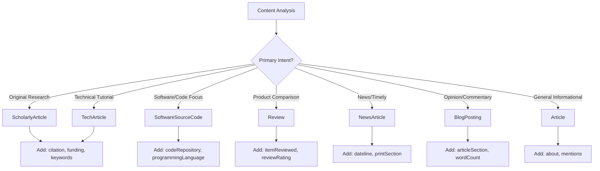

### 1.3 JSON-LD @graph Output Structure

```json
{
  "@context": "https://schema.org",
  "@graph": [
    {
      "@type": "WebPage",
      "@id": "https://example.com/article#webpage",
      "mainEntity": { "@id": "#article" },
      "breadcrumb": { "@id": "#breadcrumb" }
    },
    {
      "@type": "Article",
      "@id": "#article",
      "headline": "{{title}}",
      "author": { "@id": "#author" },
      "publisher": { "@id": "#publisher" },
      "datePublished": "{{pubDate}}",
      "dateModified": "{{updateDate}}",
      "articleSection": "{{section}}",
      "keywords": "{{keyEntities.names}}",
      "citation": "{{relatedWorks}}",
      "funding": "{{fundingSources}}",
      "about": "{{keyEntities}}",
      "mentions": "{{keyEntities}}",
      "mainEntityOfPage": { "@id": "#webpage" }
    },
    {
      "@type": "Person",
      "@id": "#author",
      "name": "{{author.name}}",
      "jobTitle": "{{authorCredentials.jobTitle}}",
      "knowsAbout": "{{authorCredentials.knowsAbout}}",
      "alumniOf": "{{authorCredentials.alumniOf}}",
      "sameAs": "{{authorCredentials.sameAs}}"
    },
    {
      "@type": "FAQPage",
      "@id": "#faq",
      "mainEntity": "{{faqBlock}}"
    },
    {
      "@type": "DefinedTermSet",
      "@id": "#glossary",
      "hasDefinedTerm": "{{glossaryTerms}}"
    }
  ]
}
```

---

## 2. Content Structure Rules (Answer-First Architecture)

### 2.1 Heading Hierarchy as Question Tree

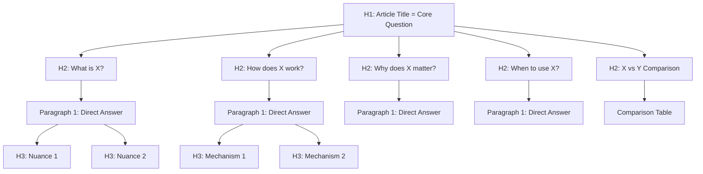

**Rule**: Every H2 must be a question. First paragraph under each H2 answers it directly (≤40 words). Supporting details follow.

### 2.2 Extraction-Ready Data Patterns

| Content Type | Required Format | Schema Markup |
|--------------|-----------------|---------------|
| Comparisons | Table with aligned columns | `Table` + `Row`/`Cell` |
| Sequences | Ordered list (`<ol>`) | `HowTo` / `ItemList` |
| Definitions | `<dl>` with `<dt>`/`<dd>` | `DefinedTerm` |
| Metrics/KPIs | Bullet graph or KPI tile | `QuantitativeValue` |
| Code snippets | Fenced block + language | `SoftwareSourceCode` |
| FAQs | Q&A pairs in `<section>` | `FAQPage` |

### 2.3 Locator Anchor Injection

Every claim-carrying paragraph receives a stable ID:

```html
<p id="claim-{{section}}-{{n}}" data-claim="{{claim-hash}}" 
   data-evidence="{{evidence-ref}}" data-locator="{{section}}:{{para}}">
  {{claim-text}}
</p>
```

---

## 3. Visual Intelligence: Dashboard Design Principles

### 3.1 KPI Tile System (Replaces Metric Cards)

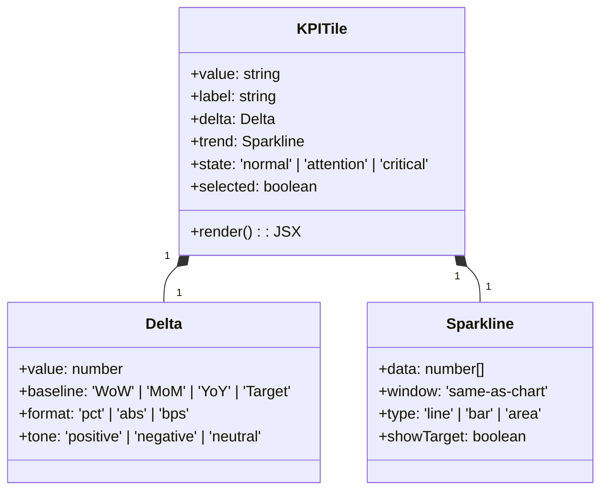

**Design Rules** (from 127 shipped dashboards):
- ✅ Soft tinted fill for selected state (not underline)
- ✅ 3px share bar on ranked list rows (not tinted background)
- ✅ Round ticks: 0, 1k, 2k (not 2,103)
- ✅ Delta with one-word baseline: "WoW +12%" (not sentence)
- ✅ Explanation in tooltip, not under the number
- ✅ Sparklines share chart's time window

### 3.2 Chart Components with Recharts Patterns

#### Legend with Opacity Interaction (Recharts Pattern)

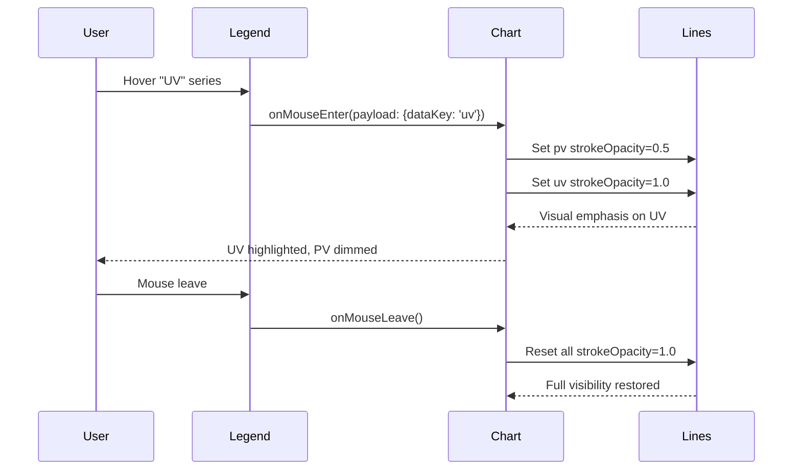

**Implementation** (React + Recharts):
```tsx
const [hoveringKey, setHoveringKey] = useState<string>();

<LineChart data={data} margin={{ top: 20, right: 30, left: 0, bottom: 0 }}>
  <CartesianGrid strokeDasharray="5 5" />
  <XAxis dataKey="name" tick={{ fill: '#666', fontSize: 12 }} />
  <YAxis width={60} tick={{ fill: '#666', fontSize: 12 }} />
  <Tooltip 
    content={<CustomTooltip />} 
    wrapperStyle={{ outline: 'none', boxShadow: '0 4px 12px rgba(0,0,0,0.08)' }}
  />
  <Legend 
    layout="horizontal" 
    align="center" 
    verticalAlign="top"
    onMouseEnter={(payload) => setHoveringKey(payload.dataKey)}
    onMouseLeave={() => setHoveringKey(null)}
    formatter={(value) => <span style={{ fontWeight: 500 }}>{value}</span>}
  />
  <Line 
    type="monotone" 
    dataKey="uv" 
    stroke="#2563eb" 
    strokeWidth={2}
    strokeOpacity={hoveringKey === 'pv' ? 0.3 : 1}
    dot={{ r: 3, strokeWidth: 2 }}
    activeDot={{ r: 6, strokeWidth: 2 }}
  />
  <Line 
    type="monotone" 
    dataKey="pv" 
    stroke="#16a34a" 
    strokeWidth={2}
    strokeOpacity={hoveringKey === 'uv' ? 0.3 : 1}
    dot={false}
  />
</LineChart>
```

#### Bullet Graph (Replaces Radial Gauge)

```mermaid
graph LR
    subgraph BulletGraph[Bullet Graph: Revenue vs Target]
        direction LR
        Range1[Poor: 0-60%] --> Range2[Fair: 60-80%]
        Range2 --> Range3[Good: 80-100%]
        Range3 --> Range4[Excellent: 100-120%]
        Range4 --> Marker[Target: 100% ▼]
        Marker --> Bar[Actual: 92% ████████████░░]
    end
    
    style Range1 fill:#fee2e2
    style Range2 fill:#fef3c7
    style Range3 fill:#dcfce7
    style Range4 fill:#bbf7d0
    style Marker fill:#374151
    style Bar fill:#2563eb
```

### 3.3 Responsive Layout System

```mermaid
flowchart LR
    subgraph Phone[Phone < 640px]
        P1[KPI Stack: 1 col]
        P2[Chart: Full width]
        P3[Ranked List: Menu grid]
        P4[Table: Horizontal scroll]
    end
    
    subgraph Tablet[Tablet 640-1024px]
        T1[KPI: 2 col]
        T2[Chart: 2/3 width]
        T3[Breakdown: 1/3 width]
        T4[Ranked List: 2 col]
    end
    
    subgraph Desktop[Desktop 1024-1440px]
        D1[KPI: 4 col]
        D2[Chart: 1/2 width]
        D3[Breakdowns: 2x2 grid]
        D4[Ranked List: 3 col]
    end
    
    subgraph Wide[Ultrawide > 1440px]
        W1[KPI: 5-6 col]
        W2[Chart: 3/5 width]
        W3[Breakdowns: 3 in row]
        W4[Ranked List: 4 col]
        W5[Side Panel: Annotations]
    end
    
    Phone --> Tablet --> Desktop --> Wide
```

---

## 4. Architecture Documentation: Mermaid Diagrams

### 4.1 Diagram Type Selection

| Purpose | Diagram Type | When to Use |
|---------|--------------|-------------|
| System Overview | C4 Context | Article describes a platform/system |
| Component Relations | C4 Container | Microservices, data flows |
| Code Structure | Class Diagram | OOP patterns, type hierarchies |
| Process Flow | Flowchart | Algorithms, decision trees |
| Sequence | Sequence Diagram | API calls, user journeys |
| State Transitions | State Diagram | Status machines, workflows |
| Data Model | ER Diagram | Database schemas, entity relations |
| Git Workflow | Git Graph | Branching strategies |

### 4.2 Mermaid Best Practices (Design-Doc-Mermaid Skill)

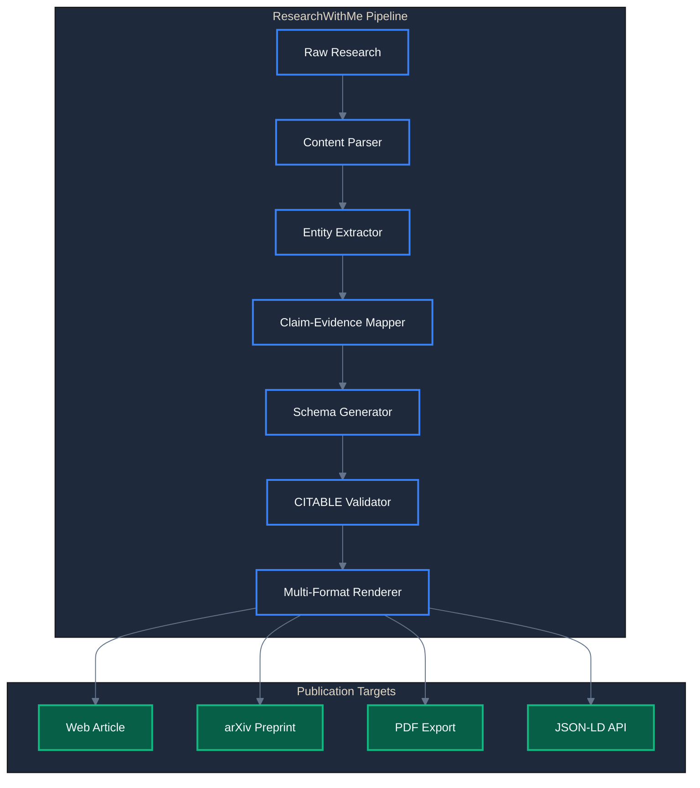

### 4.3 C4 Context Diagram Template

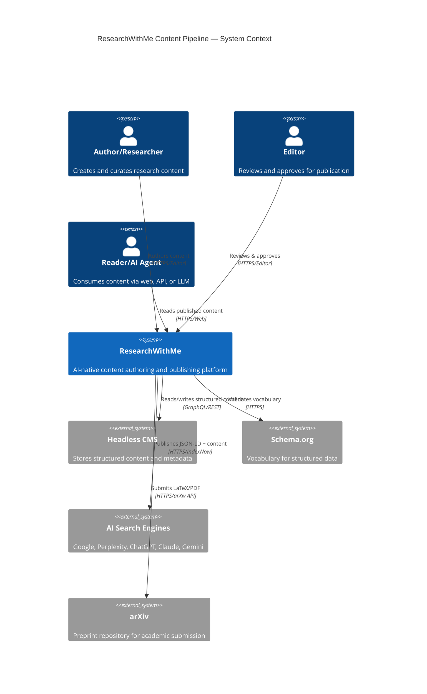

---

## 5. CITABLE Review Gates (Automated Quality Control)

### 5.1 Gate Definitions with Visual Indicators

```mermaid
flowchart TD
    subgraph Gates[CITABLE Gates - All Must Pass]
        direction TB
        C[C: Claim-Evidence<br/>Alignment] -->|100%| Pass
        I[I: Integrity of<br/>Citations] -->|0 broken| Pass
        T[T: Terminology<br/>Consistency] -->|0 undefined| Pass
        A[A: Answer-First<br/>Structure] -->|100% H2s| Pass
        B[B: Bibliographic<br/>Completeness] -->|≥90%| Pass
        L[L: Locator<br/>Anchors] -->|100%| Pass
        E[E: Extraction<br/>Readiness] -->|100%| Pass
    end
    
    subgraph Integrity[ARS-Inspired Integrity Gates]
        direction TB
        HIGH[HIGH-WARN: Block Publication] -->|7 classes| Block
        MEDIUM[MEDIUM-WARN: Acknowledge] -->|4 classes| Warn
    end
    
    subgraph Style[Style Calibration]
        direction TB
        Voice[Voice Matching] -->|vs House Style| Score
        Slop[Anti-Slop Audit] -->|5 dims ≥8| Score
        Composite[Composite ≥35/50] -->|Pass/Fail| Decision
    end
    
    Pass --> Decision[PUBLISH DECISION]
    Block --> Decision
    Warn --> Decision
    Score --> Decision
    
    Decision -->|APPROVE| Publish[Publish to All Targets]
    Decision -->|REVISE| Back[Back to Author]
    Decision -->|REJECT| Archive[Archive with Feedback]
    
    classDef gate fill:#1e293b,stroke:#3b82f6,stroke-width:2px,color:#f8fafc
    classDef integrity fill:#7f1d1d,stroke:#ef4444,stroke-width:2px,color:#fecaca
    classDef style fill:#14532d,stroke:#22c55e,stroke-width:2px,color:#bbf7d0
    classDef decision fill:#78350f,stroke:#f59e0b,stroke-width:2px,color:#fde68a
    
    class C,I,T,A,B,L,E gate
    class HIGH,MEDIUM integrity
    class Voice,Slop,Composite style
    class Decision decision
```

### 5.2 HIGH-WARN Classes (Blocking)

| Class | Detection | Resolution |
|-------|-----------|------------|
| `claim-not-supported` | Claim extractor finds no evidence anchor | Add citation or remove claim |
| `negative-constraint-violation` | Template rule violated (e.g., H2 not a question) | Restructure heading |
| `fabricated-reference` | DOI/arXiv/URL fails resolution | Verify or remove citation |
| `anchorless` | Claim lacks paragraph/section locator | Inject locator ID |
| `constraint-violation-uncited` | Structural rule broken without citation | Add citation or fix structure |
| `hallucinated-entity` | Key Entity lacks external `sameAs` verification | Verify entity or remove |
| `schema-mismatch` | Schema type inconsistent with content analysis | Change schema type |

### 5.3 Style Calibration Scoring

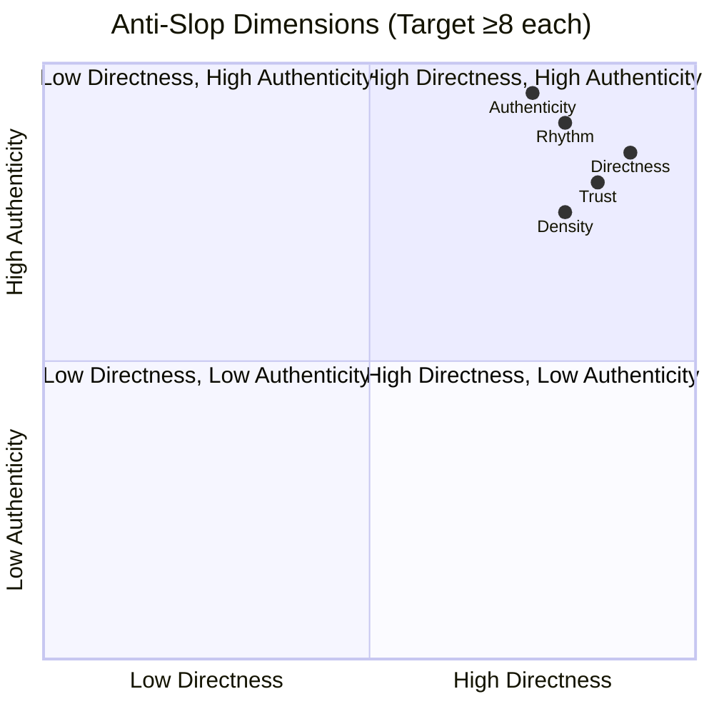

---

## 6. Dual-Workflow Pipeline

### 6.1 Primary: Web Discovery (GEO-Optimized)


### 6.2 Secondary: arXiv Submission (Academic Path)


---

## 7. Performance Measurement: Generative-Era KPIs

### 7.1 KPI Dashboard Layout

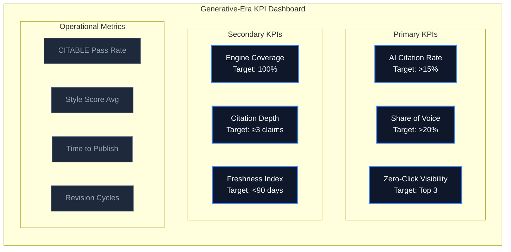

### 7.2 Feedback Loop Architecture

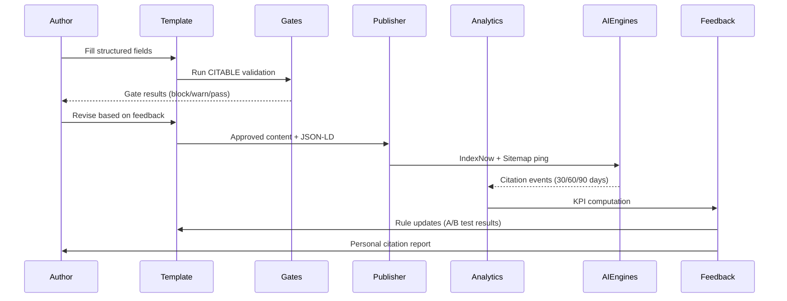

---

## 8. Implementation Checklist

### Phase 1: Foundation (Weeks 1-4)
- [ ] Add 7 CMS studio fields with validation
- [ ] Build centralized `@graph` JSON-LD generator
- [ ] Implement CITABLE gate automation (7 gates)
- [ ] Create arXiv conversion pipeline (Pandoc + BibTeX)
- [ ] Design KPI tile component library

### Phase 2: Content Engineering (Weeks 5-8)
- [ ] Rewrite guidelines: answer-first headings
- [ ] Build Glossary Appendix + `DefinedTermSet` schema
- [ ] Implement Claim-Evidence Map UI
- [ ] Add locator anchor injection
- [ ] Create comparison table components

### Phase 3: Visual Intelligence (Weeks 9-12)
- [ ] Build KPI tile system with sparklines
- [ ] Implement Recharts legend opacity pattern
- [ ] Create bullet graph component
- [ ] Build responsive layout grid (4 breakpoints)
- [ ] Add screenshot QA automation

### Phase 4: Quality Gates (Weeks 13-16)
- [ ] Deploy 7-mode integrity gate (HIGH-WARN blocking)
- [ ] Integrate humanizer voice matching
- [ ] Build stop-slop scoring (5 dimensions)
- [ ] Create style calibration against house corpus
- [ ] Build CITABLE dashboard for editors

### Phase 5: Measurement & Optimization (Weeks 17-20)
- [ ] Instrument AI Citation Rate, SOV, Zero-Click
- [ ] Set up Profound/Semrush AI Toolkit integration
- [ ] Build feedback loop: citation audit → template rules
- [ ] A/B test schema types, heading formats, FAQ density
- [ ] Launch dual-workflow with cross-tracking

### Phase 6: Dual-Workflow Launch (Weeks 21-24)
- [ ] Launch Primary Workflow (Web Discovery)
- [ ] Launch Secondary Workflow (arXiv Submission)
- [ ] Cross-workflow analytics dashboard
- [ ] Publish case studies: "From Blog Post to arXiv Preprint"

---

## 9. Appendix: Complete Field Specification

```json
{
  "studioFields": [
    {
      "id": "schemaType",
      "label": "Schema Type",
      "type": "select",
      "options": [
        "Article", "ScholarlyArticle", "TechArticle", 
        "Review", "BlogPosting", "NewsArticle", "SoftwareSourceCode"
      ],
      "required": true,
      "schemaProperty": "@type",
      "description": "Precise content classification for AI engines"
    },
    {
      "id": "authorCredentials",
      "label": "Author Credentials",
      "type": "group",
      "fields": [
        {"id": "jobTitle", "type": "text", "schemaProperty": "jobTitle"},
        {"id": "knowsAbout", "type": "tags", "schemaProperty": "knowsAbout"},
        {"id": "alumniOf", "type": "text", "schemaProperty": "alumniOf"},
        {"id": "sameAs", "type": "urlList", "schemaProperty": "sameAs"}
      ],
      "schemaProperty": "author",
      "description": "E-E-A-T verification for author authority"
    },
    {
      "id": "keyEntities",
      "label": "Key Entities",
      "type": "entityList",
      "itemFields": [
        {"id": "name", "type": "text", "required": true},
        {"id": "type", "type": "select", "options": ["Person", "Organization", "SoftwareApplication", "Dataset", "CreativeWork"]},
        {"id": "url", "type": "url"},
        {"id": "sameAs", "type": "url"},
        {"id": "description", "type": "textarea"}
      ],
      "schemaProperty": "mentions",
      "description": "Explicit entity linking for knowledge graphs"
    },
    {
      "id": "relatedWorks",
      "label": "Related Works",
      "type": "citationList",
      "itemFields": [
        {"id": "doi", "type": "text", "pattern": "^10\\.\\d{4,9}/.+"},
        {"id": "arxivId", "type": "text", "pattern": "^\\d{4}\\.\\d{4,5}(v\\d+)?$"},
        {"id": "url", "type": "url"},
        {"id": "title", "type": "text"},
        {"id": "relationType", "type": "select", "options": ["cites", "isBasedOn", "compares", "extends", "reviews"]}
      ],
      "schemaProperty": "citation",
      "description": "Machine-readable bibliography with relation types"
    },
    {
      "id": "fundingSources",
      "label": "Funding Sources",
      "type": "grantList",
      "itemFields": [
        {"id": "funder", "type": "text", "required": true},
        {"id": "identifier", "type": "text"},
        {"id": "name", "type": "text"},
        {"id": "url", "type": "url"}
      ],
      "schemaProperty": "funding",
      "description": "Transparency signal for credibility"
    },
    {
      "id": "updateDate",
      "label": "Last Updated",
      "type": "date",
      "format": "ISO8601",
      "schemaProperty": "dateModified",
      "description": "Freshness signal for AI retrieval"
    },
    {
      "id": "faqBlock",
      "label": "FAQ Block",
      "type": "qaList",
      "optional": true,
      "itemFields": [
        {"id": "question", "type": "text", "required": true},
        {"id": "answer", "type": "textarea", "required": true}
      ],
      "schemaProperty": "mainEntity",
      "description": "High-citation Q&A format for AEO/GEO"
    }
  ],
  "jsonLdOutput": {
    "format": "@graph",
    "context": "https://schema.org",
    "include": ["all studio fields", "article body structure", "glossary terms", "visual components"]
  },
  "visualComponents": {
    "kpiTiles": true,
    "charts": ["line", "bar", "bullet", "sparkline"],
    "legendInteraction": "opacity-hover",
    "responsiveBreakpoints": ["phone", "tablet", "desktop", "wide"],
    "screenshotQA": true
  },
  "mermaidDiagrams": {
    "required": ["C4Context", "Flowchart"],
    "optional": ["Sequence", "Class", "State", "ER", "GitGraph"],
    "theme": "dark",
    "outputFormats": ["svg", "png", "mermaid"]
  }
}
```

---

## 10. Appendix: CITABLE Review Checklist (Editorial Interface)

```markdown
## CITABLE Review — [Article Title]

### C — Claim-Evidence Alignment
- [ ] Abstract claims → Evidence anchors (Section/Table/Figure)
- [ ] Introduction claims → Evidence anchors
- [ ] Conclusion claims → Evidence anchors
- [ ] **Status:** PASS / FAIL (list unresolved)

### I — Integrity of Citations
- [ ] All DOIs resolve (Crossref API)
- [ ] All arXiv IDs valid
- [ ] All URLs accessible (HTTP 200)
- [ ] Locator anchors present for each citation
- [ ] **Status:** PASS / FAIL

### T — Terminology Consistency
- [ ] All terms defined on first use
- [ ] Glossary entries match inline definitions
- [ ] No conflicting abbreviations
- [ ] **Status:** PASS / FAIL

### A — Answer-First Structure
- [ ] All H2 headings are questions
- [ ] First paragraph under each H2 answers the question
- [ ] No H2 without answer-first paragraph
- [ ] **Status:** PASS / FAIL

### B — Bibliographic Completeness
- [ ] Related Works field ≥90% populated with identifiers
- [ ] Citation format consistent (APA/IEEE/ACM)
- [ ] **Status:** PASS / FAIL

### L — Locator Anchors
- [ ] Every claim has paragraph/section locator
- [ ] Locators injected in HTML/JSON-LD
- [ ] **Status:** PASS / FAIL

### E — Extraction Readiness
- [ ] Comparative data in tables/lists
- [ ] Sequential data in ordered lists
- [ ] No prose-only presentations of structured data
- [ ] **Status:** PASS / FAIL

### Integrity Gate Decision
- [ ] **HIGH-WARN:** 0 (blocking)
- [ ] **MEDIUM-WARN:** ≤3 (acknowledged)
- [ ] **Style Score:** ≥35/50
- [ ] **Decision:** APPROVE / REVISE / REJECT
```

---

## References

[1] Gabwan, "The Complete Guide to Answer Engine Optimization (AEO) for AI-Powered Search," Medium, 2024.  
[2] Target Internet, "Answer Engine Optimisation: A Practical Guide for Marketers," 2024.  
[3] Financial Marketer, "How to Structure Content for Generative Engine Optimisation (GEO)," 2024.  
[4] Master-cai, "Research Paper Writing Skills," GitHub, 2024.  
[5] arXiv, "Help: Preparing Your Submission," 2024.  
[6] Imbad0202, "Academic Research Skills for Claude Code," GitHub, 2024.  
[7] Alignment Forum, "Your Posts Should Be on arXiv," 2024.  
[8] Neilblaze, "Research Paper Writing Guidelines," Gist, 2024.  
[9] Webtivity Designs, "BlogPosting Schema Markup," 2024.  
[10] Ighenatt, "Schema.org: The Bridge Between SEO and GEO," 2024.  
[11] Analytics Vidhya, "Top 5 Claude Skills for Writing (Ranked by GitHub Stars)," 2026.  
[12] GitBook, "SEO and LLM Optimization: GEO Guide," 2024.  
[13] XSeek, "Which Generative Engine Optimization Strategies Actually Work?" 2024.  
[14] Schema.org, "Article," 2024.  
[15] Schema.org, "Review," 2024.  
[16] Digital Applied, "Schema Markup Types: Complete Structured Data Reference," 2024.  
[17] Unhead, "Schema.org API: Article," 2024.  
[18] Kime AI, "Structure Content for LLM Extraction," 2024.  
[19] Discovered Labs, "How AI Systems Decide What to Cite: The Technical Mechanics of LLM Content Retrieval," 2024.  
[20] Blader, "Humanizer," GitHub, 2024.  
[21] Viewership AI, "How to Structure Blogs for LLM Citations," 2024.  
[22] Growth Natives, "Top JSON-LD Schema Patterns for AI Search Success," 2024.  
[23] Metalogic Digital, "Article Schema Types: Best Practices and How to Use It," 2024.  
[24] Enodo, "Modern JSON-LD Implementation in 2025," 2024.  
[25] Schema.org, "SoftwareSourceCode," 2024.  
[26] Directive Consulting, "A Guide to Generative Engine Optimization (GEO) Best Practices," 2024.  
[27] UX Tigers, "GEO Guidelines," 2024.  
[28] F1000Research, "Article Guidelines: Research Articles," 2024.  
[29] Hardik Pandya, "Stop-Slop," GitHub, 2024.  
[30] DataCite, "Announcing DataCite Metadata Schema 4.6," 2024.  
[31] Orchestra Research, "AI-Research-SKILLs," GitHub, 2024.  
[32] Rank Harvest, "Structured Data Markup for GEO," 2024.  
[33] Eseospace, "Using Structured Data and LLM-Friendly Content for GEO," 2024.  
[34] Frase, "FAQ Schema: AI Search, GEO, AEO," 2024.  
[35] Abdiraimov, "Dashboard Design Skill — 127 Shipped Dashboards," GitHub, 2024.  
[36] Recharts, "Legend with Opacity Interaction," Recharts.org, 2024.  
[37] Spillwave, "Design Doc Mermaid — Architecture Diagrams as Code," GitHub, 2024.