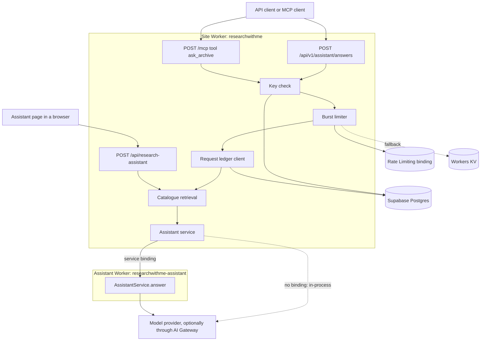
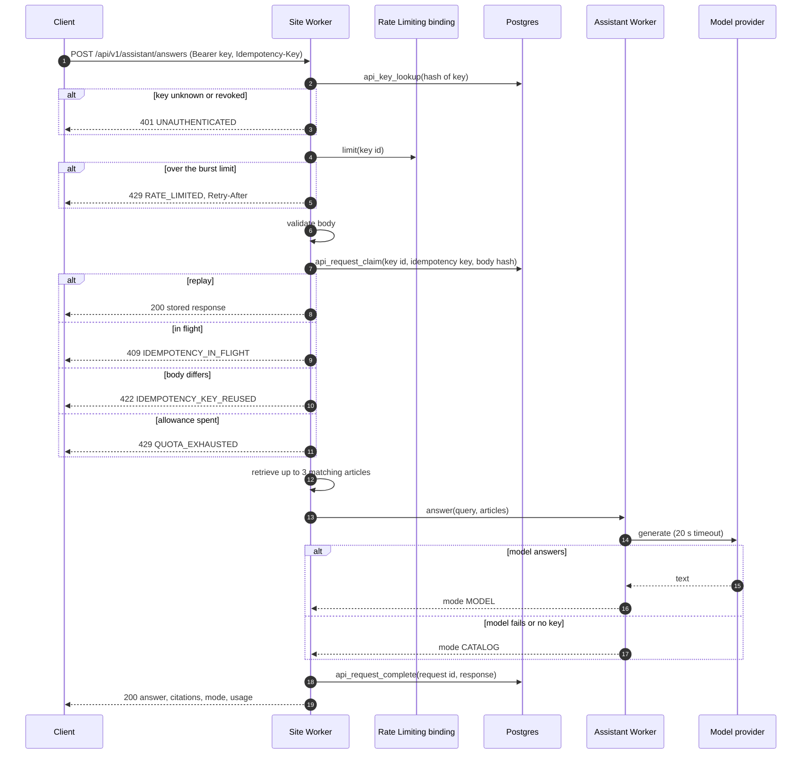
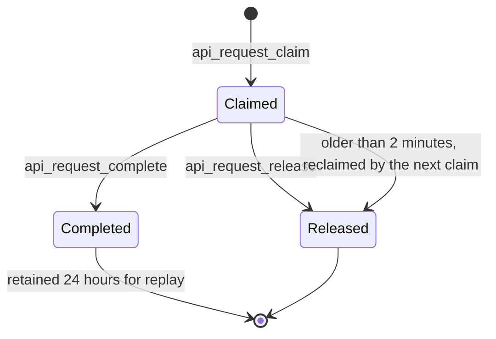
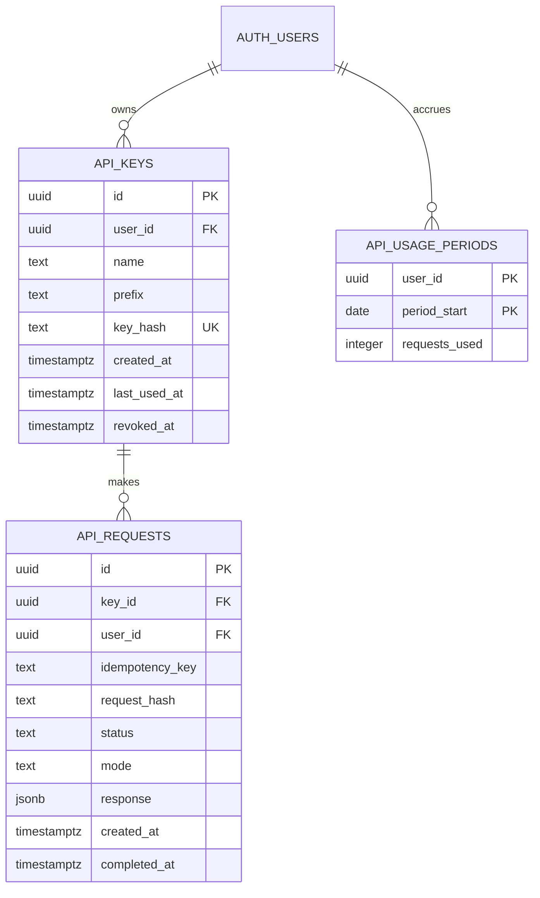

# Assistant API

> **Status: implemented in this repository, not deployed.** The code, the
> migration and the Assistant Worker exist and are covered by unit tests, but
> the migration has not been applied to the live database and neither Worker
> has been deployed with these changes, so `https://researchwith.me/api/v1/*`
> does not answer yet. Nothing here has been checked against a running
> production service. Remove this notice after the deploy steps in
> "Owner: deploy" and the checks that follow them.

The document has four parts, one per reader need: an explanation of how the
API works, a first-call tutorial, how-to guides for common tasks, and the
reference.

Related: spec `docs/superpowers/specs/2026-11-14-assistant-api-spec.md`,
decision record `docs/decisions/ADR-001-assistant-api-worker-and-rate-limiting.md`.

---

## 1. How it works

The Assistant answers questions from published ResearchWithMe reviews and
nothing else. The API is the same Assistant with a key, limits and a usage
count in front of it.

### Components



### One request



If the site Worker fails after the claim and before the completion, it calls
`api_request_release`, which deletes the ledger row and returns the unit to
the allowance, so an error response uses no allowance. Two narrow exceptions:
if the release call itself fails, the unit stays counted until the claim is
two minutes old and the same `Idempotency-Key` is sent again; and if the
answer was produced but storing it failed, the answer is still returned and
counted, and only its replay is lost.

The Assistant Worker is tried first. If the binding is missing, throws, or
returns something that is not a well-formed answer, the site Worker composes
the answer itself and logs `assistant.binding_fallback`.

### Request states



### Why two limiters

| | Burst limiter | Monthly allowance |
|---|---|---|
| Purpose | Stop a runaway loop | Decide how much each account may use |
| Backed by | Workers Rate Limiting binding | One Postgres transaction |
| Accuracy | Approximate. Counted per Cloudflare location and eventually consistent, so some minutes let more than the limit through | Exact |
| Error | `429 RATE_LIMITED` | `429 QUOTA_EXHAUSTED` |
| Resets | Within 60 seconds | First day of the next month, UTC |

### What the Assistant Worker is for

It keeps the model key out of the Worker that serves pages, and it can be
deployed, rolled back, observed and profiled without redeploying the site. It
has no route of its own; only the site Worker can call it.

---

## 2. Tutorial: your first answer

You need an account on the site.

1. Sign in and open **Dashboard, Account**. Under **API keys**, choose
   **Create key**, give it a name, and copy the key. It starts with `rwm_` and
   is shown once.
2. Ask a question:

   ```bash
   curl -sS https://researchwith.me/api/v1/assistant/answers \
     -H "Authorization: Bearer $RWM_API_KEY" \
     -H "Content-Type: application/json" \
     -d '{"query":"What do the reviews say about replication?"}'
   ```

3. Read the reply. `answer` is Markdown. `citations` lists the articles the
   answer rests on. `mode` is `MODEL` when a language model wrote the answer
   and `CATALOG` when it was assembled directly from article records.
   `usage.requestsRemaining` is what is left this month.
4. Check your usage at any time:

   ```bash
   curl -sS https://researchwith.me/api/v1/usage -H "Authorization: Bearer $RWM_API_KEY"
   ```

---

## 3. How-to guides

### Retry safely

Send an `Idempotency-Key` header (8 to 128 characters from `A-Z a-z 0-9 _ -`,
unique per question you intend to ask). If the connection drops, repeat the request
with the same key and the same body. You get the stored answer and it is
counted once. Stored answers are kept for 24 hours.

### Handle the two kinds of 429

- `RATE_LIMITED`: wait for the number of seconds in `Retry-After`, then retry.
  When the Rate Limiting binding made the decision the value is always 60,
  because the binding reports only yes or no.
- `QUOTA_EXHAUSTED`: retrying will not help until the date in
  `error.details.resetsAt`.

### Rotate a key

Create a second key, switch your client to it, then revoke the first. A
revoked key is refused on its next request.

### Use the Assistant from an MCP client

Connect to `https://researchwith.me/mcp` (streamable HTTP, protocol version
`2025-11-25`). `search_reviews` needs no key. `ask_archive` needs the header
`Authorization: Bearer <key>` and counts against the same allowance as the
HTTP API. A refusal (no key, burst limit, allowance used) comes back as a tool
result with `isError: true` and a sentence to read, not as a protocol error.
Resending the same JSON-RPC id with the same question within 24 hours returns
the stored answer and is counted once.

### Owner: deploy

Order matters. `main` deploys automatically through Workers Builds, and a
deploy whose binding names a Worker the account does not have fails. For that
reason the `ASSISTANT` binding is commented out in `wrangler.jsonc`; until
step 4 the site answers in-process and the Assistant Worker is not used.

1. Apply `supabase/migrations/20261114000200_api_keys.sql`. It is written to
   be re-runnable. It has been run only against an in-memory Postgres with a
   stubbed `auth` schema, never against Supabase; try it on a branch first.
2. Create the API bridge secret and store it in both places, Worker first:

   ```bash
   SECRET=$(openssl rand -hex 32)
   printf %s "$SECRET" | npx wrangler secret put API_BRIDGE_SECRET
   printf %s "$SECRET" | shasum -a 256
   ```

   ```sql
   insert into private.api_settings (key, value)
   values ('bridge_secret_sha256', '<hex from the command above>')
   on conflict (key) do update set value = excluded.value;
   ```

   This is not `BILLING_BRIDGE_SECRET`; use a different value. Without the
   row, or with a mismatch, every API call answers `503`. Rotate in the same
   order. Until this step is done, keys can be created on the account page
   but usage shows as unknown there and no key can be used.

   The steps below are optional and can be done later.
3. `npm run worker:assistant:deploy`, then
   `npx wrangler secret put GEMINI_API_KEY -c workers/assistant/wrangler.jsonc`
4. Uncomment the `ASSISTANT` service binding in `wrangler.jsonc`, then deploy
   the site (merge to `main`, or `npm run deploy`).
5. Confirm that rate-limit namespace `2001` is not already used by another
   Worker in the account; a shared id shares counters. Change it in
   `wrangler.jsonc` if it is.
6. Send one request with a test key. If the Assistant Worker is enabled,
   confirm the trace shows both Workers and the site log has no
   `assistant.binding_fallback` line. Repeat it with
   the same `Idempotency-Key` and confirm the same `id` comes back.

The site Worker keeps working without the Assistant Worker: it answers
in-process. If `GEMINI_API_KEY` is removed from the site Worker, that fallback
gives catalogue answers only; leaving it set keeps model answers during an
Assistant Worker outage at the cost of holding the key in both Workers.

### Owner: change a limit

- Burst: edit `ratelimits[0].simple.limit` in `wrangler.jsonc` and
  `BURST_LIMIT` in `lib/api/burst.ts` together (a test fails if they differ),
  then deploy. The
  period can only be 10 or 60 seconds.
- Allowance: set the `API_FREE_MONTHLY_REQUESTS` variable and deploy.

### Owner: investigate a slow or expensive Worker

Follow the `workers-profiling` skill: confirm the account, Worker,
environment and version first, capture a CPU or heap profile with the
Cloudflare CLI, and report the file, function and metric. Source maps are on
for the Assistant Worker and off for the site Worker (`upload_source_maps:
false` in `wrangler.jsonc`, because of their size); turn them on there before
profiling the site Worker so the frames are readable.

---

## 4. Reference

Base URL: `https://researchwith.me`. Version: `v1`, in the path. Changes
within `v1` are additive: new optional request fields and new response fields
only.

### Authentication

`Authorization: Bearer rwm_<43 characters>`. Keys belong to one account. The
service stores a SHA-256 hash and the first 12 characters.

### `POST /api/v1/assistant/answers`

Request headers

| Header | Required | Notes |
|--------|----------|-------|
| `Authorization` | Yes | Bearer key |
| `Content-Type` | Yes | `application/json` |
| `Idempotency-Key` | No | 8 to 128 characters from `A-Z a-z 0-9 _ -` |

Request body

| Field | Type | Required | Notes |
|-------|------|----------|-------|
| `query` | string | Yes | 1 to 600 characters after trimming |

Response `200`

```json
{
  "id": "req_0f8b7a52c1d94e3a",
  "answer": "### What the archive says ...",
  "citations": [
    { "id": "post-id", "slug": "post-slug", "title": "Article title", "author": "Author name", "category": "Research Reviews", "url": "https://researchwith.me/post/post-slug" }
  ],
  "mode": "MODEL",
  "notice": null,
  "usage": { "requestsUsed": 1, "requestsIncluded": 100, "requestsRemaining": 99, "resetsAt": "2026-12-01T00:00:00.000Z" }
}
```

`mode` is `MODEL` or `CATALOG`. `notice` is a sentence when the model was
unavailable, otherwise `null`. The values in the example are placeholders.

### `GET /api/v1/usage`

Response `200`: the fields of the `usage` object above at the top level, plus
`"plan": "FREE"`. Reading usage spends no allowance; it is subject to the
burst limit.

### Key management (signed-in session, same origin)

| Method and path | Purpose | Success |
|-----------------|---------|---------|
| `GET /api/account/api-keys` | List your keys: `id`, `name`, `prefix`, `createdAt`, `lastUsedAt`, `revokedAt` | `200 { "data": [...] }` |
| `POST /api/account/api-keys` | Create a key. Body `{ "name": string }`, 1 to 60 characters. At most 5 active keys | `201` with the fields above and `key`, shown once |
| `DELETE /api/account/api-keys/{keyId}` | Revoke. An id that is not yours, or is already revoked, is `404 NOT_FOUND` | `204` |

### Errors

Every error has one shape:

```json
{ "error": { "code": "RATE_LIMITED", "message": "Too many requests. Retry after 12 seconds.", "details": { "retryAfterSeconds": 12 } } }
```

| Status | Code | When |
|--------|------|------|
| 400 | `INVALID_REQUEST` | Body unreadable, `query` missing or too long, bad `Idempotency-Key` |
| 401 | `UNAUTHENTICATED` | No key, unknown key, or revoked key. `WWW-Authenticate: Bearer` set |
| 404 | `NOT_FOUND` | Key management only: no such key on this account |
| 409 | `IDEMPOTENCY_IN_FLIGHT` | The first request with this key is still running |
| 415 | `UNSUPPORTED_MEDIA_TYPE` | Not `application/json` |
| 422 | `IDEMPOTENCY_KEY_REUSED` | Same key, different body |
| 429 | `RATE_LIMITED` | Burst limit for the key, or too many failed key checks from one address. `Retry-After` header set |
| 429 | `QUOTA_EXHAUSTED` | Monthly allowance spent. `details.resetsAt` set |
| 503 | `UPSTREAM_UNAVAILABLE` | The archive, the key store or the ledger could not be reached. Nothing is answered without a ledger entry |
| 500 | `INTERNAL` | Anything else |

Revoked and unknown keys return the same `401` so that a response does not
confirm a key ever existed.

### Limits

| Limit | Value | Configured in |
|-------|-------|---------------|
| Burst per key | 30 requests per 60 seconds, approximate | `wrangler.jsonc` `ratelimits` |
| Failed key checks per address | 60 per 60 seconds; requests with a valid key do not count | `lib/api/authenticate.ts`, KV limiter |
| Monthly allowance per account | 100 answers | `API_FREE_MONTHLY_REQUESTS` |
| Active keys per account | 5 | `lib/api/keys.ts` |
| Request body | 8192 bytes | `app/api/v1/assistant/answers/route.ts` |
| Model timeout | 20 seconds, then a catalogue answer | `lib/assistant/compose.ts` |

The burst and allowance values are deliberately low starting points, to be
raised on evidence (see the spec, "Decisions on the open questions").

Where the Rate Limiting binding is absent (local development, Worker
Previews) or fails, the burst limit is enforced by the KV limiter instead.
That limiter allows requests through if KV itself is unreachable.

### Data model



`api_requests` has a unique constraint on `(key_id, idempotency_key)`. Rows
without a client key get a generated one, so every request is in the ledger.

### Configuration

| Name | Where | Purpose |
|------|-------|---------|
| `ASSISTANT` | site Worker service binding, commented out until the Assistant Worker is deployed | RPC to `researchwithme-assistant` |
| `API_BURST_LIMITER` | site Worker `ratelimits` binding | Burst limit |
| `API_FREE_MONTHLY_REQUESTS` | site Worker variable | Allowance, default 100 |
| `API_BRIDGE_SECRET` | site Worker secret; its SHA-256 digest in `private.api_settings` | Gate for the key lookup and ledger SQL functions. Separate from the billing secret |
| `GEMINI_API_KEY`, `GEMINI_MODEL` | Assistant Worker secret and variable; also read by the site Worker for its in-process fallback | Model call |
| `AI_GATEWAY_BASE_URL` | Assistant Worker variable, optional | Route the model call through AI Gateway |

### Diagram sources

The diagrams above are Mermaid blocks, which GitHub renders. They contain no
emoji, which departs from the `design-doc-mermaid` skill's default; the
repository's copy rules exclude emoji.
