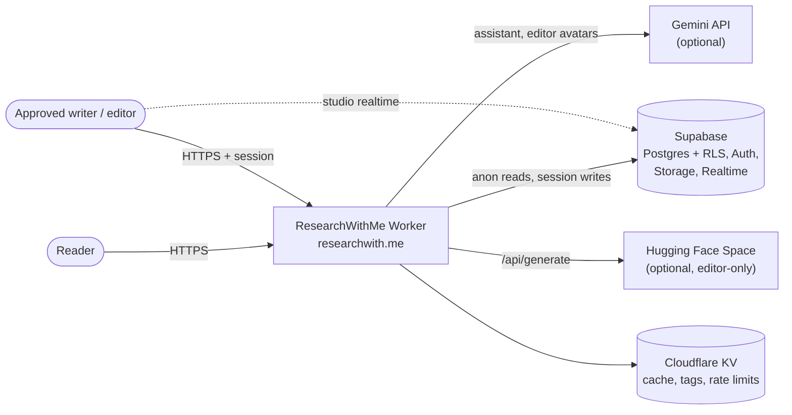

# Architecture

> Regenerated 2026-11-13 against `944f45c`. Supersedes the earlier version and its appendices.

## Core Sections (Required)

### 1) Architectural Style

- **Primary style:** a Next.js App Router monolith deployed as **one Cloudflare Worker** (OpenNext). The data layer is split into **adapter interfaces with two backends each**: local JSON for credential-free demo/dev, and Supabase for production. A second, parallel build target (`cloudflare-pages/`, Vite + Pages Functions) re-implements the server layer behind a `RuntimeServices` interface and reuses `components/` and `lib/`.
- **Why this classification:**
  - `CmsStore` (`lib/cms/types.ts`) → `createLocalCmsStore` / `createSupabaseCmsStore`, chosen in `lib/cms/store.ts` by `isSupabaseConfigured`.
  - `LegacyStore` (`lib/legacy/types.ts`) → `lib/legacy/local-store.ts` / `lib/legacy/supabase-store.ts`, for durable counters on the seed corpus.
  - `RateLimitStore` (`lib/rate-limit-core.ts`) → KV when the `RATE_LIMIT_KV` binding exists, memory otherwise (`lib/rate-limit.ts`).
  - There are no `domain/` or `data/` layers. Route handlers own HTTP and orchestration directly.
- **Primary constraints:**
  1. **Runs with zero credentials.** Every data path forks on `isSupabaseConfigured` (`lib/supabase/config.ts`). Middleware, the editor gate and the stores all have a local branch.
  2. **Workers runtime.** Read-only FS, no long-lived process, KV-backed ISR cache and tags (`open-next.config.ts`), and `nodejs_compat`.
  3. **One canonical reader.** CMS posts and the seed catalogue are merged into the same URLs. There is no separate `/blog` (`lib/cms/catalogue.ts`).
  4. **Content must exist without JavaScript.** Server pages pass `initialPosts`/`initialArticles` so feeds render in HTML (`lib/cms/catalogue.ts` `getFeedArticles` comment). `CLAUDE.md` forbids `initial={{ opacity: 0 }}` on crawlable content.

### 2) System Flow

**Flow A: public article read (`GET /post/[slug]`)**

```text
app/post/[slug]/page.tsx   (revalidate = 30; no generateStaticParams, so unknown slugs give a real 404)
  -> cache(getCachedArticleCatalogue)                React cache: metadata + body share one read
  -> unstable_cache(..., tags:['catalogue'], 30 s)   KV incremental cache on Workers
  -> getArticleCatalogue()                           lib/cms/catalogue.ts
       Promise.all(
         getPublishedCmsPosts()   -> getPublicCmsStore()  cookie-free anon client (RLS: published only) | local JSON
         getCmsCommentCounts()
         legacy.getArticles()     -> getPublicLegacyStore()   (on error: DEFAULT_LEGACY_SEEDS)
       )
       merge by slug: CMS first, then legacy corpus, then bundled seeds
  -> notFound() -> app/not-found.tsx
```

The CMS readers in `lib/cms/read.ts` catch errors and return empty results, so a Supabase outage degrades the page to the bundled catalogue instead of breaking it.

**Flow B: studio write (`POST /api/cms/posts`)**

```text
PostEditor / write page -> lib/cms/client-api.ts cmsFetch
  -> isSameOrigin(request)                      403
  -> requireEditor()                            401 anon / 403 not in public.editors (local mode: allow)
  -> rateLimit('cms:create', 20 / 60 s)          429 + Retry-After
  -> readJsonBody -> normalizePostInput          400 / 415 + fieldErrors
  -> resolvePublishableAuthor(authorId)          422 unless a *published* profile; byline overwritten from profile
  -> store.getPostBySlug  +  legacy.findArticle  409 on either collision; 503 if legacy check fails
  -> getEditorCmsStore().createPost              session-scoped client; RLS re-checks is_editor()
  -> revalidateArticle(slug) if published        invalidates path + 'catalogue' tag
  -> 201 { post, mode }
```

**Flow C: writer access.** A reader signs in (email/password or Google, PKCE via `/auth/callback`) → links GitHub/ORCID → `POST /api/dashboard/applications` → an editor approves via `POST /api/dashboard/applications/[id]` → the approval writes `public.editors` (`supabase/migrations/20261108000300_author_applications.sql`).

### 3) Layer/Module Responsibilities

| Layer or module | Owns | Must not own | Evidence |
|-----------------|------|--------------|----------|
| `middleware.ts` | Session refresh; `/dashboard/**` → `/login` for anonymous users | Editor authorisation (that is `requireEditor`) | `middleware.ts` |
| `app/**/page.tsx` | Rendering, metadata, 404 resolution | Writes | `app/post/[slug]/page.tsx` |
| `app/api/**/route.ts` | Origin, rate limit, auth gate, parsing, status mapping | Storage details | `app/api/cms/posts/route.ts` |
| `lib/cms/schema.ts` | Input normalisation, field errors, public-ID namespacing (`cms-<id>`) | I/O | `lib/cms/schema.ts` |
| `lib/cms/store.ts` | Backend selection; memoised public store; per-request editor store | Queries | `lib/cms/store.ts` |
| `lib/cms/catalogue.ts` | Merging CMS + legacy + seeds; cached variants tagged `catalogue` | Writes | `lib/cms/catalogue.ts` |
| `lib/cms/auth.ts` | `getDashboardUser`, `requireEditor`; `is_editor()` RPC **fails closed** | HTTP responses | `lib/cms/auth.ts` |
| `lib/legacy/*` | Durable likes/comments for seed articles; throws on persistence failure so callers return 503 | New content | `lib/db.ts` header |
| `lib/supabase/*` | Credentials, browser/server/public clients, OAuth, storage upload, `useSession` | Queries | `lib/supabase/config.ts` |
| `lib/email/*` | Scenario registry, rendering, Resend sender, off-domain sender refusal | Choosing when to send | `lib/email/send.ts` |
| `cloudflare-pages/src/server/*` | The same API surface for the Pages target, written against injectable `RuntimeServices` | `next/*` imports | `cloudflare-pages/src/server/context.ts` |
| `supabase/migrations/` | Schema, RLS, `is_editor()`, application RPCs | App code | 9 SQL files |

### 4) Reused Patterns

| Pattern | Where found | Why it exists |
|---------|-------------|---------------|
| Adapter/strategy with an env switch | `CmsStore`, `LegacyStore`, `RateLimitStore` | Same callers in demo and production |
| Pure core + platform shell | `rate-limit-core.ts`/`rate-limit.ts`, `cms/secret-core.ts`/`secret.ts`, `author-directory-core.ts`/`author-directory.ts` | Core logic runs in both build targets and in tests without Next or Worker context |
| Injectable runtime services | `RuntimeServices` + `createTestApp()` (`test/support/pages.ts`) | Pages handlers are tested in-process with fakes |
| Discriminated-union results | `normalizePostInput` → `{ok:true,value} \| {ok:false,…fieldErrors}`; `EditorGate` | Field errors reach forms without exceptions |
| Typed error → HTTP mapping | `Cms*Error` hierarchy + `errorResponse()` (`lib/cms/errors.ts`, `lib/cms/http.ts`) | One mapping for every route |
| Graceful degradation | `lib/cms/read.ts`; legacy → seeds; assistant → deterministic answer | Outages never blank the site |
| Two-level caching | React `cache()` per request + `unstable_cache` (KV) per 30 s, invalidated by tag | Low TTFB while keeping real 404s |
| Lazy module singletons vs request-scoped clients | Public client/store memoised; `createSupabaseServerClient()` never cached | Never leak sessions |
| Idempotent SQL | `if not exists`, `drop policy if exists`, `on conflict` | `CLAUDE.md` rule; safe re-runs |

### 5) Known Architectural Risks

- **Two server implementations of one API.** `app/api/` (17 files, the production Worker) and `cloudflare-pages/src/server/api/` (12 files, the Pages port) implement the same operations separately. They already differ: client-IP keying for rate limits uses `cf-connecting-ip` in Pages (`cloudflare-pages/src/server/http.ts:17`) but the first `x-forwarded-for` entry in Next (`lib/rate-limit.ts` `clientKey`). The behavioural test suite (`test/pages/*`) exercises **only the Pages copy**. See TESTING and CONCERNS.
- **Unfinished migration.** `docs/migration-baseline.md` describes a Next → Pages port. Production still deploys the Next build (`wrangler.jsonc`), and the Pages project (`researchwithme-pages`) has no deploy step in CI. Until one target is retired, every API change has to be made twice.
- **Local mode is unauthenticated by design.** `requireEditor()` allows everything when Supabase is unconfigured, and middleware skips the guard. `scripts/check-production-env.mjs` is the only protection, and it runs on `npm run deploy`/`upload`. It is not wired into the Workers Builds path (`scripts/build-next-or-worker.mjs`).
- **One KV namespace for three jobs.** ISR cache, tag cache and rate-limit counters share namespace `8d2dc8f0…` and the free plan's 1,000 writes/day, with previews included.
- **Build-time configuration.** `NEXT_PUBLIC_*` are inlined, so the editor gate's mode is fixed per build.

### 6) Evidence

- `lib/cms/{types,store,catalogue,read,auth,http,errors}.ts`, `lib/legacy/*`, `lib/rate-limit{,-core}.ts`
- `app/post/[slug]/page.tsx`, `app/api/cms/posts/route.ts`, `middleware.ts`
- `open-next.config.ts`, `wrangler.jsonc`, `scripts/build-next-or-worker.mjs`, `scripts/check-production-env.mjs`
- `cloudflare-pages/src/server/{context,dispatch,http}.ts`, `docs/migration-baseline.md`
- `supabase/migrations/*.sql`

## Extended Sections

### System context



Resend isn't shown because the production Next build has no code path that sends email today (see INTEGRATIONS §1). Without Supabase credentials, every store falls back to local JSON.

### Failure-mode posture

| Failure | Behaviour | Evidence |
|---|---|---|
| Supabase read fails (public) | Empty CMS result, page renders from legacy/seed catalogue | `lib/cms/read.ts`, `lib/cms/catalogue.ts` |
| Legacy store fails | `DEFAULT_LEGACY_SEEDS` | `lib/cms/catalogue.ts` |
| Legacy check fails during create | 503, no write | `app/api/cms/posts/route.ts:73-81` |
| `is_editor()` RPC errors | Treated as non-editor | `lib/cms/auth.ts` |
| Gemini missing/failing | Deterministic cited answer + `notice` | `app/api/research-assistant/route.ts` |
| HF Space slow | `withTimeout()` race at 60 s (the Gradio call itself isn't cancelled), generic 502 | `app/api/generate/route.ts:10,27,115` |
| Gemini slow | `AbortSignal.timeout(MODEL_TIMEOUT_MS)` | `app/api/research-assistant/route.ts:149`, `app/api/author-avatar/route.ts:162` |
| KV rate-limit read error | Fails open | `lib/__tests__/rate-limit.test.ts` |
