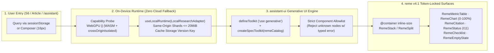

# `researchwith.me` Master Design System & Generative UI Architecture (`reme v4.1 — Next.js Edition`)

*Version 4.1 · supersedes v4.0 · Next.js App Router · manifest-compiled design system · zero third-party telemetry · `assistant-ui` Generative UI*

> **Confirmed Implementation Decisions (ADR-00)**
> 1. **Framework Adaptation:** Keep **Next.js (App Router, React 19, TypeScript)** and adapt `reme v4` natively—replacing Astro static islands with React Server Components (RSC) + explicit `'use client'` lazy islands, `@next/mdx` content compilation, and Next.js header/middleware enforcement.
> 2. **Heading-Measure Rule (`I4`):** Adopt the **supplied heading measure caps** (`h1: 24ch`, `h2: 32ch`, `h3: 34ch`). Invariant `I4` is formally split into **heading roles** ($[20, 40]\text{ ch}$) and **prose/input roles** ($[45, 75]\text{ ch}$).
> 3. **Audit Resolution:** All 9 P0 blockers, 7 P1 engineering gaps, and 8 P2 edge cases from the `v4.0` audit are patched directly into this specification.
> 4. **Generative UI Runtime:** Integrate **`assistant-ui`** via `install and set up assistant-ui` (`npx assistant-ui@latest setup` / `@assistant-ui/next` + `@assistant-ui/generative-ui`), strictly bound to `reme v4.1` tokens, primitives, and allowlisted spec components.

---

## Executive Protocol & Non-Negotiable Rules

**Objective.** Every visual surface of `researchwith.me`—color tokens, derived interaction states, slot-aware typography, spacing, radii, motion, primitives, 12-column responsive grid, page wireframes, MDX article layouts, Playwright test fixtures, and **AI-composed Generative UI widgets**—is compiled from **one typed TypeScript manifest** (`src/design/index.ts`). Nothing visual is hand-authored twice.

**Non-Negotiable Rule of `v4.1`.** If a value affects pixels, color, typography, motion, or spacing—including inside `assistant-ui` threads and Generative UI components—it lives in `src/design/*.manifest.ts`. Authored components (including generated shadcn/`assistant-ui` wrappers) may consume only `src/generated/**` CSS custom properties and Tailwind preset tokens. Any raw color literal, raw length outside the border allowlist, or arbitrary Tailwind value fails `pnpm design:lint`.

**`DESIGN.md` Aesthetic Laws (CI Lint-Enforced):**
- No kicker text above `h1`.
- No text baked into editorial artwork or hero covers.
- No horizontal scrolling chip/pill rows.
- No gradient text (`bg-clip-text`).
- No glassmorphism / `backdrop-filter: blur(...)`.
- No skeleton loaders (`animate-pulse` / `skeleton.tsx` banned)—explicit, calm text empty and progress states only.

---

# PART I — `reme v4.1` Next.js Design System

## Phase 0: Next.js Stack, Config, and the Generated Boundary

### 0.1 Production Stack (Next.js App Router)

| Layer | Technology | Enforcement Rule |
| --- | --- | --- |
| Framework | **Next.js 15+ (App Router)**, React 19, TypeScript strict | RSC by default; `'use client'` only for interactive islands (theme boot, drawer, search, figure lab, MDX interactive widgets, `assistant-ui`). |
| Styling | **Tailwind CSS 3.4** + generated preset (`src/generated/tailwind.preset.generated.cjs`) | `theme.extend` is empty in `tailwind.config.ts`; `darkMode: ['selector', '[data-theme="dark"]']` prevents `dark:` drift. |
| Manifest Compiler | TypeScript + **Zod v3** (`scripts/design/gen.ts`) | Pure, deterministic function (no network, no `Date.now()`, no `Math.random()`). |
| Content Engine | `@next/mdx` / `next-mdx-remote` + `rehype-katex` + `remark-math` + `shiki` (build-time) | Zero runtime syntax-highlighting JS; all blog posts render via the `reme` MDX article layout. |
| Generative UI | **`@assistant-ui/react`**, **`@assistant-ui/next`**, **`@assistant-ui/generative-ui`**, **`generative-frame`** | Wrapped via `withAui(nextConfig)`; strictly themed with `reme` CSS variables (zero raw hex/shadcn slate tokens). |
| Hosting | **Cloudflare Pages** (via `@cloudflare/next-on-pages` / OpenNext Cloudflare) or **Netlify** | Supports custom response headers (`COOP`/`COEP`/`CSP`), Cloudflare R2 same-origin proxy for $>25\text{ MiB}$ WASM/WebGPU model shards, and Edge Rate Limiting for `/api/dispatch`. |

### 0.2 The Generated-vs-Authored Boundary

| Path | Ownership | Rule |
| --- | --- | --- |
| `src/design/*.manifest.ts` | **Authored** | Single source of truth for all visual values, contrast pairs, slots, pages, and GenUI vocabulary tokens. |
| `scripts/design/gen.ts` | Authored | Compiles manifest $\rightarrow$ CSS, Tailwind preset, CSP hash, JSON geometry/type fixtures, and Markdown wireframes. |
| `src/generated/**` | **Generated (committed)** | Never hand-edit. CI runs `design:verify` and fails on a 1-byte diff. |
| `src/app/**`, `src/components/**` | Authored | Consumes generated CSS custom properties and preset utilities only (`design:lint` enforced). |
| `src/components/assistant-ui/**` | Authored (scaffolded by CLI, then tokenized) | Must pass `design:lint`: all shadcn defaults mapped to `--bg-*`, `--text-*`, `--border-*`, `--space-*`. |
| `docs/*.generated.md` | **Generated (committed)** | Auto-generated token tables, span geometry tables, and per-page ASCII wireframes. |

```bash
pnpm design:gen      # src/design/*.manifest.ts -> src/generated/** + docs/*.generated.md
pnpm design:verify   # regenerate into temp dir -> assert byte-identical (I14)
pnpm design:lint     # AST + regex token-escape lint over src/app & src/components (I5, I6, I7, I12)
pnpm audit:all       # run all 23 automated gates (Gates 1-16 + 20-23)
```

### 0.3 `next.config.ts` (Next.js + `withAui` + MDX + Security Headers)

```ts
// next.config.ts
import type { NextConfig } from 'next';
import createMDX from '@next/mdx';
import { withAui } from '@assistant-ui/next';
import { SECURITY_HEADERS } from './src/generated/headers.generated';

const withMDX = createMDX({
  extension: /\.mdx?$/,
});

const nextConfig: NextConfig = {
  pageExtensions: ['ts', 'tsx', 'md', 'mdx'],
  images: {
    formats: ['image/avif', 'image/webp'],
    deviceSizes: [480, 800, 1200],
  },
  async headers() {
    return [
      {
        source: '/(.*)',
        headers: SECURITY_HEADERS, // Emitted from manifest + SHA-256 theme boot hash
      },
      {
        source: '/_next/static/(.*)',
        headers: [
          { key: 'Cache-Control', value: 'public, max-age=31536000, immutable' },
        ],
      },
      {
        source: '/models/(.*)',
        headers: [
          { key: 'Cross-Origin-Resource-Policy', value: 'same-origin' },
          { key: 'Cache-Control', value: 'public, max-age=31536000, immutable' },
        ],
      },
    ];
  },
};

export default withAui(withMDX(nextConfig));
```

---

## Phase 1: The Ten-Module Typed Manifest & Patched Build Invariants (`I1–I18`)

`v4.1` adds a dedicated `genui.manifest.ts` module so `assistant-ui` layouts obey the exact same build-time contracts as static pages.

```ts
// src/design/index.ts
import { color }      from './color.manifest';
import { type_ }      from './type.manifest';
import { space }      from './space.manifest';
import { motion }     from './motion.manifest';
import { breakpoint } from './breakpoint.manifest';
import { grid }       from './grid.manifest';
import { primitive }  from './primitive.manifest';
import { layout }     from './layout.manifest';
import { section }    from './section.manifest';
import { genui }      from './genui.manifest';

export const design = Object.freeze({
  meta: {
    version: '4.1',
    framework: 'next-app-router',
    locales: ['en', 'bn'] as const,
    modes: ['light', 'dark', 'more'] as const,
  },
  color,
  type: type_,
  space,
  motion,
  breakpoint,
  grid,
  primitive,
  layout,
  section,
  genui,
} as const);
```

### 1.1 Patched Build Invariants (`I1–I18`)

Every invariant runs inside `pnpm design:gen` and `pnpm design:lint`. Any violation aborts the build with the failing path and exact computed measurement.

| ID | Invariant (`v4.1` — Audit-Patched) |
| --- | --- |
| **I1** | Every layout slot across all pages declares an `xs` value. |
| **I2** | *(Patched)* Card grids are declared as nested row arrays per tier (`xs: [[1],[1],[1]]`, `md: [[1,1],[2]]`, `lg: [[4,4,4]]`). For every tier and every row, $\sum \text{span} \le \text{cols}_{\text{tier}}$. |
| **I3** | *(Patched)* Every declared contrast pair—**including explicit `surfaceHover`, `surfaceActive`, `primaryHover`, `primaryActive`, `selected`, and `disabled` token pairs**—meets its minimum WCAG 2.1 ratio in light, dark, and `prefers-contrast: more` on every legal background (`canvas` and `surface`). |
| **I4** | *(Confirmed & Patched)* Every **heading** text role (`h1`, `h2`, `h3`) declares `measureCh` $\in [20, 40]$ inclusive (using the supplied caps `24`, `32`, `34`). Every **prose/UI** text role (`body`, `meta`, `input`, `code`) declares `measureCh` $\in [45, 75]$ inclusive. |
| **I5** | Zero raw color literals (`#...`, `rgb(...)`, `hsl(...)`, `oklch(...)`, named colors except `transparent`/`currentColor`/`CanvasText`) outside `color.manifest.ts`. |
| **I6** | Zero raw CSS lengths in authored `.css`/`.tsx` outside the strict allowlist: `0`, `1px`, `2px` (border widths), `100%`. |
| **I7** | *(Patched)* **Zero** Tailwind arbitrary values `[...]` in authored source (the `v4.0` drawer carve-out is removed; `w-drawer` is emitted from `primitive.drawer.width` into the Tailwind preset). |
| **I8** | Every primitive variant (and every GenUI catalog component) consumes only the token groups declared in its capability allowlist. |
| **I9** | *(Patched)* Every slot node in `section.manifest.ts` resolves to either a declared key in `primitive.manifest.ts` (which now includes `prose`, `range`, `live`, `statusBadge`, `table`, `callout`) or a declared key in `type.manifest.ts`. |
| **I10** | Every list-bearing section and GenUI list declares an `emptyKey` present in both `en` and `bn` typed locale catalogs. |
| **I11** | Every status/trust state declares `{ token, icon, labelKey }`. Color-only states are unrepresentable in TypeScript. |
| **I12** | Every emitted `transition`, `animation`, `scroll-behavior`, and `scroll-snap-*` sits inside `@media (prefers-reduced-motion: no-preference)`. Animated properties are restricted strictly to `opacity` and `transform`. |
| **I13** | *(Patched)* Every off-screen section (`S2–S9` and long-page below-fold bands) carrying `content-visibility: auto` declares **per-locale, per-tier** measured `containIntrinsic: { en: {...}, bn: {...} }`. |
| **I14** | `design:gen` is deterministic: two consecutive runs are byte-identical, and committed `src/generated/**` matches a fresh run. |
| **I15** | *(Patched)* WOFF2 Latin subsets cover $100\%$ of codepoints in the `en` catalog + UI/scientific glyphs (`→ × + − · ≤ ≥ ≈ ≠ °`) + ASCII characters inside `bn`. The `bn` catalog is separately validated to ensure all non-ASCII codepoints fall strictly inside Bengali Unicode ranges (`U+0980–U+09FF`, `U+200C–U+200D`). |
| **I16** | Grid identity holds per tier to $\le 0.01\text{ px}$: $\text{inner} = \text{cols} \times T + (\text{cols} - 1) \times G$, and every published span width satisfies $W(n) = \min(n \cdot T + (n - 1) \cdot G,\; \text{maxInline})$. |
| **I17** | Every interactive primitive (`control`, `row`, `field`, `disclosure`, `range` thumb, GenUI buttons) declares a minimum hit target $\ge 44 \times 44\text{ px}$ at every tier. |
| **I18** | Every heading role's solved font size keeps `h1` $\le 4$ rendered lines and `h2` $\le 3$ rendered lines across all 7 reference widths in both `en` and `bn` (verified by Gate 13). |

---

## Phase 2: Color Module, Verified States & Contrast Solver (`I3`)

All P0-4 contrast failures from `v4.0` are resolved:
- `status-ok` light darkened from `#1B5E20` ($7.10:1$) to **`#15541B`** ($8.02:1$ on canvas, $8.89:1$ on surface) so it remains $>7.0:1$ even on subtle hover surfaces.
- **Primary controls** get opposite-polarity hover/active mixes (`bg-brand` mixed with `text-on-primary`), eliminating the zero-change `#111111 + #111111` bug.
- **Disabled state** replaces failing `opacity: 0.55` ($2.55:1$) with explicit AA-safe disabled tokens (`#5F5D59` on light canvas $= 5.83:1$; `#8E8C88` on dark canvas $= 5.87:1$) plus `cursor: not-allowed` and `aria-disabled="true"`.

```ts
// src/design/color.manifest.ts
export const color = {
  roles: {
    'bg-canvas':          { light: '#F5F3EF', dark: '#121212' },
    'bg-surface':         { light: '#FFFFFF', dark: '#1A1A1A' },
    'bg-brand':           { light: '#111111', dark: '#F5F3EF' },
    'bg-mark':            { light: '#F3E3A1', dark: '#4A3B08' }, // Author punchline <mark> highlight
    'text-ink':           { light: '#111111', dark: '#F5F3EF' },
    'text-ink-secondary': { light: '#4F4F4F', dark: '#A8A8A8' },
    'text-on-primary':    { light: '#FFFFFF', dark: '#111111' },
    'text-disabled':      { light: '#5F5D59', dark: '#8E8C88' }, // v4.1: >= 5.8:1 (no opacity fade)
    'border-line':        { light: '#E5E2DC', dark: '#2E2E2E' },
    'border-strong':      { light: '#8A8780', dark: '#7A7A7A' },
    'focus-ring':         { light: '#111111', dark: '#F5F3EF' },
    'status-ok':          { light: '#15541B', dark: '#7FD38A' }, // v4.1: darkened for hover headroom
    'status-warn':        { light: '#6B4200', dark: '#F2B84B' },
    'status-error':       { light: '#8A1C1C', dark: '#FF8A80' },
    'status-info':        { light: '#1F4E8C', dark: '#8AB4F8' },
    'series-1':           { light: '#0B5FA5', dark: '#7DB7F0' },
    'series-2':           { light: '#B34700', dark: '#F0A06A' },
    'series-3':           { light: '#2E7D32', dark: '#7FD38A' },
    'series-4':           { light: '#6A1B9A', dark: '#C79AE8' },
  },
  states: {
    surfaceHover:  { base: 'bg-surface', mix: 'text-ink',        amount: 0.05, fgChecked: ['text-ink'] },
    surfaceActive: { base: 'bg-surface', mix: 'text-ink',        amount: 0.10, fgChecked: ['text-ink'] },
    primaryHover:  { base: 'bg-brand',   mix: 'text-on-primary', amount: 0.14, fgChecked: ['text-on-primary'] },
    primaryActive: { base: 'bg-brand',   mix: 'text-on-primary', amount: 0.22, fgChecked: ['text-on-primary'] },
    selected:      { base: 'bg-surface', mix: 'status-info',     amount: 0.08, fgChecked: ['text-ink'] },
    disabled:      { fg: 'text-disabled', bg: ['bg-canvas', 'bg-surface'], min: 4.5, plusNonColorCue: true },
  },
  pairs: [
    { fg: 'text-ink',           bg: ['bg-canvas', 'bg-surface', 'bg-mark'], min: 7.0, kind: 'text' },
    { fg: 'text-ink-secondary', bg: ['bg-canvas', 'bg-surface'],            min: 7.0, kind: 'text' },
    { fg: 'text-on-primary',    bg: ['bg-brand'],                           min: 7.0, kind: 'text' },
    { fg: 'status-ok',          bg: ['bg-canvas', 'bg-surface'],            min: 7.0, kind: 'text' },
    { fg: 'status-warn',        bg: ['bg-canvas', 'bg-surface'],            min: 7.0, kind: 'text' },
    { fg: 'status-error',       bg: ['bg-canvas', 'bg-surface'],            min: 7.0, kind: 'text' },
    { fg: 'status-info',        bg: ['bg-canvas', 'bg-surface'],            min: 7.0, kind: 'text' },
    { fg: 'border-strong',      bg: ['bg-canvas', 'bg-surface'],            min: 3.0, kind: 'ui' },
    { fg: 'focus-ring',         bg: ['bg-canvas', 'bg-surface'],            min: 3.0, kind: 'ui' },
    { fg: 'series-1',           bg: ['bg-canvas', 'bg-surface'],            min: 3.0, kind: 'ui' },
    { fg: 'series-2',           bg: ['bg-canvas', 'bg-surface'],            min: 3.0, kind: 'ui' },
    { fg: 'series-3',           bg: ['bg-canvas', 'bg-surface'],            min: 3.0, kind: 'ui' },
    { fg: 'series-4',           bg: ['bg-canvas', 'bg-surface'],            min: 3.0, kind: 'ui' },
  ],
} as const;
```

### 2.1 Boot Script (Theme + No-JS Detection, $\le 0.6\text{ KB}$, Auto-Hashed into CSP)

Rendered in `src/app/layout.tsx` via `<script dangerouslySetInnerHTML={{ __html: THEME_BOOT_SCRIPT }} />`, where both `THEME_BOOT_SCRIPT` and its SHA-256 CSP digest are emitted by `scripts/design/gen.ts`:

```js
// Emitted minified (<320 bytes) into src/generated/theme-boot.generated.ts
(function(){var r=document.documentElement;r.dataset.js='1';try{var t=localStorage.getItem('reme-theme');if(t==='light'||t==='dark'){r.dataset.theme=t;}}catch(e){}})();
```

Notice `r.dataset.js='1'`: this simultaneously eliminates theme flash **and** solves the No-JS `<dialog>` paradox (P1-3) so navigation stays visible when JavaScript is disabled.

---

## Phase 3: Slot-Aware Type Module (Supplied Heading Caps + Fixed Mobile-First Cascade)

### 3.1 Font Delivery & Budget ($\le 80\text{ KB}$ Combined WOFF2)

| Role | Font Family | Delivery & Subsetting |
| --- | --- | --- |
| Headings, editorial prose | **Newsreader** roman, `wght` 400–600, `opsz` pinned | Self-hosted WOFF2 (`public/fonts/newsreader.woff2`), Latin + scientific glyphs |
| UI, body | **Inter**, `wght` 400–600, `opsz` dropped | Self-hosted WOFF2 (`public/fonts/inter.woff2`), Latin + scientific glyphs |
| Meta, code, tensors | `ui-monospace, SFMono-Regular, Menlo, Monaco, Consolas, monospace` | System stack only ($0\text{ KB}$) |
| Bangla (`/bn/`) | `'Noto Sans Bengali', 'Kalpurush', system-ui, sans-serif` | System stack only ($0\text{ KB}$), zero synthetic bold/italic, `text-transform: none`, `hyphens: none` |

- **Subset Ranges (`pyftsubset`):** `U+0020-007E, U+00A0-00FF, U+2013-2014, U+2018-201D, U+2022, U+2026, U+2190-2193, U+00D7, U+002B, U+2212, U+2248, U+2260, U+2264-2265`.
- **Zero-CLS Swap:** Metric-matched `@font-face` fallbacks (`size-adjust`, `ascent-override`, `descent-override`) emitted into `src/generated/fonts.generated.css`; both WOFF2 files preloaded in `src/app/layout.tsx`.

### 3.2 `type.manifest.ts` (Using Confirmed Supplied Heading Caps)

```ts
// src/design/type.manifest.ts
export const type_ = {
  measureBounds: {
    heading: { minCh: 20, maxCh: 40 }, // Confirmed I4 heading band
    prose:   { minCh: 45, maxCh: 75 }, // Confirmed I4 prose/UI band
  },
  roles: {
    h1:    { kind: 'heading', slot: 'hero.text',    font: 'serif', weight: 600, lh: 1.10, measureCh: 24,
             targets: { xs: 32, md: 44, lg: 41, xl: 52 }, min: 32, max: 52 },
    h2:    { kind: 'heading', slot: 'section.head', font: 'serif', weight: 600, lh: 1.20, measureCh: 32,
             targets: { xs: 24, md: 30, lg: 30, xl: 32 }, min: 24, max: 32 },
    h3:    { kind: 'heading', slot: 'card',         font: 'serif', weight: 600, lh: 1.25, measureCh: 34,
             targets: { xs: 20, md: 22, lg: 22, xl: 24 }, min: 20, max: 24 },
    body:  { kind: 'prose',   slot: 'prose',        font: 'sans',  weight: 400, lh: 1.65, measureCh: 68, fixed: 16 },
    meta:  { kind: 'prose',   slot: 'prose',        font: 'mono',  weight: 400, lh: 1.45, measureCh: 60, fixed: 13 },
    code:  { kind: 'prose',   slot: 'prose',        font: 'mono',  weight: 400, lh: 1.55, measureCh: 72, fixed: 14 },
    input: { kind: 'prose',   slot: 'field',        font: 'sans',  weight: 400, lh: 1.40, measureCh: 60, fixed: 16 },
  },
} as const;
```

### 3.3 Generated Type CSS (Fixed Mobile-First Cascade + Mandatory `container-type`)

```css
/* src/generated/type.generated.css — emitted strictly mobile-first (xs -> md -> lg -> xl) */
[data-slot='hero.text'],
[data-slot='section.head'],
[data-slot='article.header'],
.card,
.genui-surface {
  container-type: inline-size;
}

/* h1: non-monotonic slot scaling (xs 358px -> md 720px -> lg 381.33px -> xl 483.33px) */
.t-h1 {
  font-family: var(--font-serif);
  font-weight: 600;
  line-height: 1.10;
  max-inline-size: 24ch;
  font-size: 2rem; /* xs: 32px */
}
@media (min-width: 768px)  { .t-h1 { font-size: clamp(2rem,      6.11cqi,  2.75rem);   } } /* md: 44px */
@media (min-width: 1024px) { .t-h1 { font-size: clamp(2rem,      10.75cqi, 2.5625rem); } } /* lg: 41px */
@media (min-width: 1280px) { .t-h1 { font-size: clamp(2.5625rem, 10.76cqi, 3.25rem);   } } /* xl: 52px */

/* h3: truly fluid inside @container Cards (274px..379px..720px) */
.t-h3 {
  font-family: var(--font-serif);
  font-weight: 600;
  line-height: 1.25;
  max-inline-size: 34ch;
  font-size: clamp(1.25rem, 6.2cqi, 1.5rem); /* 20px..24px */
}
```

---

## Phase 4: Space, Concentric Radii, Borders & Motion (`I12`, `I17`)

```ts
// src/design/space.manifest.ts
export const space = {
  base: 4,
  steps: { 1: 4, 2: 8, 3: 12, 4: 16, 5: 20, 6: 24, 8: 32, 10: 40, 12: 48, 16: 64, 20: 80 },
  radius: {
    sm: 8,
    md: 12,
    lg: 16,
    xl: 24,
    inset: 12,  // v4.1 P2 fix: concentric radius for Frame nested inside Card (24px - pad)
    pill: 999,
  },
  border: { hair: 1, strong: 2 },
  target: { min: 44 },        // Exposed as min-h-target / min-w-target in Tailwind preset
  header: { height: 64 },
  drawer: { width: 'min(19rem, 84vw)' }, // Exposed as w-drawer (eliminates I7 exception)
  section: { gapY: { xs: 48, md: 56, lg: 72, xl: 80 } },
  zIndex: { base: 0, sticky: 10, drawer: 40, toast: 50 },
} as const;
```

```ts
// src/design/motion.manifest.ts
export const motion = {
  duration: { fast: 120, base: 180, slow: 260 },
  easing: { standard: 'cubic-bezier(.2,0,0,1)', exit: 'cubic-bezier(.4,0,1,1)' },
  allowed: ['opacity', 'transform'] as const,
} as const;
```

---

## Phase 5: Breakpoint, Grid Engine & Verified Span Geometry (`I2`, `I16`)

### 5.1 Device Matrix

| Tier | Viewport Range | Reference Widths | Cols | Gutter ($G$) | Margin ($\text{pad}$) | Inner Width | Track ($T$) |
| --- | --- | --- | ---: | ---: | ---: | ---: | ---: |
| `xs` | $320\text{–}767\text{ px}$ | $320, 390, 600$ | $1$ | $20$ | $16$ | $288 / 358 / 568$ | $=\text{inner}$ |
| `md` | $768\text{–}1023\text{ px}$ | $768$ | $2$ | $24$ | $24$ | $720$ | $348.00$ |
| `lg` | $1024\text{–}1279\text{ px}$ | $1024$ | $12$ | $32$ | $32$ | $960$ | $50.67$ |
| `xl` | $1280\text{–}1535\text{ px}$ | $1280$ | $12$ | $40$ | $32$ | $1216$ | $64.67$ |
| `2xl` | $1536\text{ px}+$ | $1536, 1920$ | $12$ | $40$ | auto | $1216$ (outer $1280$) | $64.67$ |

### 5.2 Grid Engine CSS (Foldable + Landscape + Safe-Area Complete)

```css
/* src/generated/grid.generated.css */
.page-shell {
  padding-inline: max(0px, env(safe-area-inset-left)) max(0px, env(safe-area-inset-right));
}

.grid-reme {
  --cols: 1; --gap: 20px; --pad: 16px;
  display: grid;
  grid-template-columns: repeat(var(--cols), minmax(0, 1fr));
  gap: var(--gap);
  width: min(100% - 2 * var(--pad), 1216px);
  margin-inline: auto;
}

@media (min-width: 768px)  { .grid-reme { --cols: 2;  --gap: 24px; --pad: 24px; } }
@media (min-width: 1024px) { .grid-reme { --cols: 12; --gap: 32px; --pad: 32px; } }
@media (min-width: 1280px) { .grid-reme { --gap: 40px; } }

/* Landscape phones: unstick header & zero scroll-margin offset */
@media (orientation: landscape) and (max-height: 480px) {
  :root { --header-h: 0px; }
  [data-slot='header'] { position: static; }
  [data-slot='hero.visual'] { max-block-size: 60dvh; }
}

/* Dual-screen foldables: stay strictly inside left segment */
@media (horizontal-viewport-segments: 2) {
  .grid-reme {
    width: min(calc(env(viewport-segment-width 0 0) - 2 * var(--pad)), 1216px);
    margin-inline-start: var(--pad);
    margin-inline-end: auto;
  }
}

/* Centered maxInline slots (e.g., FAQ, Dispatch, Article Prose) */
[data-max-inline='720'] {
  max-inline-size: 720px;
  inline-size: 100%;
  justify-self: center;
}
```

### 5.3 Patched Multi-Page `layout.manifest.ts` (Satisfies `I1`, `I2`, `I16`)

```ts
// src/design/layout.manifest.ts
export const layout = {
  // Landing Page (S1-S10)
  hero:      { text: { xs: 1, md: 2, lg: 5 },  visual: { xs: 1, md: 2, lg: 7 } },
  writing:   { lead: { xs: 1, md: 2, lg: 7 },  list:   { xs: 1, md: 2, lg: 5 } },
  topics:    { cards: { xs: [[1], [1], [1]], md: [[1, 1], [2]], lg: [[4, 4, 4]] } },
  figure:    { frame: { xs: 1, md: 2, lg: 6 }, notes:  { xs: 1, md: 2, lg: 6 } },
  datasets:  { cards: { xs: [[1], [1], [1]], md: [[1, 1], [2]], lg: [[4, 4, 4]] } },
  assistant: { prompt: { xs: 1, md: 2, lg: 7 }, links: { xs: 1, md: 2, lg: 5 } },
  author:    { bio:  { xs: 1, md: 2, lg: 8 },  meta:   { xs: 1, md: 2, lg: 4 } },
  faq:       { body: { xs: 1, md: 2, lg: { span: 8, start: 3, maxInline: 720 } } },
  dispatch:  { body: { xs: 1, md: 2, lg: { span: 8, start: 3, maxInline: 720 } } },
  footer:    { brand: { xs: 1, md: 2, lg: 5 }, nav: { xs: 1, md: 1, lg: 4 }, feed: { xs: 1, md: 1, lg: 3 } },

  // Subpages (Blog, Article, Topics, Lab, Datasets, Assistant Workspace, Search, About)
  archive:   { filters: { xs: 1, md: 2, lg: 3 }, feed: { xs: 1, md: 2, lg: 9 } },
  article:   { header: { xs: 1, md: 2, lg: { span: 10, start: 2 } },
               body:   { xs: 1, md: 2, lg: { span: 8, start: 1, maxInline: 720 } },
               toc:    { xs: 1, md: 2, lg: { span: 4, start: 9 } } },
  labPage:   { stage:  { xs: 1, md: 2, lg: 8 }, controls: { xs: 1, md: 2, lg: 4 } },
  workspace: { threads:{ xs: 1, md: 2, lg: 3 }, thread:   { xs: 1, md: 2, lg: 9 } },
  searchPage:{ bar:    { xs: 1, md: 2, lg: { span: 8, start: 3, maxInline: 720 } },
               results:{ xs: 1, md: 2, lg: { span: 8, start: 3, maxInline: 720 } } },
} as const;
```

### 5.4 Verified Span Geometry Fixture (`fixtures/geometry.json`)

Formula: $W(n) = \min\!\big(n \cdot T + (n - 1) \cdot G,\; \text{maxInline}\big)$, tolerance $\pm 0.5\text{ px}$ (measured with overlay scrollbars on CSS layout viewport).

| Span ($n$) | `xl` / `2xl` ($T=64.67, G=40$) | `lg` ($T=50.67, G=32$) | `md` ($T=348, G=24$) |
| ---: | ---: | ---: | ---: |
| 1 | $64.67\text{ px}$ | $50.67\text{ px}$ | $348.00\text{ px}$ |
| 2 | $169.33\text{ px}$ | $133.33\text{ px}$ | $720.00\text{ px}$ |
| 3 | $274.00\text{ px}$ | **$216.00\text{ px}$** | — |
| 4 | $378.67\text{ px}$ | $298.67\text{ px}$ | — |
| 5 | $483.33\text{ px}$ | $381.33\text{ px}$ | — |
| 6 | $588.00\text{ px}$ | $464.00\text{ px}$ | — |
| 7 | $692.67\text{ px}$ | $546.67\text{ px}$ | — |
| 8 | $797.33\text{ px}$ *(capped $720$ if `maxInline`)* | $629.33\text{ px}$ | — |
| 9 | $902.00\text{ px}$ | $712.00\text{ px}$ | — |
| 10 | $1006.67\text{ px}$ | $794.67\text{ px}$ | — |
| 12 | $1216.00\text{ px}$ | $960.00\text{ px}$ | — |

---

## Phase 6: Complete Primitive Module (`I8`, `I9`, `I11`, `I17`)

All 5 undeclared `v4.0` primitives (`prose`, `range`, `live`, `statusBadge`, `table`, `callout`) plus `field.variants.multiline` are explicitly declared so `I9` holds with zero gaps:

```ts
// src/design/primitive.manifest.ts
export const primitive = {
  frame: {
    ratio: '16 / 9',
    radius: { standalone: 'xl', nested: 'inset' },
    border: 'hair',
    tokens: ['border', 'bg'],
    a11y: { requires: ['width', 'height', 'alt'] },
  },
  card: {
    bg: 'bg-surface',
    border: 'hair',
    radius: 'xl',
    pad: { default: 6, prompt: 5, compact: 4 },
    container: 'inline-size',
    tokens: ['bg', 'border', 'text'],
  },
  row: {
    minH: 44,
    borderBlockEnd: 'hair',
    states: ['hover', 'focus-visible'],
    tokens: ['border', 'text', 'state'],
  },
  control: {
    shape: 'pill',
    minH: 44,
    variants: {
      primary:   { bg: 'bg-brand',   fg: 'text-on-primary', hover: 'primaryHover', active: 'primaryActive' },
      secondary: { bg: 'bg-surface', fg: 'text-ink', border: 'strong', hover: 'surfaceHover', active: 'surfaceActive' },
      ghost:     { bg: 'transparent', fg: 'text-ink', hover: 'surfaceHover', active: 'surfaceActive' },
    },
    states: ['hover', 'active', 'focus-visible', 'disabled'],
    tokens: ['bg', 'border', 'text', 'state'],
    a11y: { requires: ['accessible-name'] },
  },
  field: {
    bg: 'bg-canvas',
    border: 'strong',
    minH: 44,
    radius: 'md',
    fontRole: 'input',
    variants: { singleline: 'input', multiline: 'textarea' },
    a11y: { requires: ['visible-label', 'describedby-on-error'] },
  },
  range: {
    element: 'input[type=range]',
    minH: 44,
    thumbSize: 44,
    trackColor: 'border-strong',
    fillColor: 'bg-brand',
    tokens: ['border', 'bg', 'state'],
    a11y: { requires: ['visible-label', 'aria-valuetext'] },
  },
  live: {
    element: 'output',
    ariaLive: 'polite',
    fontRole: 'meta',
    tokens: ['text'],
  },
  prose: {
    fontRole: 'body',
    measureCh: 68,
    tokens: ['text', 'border', 'bg'],
  },
  callout: {
    bg: 'bg-surface',
    borderStart: 'strong',
    radius: 'md',
    pad: 5,
    variants: { takeaways: 'border-strong', punchline: 'bg-mark' },
    tokens: ['bg', 'border', 'text'],
  },
  statusBadge: {
    states: {
      verified:    { token: 'status-ok',    icon: 'check-circle', labelKey: 'status.verified' },
      pending:     { token: 'status-warn',  icon: 'clock',        labelKey: 'status.pending' },
      unavailable: { token: 'status-error', icon: 'x-circle',     labelKey: 'status.unavailable' },
      localLive:   { token: 'status-info',  icon: 'shield-check', labelKey: 'status.localLive' },
    }, // Enforces I11: icon + label + token always emitted together
    tokens: ['text', 'border'],
  },
  table: {
    bg: 'bg-surface',
    border: 'hair',
    headerBg: 'bg-canvas',
    fontRole: 'meta',
    overflow: 'auto', // Horizontal scroll container inside card/prose, never page-level overflow
    tokens: ['bg', 'border', 'text'],
  },
  disclosure: {
    element: 'details',
    marker: 'none',
    minH: 44,
    sign: { closed: '+', open: '−' },
    pad: { block: 4 },
    borderBlockEnd: 'hair',
    tokens: ['border', 'text', 'state'],
  },
  drawer: {
    element: 'dialog',
    width: 'min(19rem, 84vw)',
    side: 'inline-end',
    bg: 'bg-surface',
    border: 'hair',
    noJsFallback: 'inline-wrap', // Activated via :root:not([data-js])
    tokens: ['bg', 'border', 'text'],
    a11y: { requires: ['modal', 'escape-close', 'backdrop-close', 'focus-return'] },
  },
} as const;
```

---

## Phase 7: Complete Multi-Page Token-Integrated Wireframes (`docs/WIREFRAMES.generated.md`)

Every page below is rendered inside `src/app/[locale]/layout.tsx` (sharing **S0 Header** and **S10 Footer**).  
**Token Legend:**
- `CANVAS` = `--bg-canvas` (`#F5F3EF` / `#121212`)
- `SURF` = `--bg-surface` (`#FFFFFF` / `#1A1A1A`) + `1px solid var(--border-line)`
- `BRAND` = `--bg-brand` (`#111111` / `#F5F3EF`) + `--text-on-primary`
- `MARK` = `--bg-mark` (`#F3E3A1` / `#4A3B08`) + `--text-ink`
- `INK` / `SEC` = `--text-ink` / `--text-ink-secondary` (both $\ge 7.0:1$ AAA)
- `▢` Card (`radius-xl`, `container-type: inline-size`) · `▭` Frame (16:9) · `═` Interactive ($\ge 44\text{ px}$) · `─` Row separator (`--border-line`)

---

### Page 1: Landing Page (`/en/`, `/bn/`) — Sections S0–S10

#### 1A. Phone `xs` (390px · 1 col · inner 358px · `CANVAS`)
```text
┌─ 390 · 1 col · inner 358 · bg: CANVAS ─────────────────────────┐
│ ▣ reme (INK)                                 [⌕ 44px] [☰ 44px] │ S0  h-16 · border-line
├────────────────────────────────────────────────────────────────┤
│ H1 (.t-h1 32px, 24ch, INK)                                     │ S1  hero.text (1)
│ mono meta (.t-meta 13px, SEC)                                  │
│ ═[ Primary CTA · BRAND · w-full · h-44px ]═                    │
│ ▭ 16:9 Hero Frame (358×201 · radius-xl · border-line)          │ S1  hero.visual (1)
├────────────────────────────────────────────────────────────────┤
│ ▢ Lead Card (SURF · pad-6 · radius-xl)                         │ S2  writing.lead (1)
│   ▭ Nested Cover (radius-inset 12px)                           │     contain-intrinsic:
│   H3 (.t-h3 20px, INK) · mono date (SEC) · 2-line deck         │     en:980 / bn:1160
│   Read article → (INK · min-h-44)                              │
│ ─ Dispatch Row 1 (min-h-44 · border-line) ──────────────────── │ S2  writing.list (1)
│ ─ Dispatch Row 2 (min-h-44 · border-line) ──────────────────── │
├────────────────────────────────────────────────────────────────┤
│ ▢ Topic 1 (SURF · H3 · mono count SEC · 1-line scope)          │ S3  topics.cards
│ ▢ Topic 2 (SURF)                                               │     [[1],[1],[1]]
│ ▢ Topic 3 (SURF)                                               │     en:540 / bn:620
├────────────────────────────────────────────────────────────────┤
│ ▭ Figure Lab Stage (SVG/Canvas 2D · 16:9 · lazy 200px)         │ S4  figure.frame (1)
│ ═(▶ Primary BRAND)═ ═(◻ Secondary SURF+border-strong)═         │ S4  figure.notes (1)
│ ──●──────── Range Slider (44px thumb · visible label)          │     en:620 / bn:700
│ output aria-live="polite" (mono SEC) + visible data table      │
├────────────────────────────────────────────────────────────────┤
│ ▢ Dataset + [✓ Verified · status-ok]                           │ S5  datasets.cards
│ ▢ Method  + [◷ Pending  · status-warn]                         │     [[1],[1],[1]]
│ ▢ DOI     + [✓ Verified · status-ok]                           │     en:560 / bn:640
├────────────────────────────────────────────────────────────────┤
│ ▢ Assistant Entry Card (SURF · pad-5)                          │ S6  assistant.prompt
│   [ Field multiline · CANVAS · border-strong · 16px ]          │     en:480 / bn:560
│   ═[ Open assistant → · BRAND · w-full ]═                      │
│   [🛡 Queries processed locally · status-info] (only if live)   │
│ ─ Quick Link Row 1..3 (min-h-44) ───────────────────────────── │ S6  assistant.links
├────────────────────────────────────────────────────────────────┤
│ Bio & principles (prose 68ch, INK)                             │ S7  author.bio (1)
│ ─ System meta rows (build, updated, license, repo) ─────────── │ S7  author.meta (1)
├────────────────────────────────────────────────────────────────┤
│ FAQ native <details> rows (+ / − · min-h-44 · border-line)     │ S8  faq.body (1)
├────────────────────────────────────────────────────────────────┤
│ Dispatch <form method="post" action="/api/dispatch">           │ S9  dispatch.body (1)
│   [ Email field · 16px ] [ Message textarea · 16px ]           │     + hidden a11y honeypot
│   ═[ Send · BRAND · w-full ]═                                  │
├────────────────────────────────────────────────────────────────┤
│ Footer (border-block-start: border-line · CANVAS)              │ S10 footer
│   Brand + note · Nav rows (44px) · RSS + Theme + EN/BN links   │
└────────────────────────────────────────────────────────────────┘
```

#### 1B. Tablet Portrait `md` (768px · 2 cols · inner 720px · track 348px)
```text
┌──────────── 768 · 2 cols · inner 720 · track 348 · gap 24 ─────────────┐
│ ▣ reme                                         [⌕ 44px] [☰ 44px]       │ S0  drawer <1024
├────────────────────────────────────────────────────────────────────────┤
│ H1 (.t-h1 44px via 6.11cqi, 24ch, INK)                     (span 2)    │ S1  hero.text
│ mono meta (SEC) · ═[ Primary CTA · BRAND ]═                            │
│ ▭ 16:9 Hero Frame (720×405 · radius-xl)                    (span 2)    │ S1  hero.visual
├────────────────────────────────────────────────────────────────────────┤
│ ▢ Lead Writing Card (SURF · span 2) · ─ Dispatch List (span 2)         │ S2  writing
├────────────────────────────────────┬───────────────────────────────────┤
│ ▢ Topic 1 (348px · SURF)           │ ▢ Topic 2 (348px · SURF)          │ S3  md [[1,1],[2]]
├────────────────────────────────────┴───────────────────────────────────┤
│ ▢ Topic 3 (720px · SURF · span 2)                                      │
├────────────────────────────────────────────────────────────────────────┤
│ ▭ Figure Lab Frame (720×405) · Notes + Controls + Table (span 2)       │ S4  figure
├────────────────────────────────────┬───────────────────────────────────┤
│ ▢ Dataset (348px · status-ok)      │ ▢ Method (348px · status-warn)    │ S5  md [[1,1],[2]]
├────────────────────────────────────┴───────────────────────────────────┤
│ ▢ Citation / DOI (720px · status-ok · span 2)                          │
├────────────────────────────────────────────────────────────────────────┤
│ ▢ Assistant Prompt Box (span 2) · ─ Quick Links (span 2)               │ S6  assistant
│ Bio (span 2) · System Meta (span 2)                                    │ S7  author
│ FAQ <details> (maxInline 720px, centered)                              │ S8  faq
│ Dispatch Form: [ Email (1) ][ Message (1) ] ═[ Send ]═ (720px)         │ S9  dispatch
│ Footer: Brand (span 2) / Nav (span 1) | Feed + Locale (span 1)         │ S10 footer
└────────────────────────────────────────────────────────────────────────┘
```

#### 1C. Desktop `lg` / `xl` (1280px · 12 cols · inner 1216px · $T=64.67, G=40$)
```text
   1   2   3   4   5   6   7   8   9  10  11  12
┌────────────────────────────────────────────────────────────────────────┐
│ ▣ reme   Writing  Topics  Lab  Datasets  Assistant  About  [⌕] [◐] EN  │ S0  inline >=1024
├─────────────────────────┬──────────────────────────────────────────────┤
│ H1 (52px @ 483.33px)    │ ▭ 16:9 Hero Frame (692.67×390 · SURF border) │ S1  5 + 7
│ (41px @ lg 381.33px)    │   fetchpriority="high" · loading="eager"     │
│ mono meta · ═[ CTA ]═   │                                              │
├─────────────────────────┴─────────────┬────────────────────────────────┤
│ ▢ Lead Card (cols 1–7 · 692.67px)     │ ─ Dispatch List (cols 8–12)    │ S2  7 + 5
│   ▭ Cover (radius-inset) · H3 · deck  │ ─ 483.33px · min-h-44 rows     │
│   Read article →                      │ ─ mono date + title            │
├──────────────────────┬────────────────┴───────┬────────────────────────┤
│ ▢ Topic 1 (378.67px) │ ▢ Topic 2 (378.67px)   │ ▢ Topic 3 (378.67px)   │ S3  4 + 4 + 4
├──────────────────────┴───────────┬────────────┴────────────────────────┤
│ ▭ Figure Lab Stage (cols 1–6)    │ Notes + Controls + Readout (7–12)   │ S4  6 + 6
│   588px · SVG/Canvas 2D          │ ═(▶)═ ═(◻)═ · ──●── · Table alt     │
├──────────────────────┬───────────┴────────────┬────────────────────────┤
│ ▢ Dataset (378.67px) │ ▢ Method (378.67px)    │ ▢ Citation (378.67px)  │ S5  4 + 4 + 4
├──────────────────────┴────────────────┬───────┴────────────────────────┤
│ ▢ Assistant Prompt Card (cols 1–7)    │ ─ Quick Links (cols 8–12)      │ S6  7 + 5
│   [ Textarea ] ═[ Open assistant → ]═ │   Session handoff -> /assistant│
├───────────────────────────────────────┴──────┬─────────────────────────┤
│ Author Bio & Editorial Standards (cols 1–8)  │ System Meta (cols 9–12) │ S7  8 + 4
├──────────┬───────────────────────────────────┴──────────┬──────────────┤
│          │ S8 FAQ <details> (cols 3–10 · maxInline 720) │              │ S8  centered 720
│          │ S9 Dispatch Form (cols 3–10 · maxInline 720) │              │ S9  centered 720
├──────────┴────────────┬────────────────────────┬────────┴──────────────┤
│ Brand + Note (1–5)    │ Nav + Lab (cols 6–9)   │ RSS + Theme (10–12)   │ S10 5 + 4 + 3
└───────────────────────┴────────────────────────┴───────────────────────┘
```

---

### Page 2: Writing & Research Archive (`/en/blog/`, `/bn/blog/`)

*Tokens:* `CANVAS` page background · `SURF` cards · `SEC` mono publication dates & reading time · vertical filter rows (never horizontal chip rows per `DESIGN.md`).

```text
Desktop xl (1280 · 12 cols · archive.filters=3 [274px] + archive.feed=9 [902px])
┌────────────────────────────────────────────────────────────────────────┐
│ S0 Sticky Header (h-16 · border-line)                                  │
├────────────────────────────────────────────────────────────────────────┤
│ H1 "Writing & Technical Audits" (.t-h1 52px, 24ch, INK) · mono count   │ cols 1–12
├──────────────────┬─────────────────────────────────────────────────────┤
│ Sticky Filters   │ ▢ Featured Deep-Dive Card (SURF · pad-6)            │
│ (cols 1–3 · 274) │   ▭ 16:9 Cover (radius-inset)                       │
│                  │   H2 (.t-h2 32px) · mono date · difficulty · 18 min │
│ Topic Rows       │   2-line thesis · Read deep-dive → (min-h-44)       │
│ ─ All (active)   ├─────────────────────────────────────────────────────┤
│ ─ Earth Obs.     │ Chronological Dispatch Rows (min-h-44 · border-line)│
│ ─ Foundation M.  │ ─ 2026-11-24 · Prithvi-EO-2.0: Architecture...  →   │
│ ─ Reproducib.    │ ─ 2026-10-12 · [Next Paper Audit Title]         →   │
│                  │ ─ 2026-09-03 · Welcome to researchwith.me       →   │
│ Year Rows        │                                                     │
│ ─ 2026           │ (Empty state if filter=0: "No articles match..." )  │
│ ─ 2025           │ Pagination: ═[ ← Newer ]═  mono 1 / 4  ═[ Older → ]═│
└──────────────────┴─────────────────────────────────────────────────────┘
Mobile xs (390) & Tablet md (768): Filters collapse into native <details> ("Filter archive +")
above the single-column Featured Card + Dispatch Rows.
```

---

### Page 3: Technical Deep-Dive MDX Article (`/en/blog/[slug]/`)

Designed specifically for your `technical-paper-deep-dive-template.mdx` (e.g., `prithvi-eo-2-0-multi-temporal-foundation-model`):

```text
Desktop xl (1280 · 12 cols · article.body=8 [maxInline 720px] + article.toc=4 [378.67px])
┌────────────────────────────────────────────────────────────────────────┐
│ S0 Sticky Header (h-16)                                                │
├────────────────────────────────────────────────────────────────────────┤
│ [article.header · cols 2–11]                                           │
│ H1 "Prithvi-EO-2.0: Architecture, Benchmarks..." (.t-h1 52px, INK)     │
│ mono meta: 2026-11-24 · Updated 2026-11-26 · 18 min · Advanced (SEC)   │
│ ▭ 16:9 Hero Cover (1006.67×566 · radius-xl · border-line · priority)   │
├──────────────────────────────────────────────┬─────────────────────────┤
│ [article.body · cols 1–8 · maxInline 720px]  │ [article.toc · 9–12]    │
│                                              │ Sticky Aside (top:80px) │
│ ▌ Callout Punchline (MARK bg · border-strong)│ ▢ On This Page (SURF)   │
│ ▌ <mark>Don't deploy a 600M-parameter...</>  │   ─ Quick-Spec          │
│ ▌ — Ashif Ahmed Shuvo                        │   ─ Architecture & Math │
│                                              │   ─ Pretraining Setup   │
│ 2-Paragraph Executive Lead (.t-body 16px,    │   ─ GEO-Bench Audit     │
│ 68ch, lh 1.65, INK)                          │   ─ Repro Playbook      │
│                                              │   ─ Audit Checklist     │
│ ▢ <KeyTakeaways> (SURF · 4px border-start)   │   ─ References          │
│   • 5 quantitative takeaways                 │                         │
│                                              │ ▢ Artifact Card (SURF)  │
│ H2 Agent & Engineering Quick-Spec (.t-h2)    │   [✓ Verified · ok]     │
│ ▢ Scrollable Spec Table (header: CANVAS,     │   Paper DOI link        │
│   cells: SURF, mono 13px, border-line)       │   HF Checkpoints link   │
│                                              │   BibTeX Copy (44px)    │
│ H2 Interactive Island (<PrithviExplorer />)  │                         │
│ ▢ SURF Card · @container · lazy hydrated     │ ═[ Ask Assistant about  │
│                                              │    this paper → BRAND]═ │
│ H2 Math, Mermaid Diagram & ADRs              │   (seeds sessionStorage │
│   SVG Mermaid (series-1..4 dual-encoded)     │    with article slug)   │
│   KaTeX Display Equations (overflow-x:auto)  │                         │
│   ADR-01..03 Structured Blocks               │                         │
│                                              │                         │
│ H2 Charts (<FloodResultsChart />, PASTIS)    │                         │
│   0–100% untruncated axes · visible data tbl │                         │
│                                              │                         │
│ H2 Step-by-Step Playbook (Shiki build-time)  │                         │
│   bash / python / yaml code blocks (SURF)    │                         │
│                                              │                         │
│ H2 Pre-Deployment Checklist + Verdict        │                         │
│ H2 References (1..18) + BibTeX Block         │                         │
└──────────────────────────────────────────────┴─────────────────────────┘
Mobile xs (390) & md (768): Sticky Aside becomes a native <details> ("Table of contents &
artifacts +") directly under the Hero Cover; body flows 100% width with overflow-x:auto
wrappers exclusively around tables, code blocks, and KaTeX display formulas (Gate 5 = 0px page scroll).
```

---

### Page 4: Topics Hub (`/en/topics/`) & Topic Detail (`/en/topics/[topic]/`)

```text
Desktop xl (1280 · 12 cols)
┌────────────────────────────────────────────────────────────────────────┐
│ S0 Sticky Header                                                       │
├────────────────────────────────────────────────────────────────────────┤
│ H1 "Research Topics" (.t-h1) · 1-sentence scope description (SEC)      │
├──────────────────────┬────────────────────────┬────────────────────────┤
│ ▢ Earth Observation  │ ▢ Foundation Models    │ ▢ Reproducibility      │ 4 + 4 + 4
│   mono: 14 articles  │   mono: 9 articles     │   mono: 11 articles    │ (md: 2-col,
│   1-line scope       │   1-line scope         │   1-line scope         │  xs: 1-col)
│   Explore topic →    │   Explore topic →      │   Explore topic →      │
├──────────────────────┼────────────────────────┼────────────────────────┤
│ ▢ Geospatial AI      │ ▢ Remote Sensing       │ ▢ Vision Transformers  │ 4 + 4 + 4
└──────────────────────┴────────────────────────┴────────────────────────┘
Topic Detail (/en/topics/[topic]/): Breadcrumb Row ("Topics / Earth Observation") +
H1 Topic Title + Scope Prose (68ch) + Linked Datasets Row + Filtered Dispatch List (cols 1–8)
+ Related Topics Card (cols 9–12).
```

---

### Page 5: Figure Lab Hub (`/en/lab/`) & Interactive Experiment (`/en/lab/[slug]/`)

```text
Desktop xl (1280 · 12 cols · labPage.stage=8 [797.33px] + labPage.controls=4 [378.67px])
┌────────────────────────────────────────────────────────────────────────┐
│ S0 Sticky Header                                                       │
├────────────────────────────────────────────────────────────────────────┤
│ Breadcrumb: Lab / Masked Patch Reconstructor · H1 Title (.t-h1)        │
├──────────────────────────────────────────────┬─────────────────────────┤
│ ▢ Interactive Stage (cols 1–8 · SURF · pad-6)│ ▢ Controls (cols 9–12)  │
│   ▭ 16:9 SVG / Canvas 2D Viewport            │   (SURF · pad-6)        │
│   Series colors: series-1..4 + dash/markers  │   ═(▶ Run BRAND)═       │
│   (No-JS: static server-rendered SVG)        │   ═(↺ Reset SEC)═       │
│                                              │   Mask Ratio (44px rng) │
│   output aria-live="polite" (mono SEC):      │   ──●──────── 75%       │
│   "256 visible / 768 masked tokens"          │   Frames T (44px rng)   │
│                                              │   ────────●── 4         │
│ ▢ Always-Visible Data Table Alternative      │   Metadata (-TL) Toggle │
│   (Rendered in DOM, never behind a toggle)   │   [✓ Verified · ok]     │
└──────────────────────────────────────────────┴─────────────────────────┘
Mobile xs (390) & md (768): Stage stacks above Controls; always-visible data table follows below.
```

---

### Page 6: Datasets, Reproducibility & Citation Registry (`/en/datasets/`)

```text
Desktop xl (1280 · 12 cols)
┌────────────────────────────────────────────────────────────────────────┐
│ S0 Sticky Header                                                       │
├────────────────────────────────────────────────────────────────────────┤
│ H1 "Datasets & Reproducibility" (.t-h1) · Provenance statement (68ch)  │
├────────────────────────────────────────────────────────────────────────┤
│ ▢ Registry Table (cols 1–12 · SURF · border-line · overflow-x:auto)    │
│   Artifact / Model    | Status (I11: icon+lbl) | License  | DOI / Repo │
│   ────────────────────┼────────────────────────┼──────────┼────────────│
│   Prithvi-EO-2.0-600M | [✓ Verified · ok]      | Apache-2 | 10.1109/.. │
│   Sen1Floods11 Split  | [✓ Verified · ok]      | CC-BY-4  | github/... │
│   HLS 4.2M Manifest   | [✕ Unavailable · err]  | —        | Upstream   │
│   PASTIS 10% Fold     | [◷ Pending · warn]     | CC-BY-4  | Local CI   │
├──────────────────────┬────────────────────────┬────────────────────────┤
│ ▢ Verification Spec  │ ▢ Environment Pinning  │ ▢ Citation / BibTeX    │ 4 + 4 + 4
└──────────────────────┴────────────────────────┴────────────────────────┘
Mobile xs (390): Table switches via @container to stacked Artifact Cards (SURF) preserving
all 4 fields and I11 status badges without horizontal page overflow.
```

---

### Page 7: Research Assistant & Generative UI Workspace (`/en/assistant/`)

Powered by **`assistant-ui`** + `reme v4.1` Generative UI Catalog (full architecture in Part II):

```text
Desktop xl (1280 · 12 cols · workspace.threads=3 [274px] + workspace.thread=9 [902px])
┌────────────────────────────────────────────────────────────────────────┐
│ S0 Sticky Header                                                       │
├──────────────────┬─────────────────────────────────────────────────────┤
│ Local Session    │ Status Bar (SURF · border-line · min-h-44)          │
│ Sidebar (1–3)    │ [🛡 Local WebGPU/WASM · status-info]  Cache: 118MB   │
│ (274px · SURF)   │ (Or if unsupported: [✕ Local unavailable · err]     │
│                  │  + link to /search — privacy line hidden!)          │
│ ═[ + New Thread ]├─────────────────────────────────────────────────────┤
│                  │ Assistant Thread Viewport (CANVAS · maxInline 720px)│
│ ThreadList       │                                                     │
│ (In-memory /     │ [User Message · SURF · border-line · radius-lg]     │
│  IndexedDB only) │ "Compare Prithvi 600M vs 600M-TL on Sen1Floods11"   │
│ ─ Prithvi Audit  │                                                     │
│ ─ HLS Band Check │ [Assistant Message · CANVAS · 68ch prose]           │
│                  │  1. Concise grounded answer (.t-body 16px)          │
│ Model Controls   │  2. ▢ Generative UI Spec Surface (@container):      │
│ ─ Load Model     │     ┌─ RemeMetricTable (SURF · mono 13px) ────────┐ │
│   (explicit clk) │     │ Model    | mIoU      | Water IoU | Delta    │ │
│ ─ Clear Cache    │     │ 600M     | 89.9(0.6) | 82.5(1.0) | +2.9     │ │
│                  │     │ 600M-TL  | 90.3(0.3) | 83.1(0.5) | +3.5     │ │
│                  │     └─────────────────────────────────────────────┘ │
│                  │     ┌─ RemeChart (SVG 0-100% + visible data tbl) ─┐ │
│                  │     └─────────────────────────────────────────────┘ │
│                  │     [✓ Grounded: Table IV · status-ok] [Cite 44px]  │
│                  ├─────────────────────────────────────────────────────┤
│                  │ Composer (SURF · border-strong · radius-xl)         │
│                  │ [ Textarea 16px · "Ask about indexed papers..." ]   │
│                  │ ═[ Stop / Send · BRAND · 44px ]═                    │
└──────────────────┴─────────────────────────────────────────────────────┘
Mobile xs (390) & md (768): Session sidebar moves into native <dialog> drawer ("Sessions ☰");
Thread + Generative UI surfaces adapt seamlessly via @container inline-size queries.
```

---

### Page 8: Archive Search (`/en/search/`)

```text
Desktop xl (1280 · 12 cols · centered maxInline 720px across cols 3–10)
┌────────────────────────────────────────────────────────────────────────┐
│ S0 Sticky Header                                                       │
├──────────┬──────────────────────────────────────────────┬──────────────┤
│          │ H1 "Search Archive" (.t-h1)                  │              │
│          │ [ Search Field · CANVAS · border-strong 44px]│              │
│          │ output aria-live="polite": "4 matches (12ms)"│              │
│          │                                              │              │
│          │ Static index fetched same-origin on focus.   │              │
│          │ ─ Result Row 1: Title · mono type/date · hit │              │
│          │ ─ Result Row 2: Title · mono type/date · hit │              │
│          │ (Empty: "No results found. Browse /blog.")   │              │
│          │ (No-JS: static list of all titles + anchors) │              │
└──────────┴──────────────────────────────────────────────┴──────────────┘
```

---

### Page 9: About, Author & Editorial Methodology (`/en/about/`)

```text
Desktop xl (1280 · 12 cols · author.bio=8 [maxInline 720px] + author.meta=4 [378.67px])
┌────────────────────────────────────────────────────────────────────────┐
│ S0 Sticky Header                                                       │
├──────────────────────────────────────────────┬─────────────────────────┤
│ H1 "About researchwith.me" (.t-h1 52px)      │ ▢ Colophon Card (SURF)  │
│                                              │   Author: Ashif Ahmed   │
│ H2 Editorial Standard (.t-h2)                │           Shuvo         │
│   Prose (68ch, INK): How papers, weights,    │   Build: reme v4.1      │
│   splits, and benchmarks are audited.        │   License: MIT / CC-BY  │
│                                              │   Privacy: 0 cookies    │
│ H2 Reproducibility Rubric (.t-h2)            │   0 third-party reqs    │
│   ▢ 4-tier verification table (SURF)         │   Source repo link →    │
│                                              │   RSS / Atom feeds →    │
└──────────────────────────────────────────────┴─────────────────────────┘
```

---

### Page 10: Dispatch Confirmation (`/en/dispatch/thanks/`) & Not Found (`/not-found`)

```text
Centered Single Card (cols 3–10 · maxInline 720px · SURF · pad-6)
┌────────────────────────────────────────────────────────────────────────┐
│ [✓ Message received · status-ok]  (or [✕ Page not found · status-err]) │
│ H1 "Dispatch delivered" (.t-h1)                                        │
│ Prose: "Forwarded to the site owner. No cookies or tracking stored."   │
│ ═[ ← Return home · BRAND · 44px ]═  ═[ Browse archive · SEC · 44px ]═  │
└────────────────────────────────────────────────────────────────────────┘
```

---

## Phase 8: Localization, Security Headers, Hosting & Edge Rate Limiting

### 8.1 Next.js App Router Localization (`/en/`, `/bn/`)

- Routes live under `src/app/[locale]/...` with `generateStaticParams() => [{ locale: 'en' }, { locale: 'bn' }]`.
- `<html lang={locale}>` set in `src/app/[locale]/layout.tsx`; `alternates.languages` emits `<link rel="alternate" hreflang="en|bn">` automatically via Next.js Metadata API.
- Typed catalog union in `src/i18n/catalog.ts` enforces `I10` at compile time.

```css
/* src/generated/i18n.generated.css */
:lang(bn) {
  font-family: 'Noto Sans Bengali', 'Kalpurush', system-ui, sans-serif;
  letter-spacing: 0;
  text-transform: none;
  hyphens: none;
  line-height: 1.7;
}
:lang(bn) :is(h1, h2, h3) {
  line-height: 1.35;
  font-family: inherit;
  font-style: normal;
}
```

### 8.2 Hardened Response Headers (`src/generated/headers.generated.ts`)

Patches P0-5 (`'wasm-unsafe-eval'` for S6 WASM + `style-src 'self'` without Astro inline violations) and P2-7 (`CORP` + `HSTS`):

```http
Content-Security-Policy: default-src 'self';
  script-src 'self' 'sha256-<generated-boot-hash>' 'wasm-unsafe-eval';
  style-src 'self';
  img-src 'self' data:;
  font-src 'self';
  connect-src 'self';
  worker-src 'self' blob:;
  object-src 'none';
  frame-src 'none';
  base-uri 'none';
  form-action 'self';
  frame-ancestors 'none'
Referrer-Policy: no-referrer
X-Content-Type-Options: nosniff
Strict-Transport-Security: max-age=31536000; includeSubDomains
Cross-Origin-Opener-Policy: same-origin
Cross-Origin-Embedder-Policy: require-corp
Cross-Origin-Resource-Policy: same-origin
Permissions-Policy: camera=(), microphone=(), geolocation=(), payment=(), usb=()
```

> **Next.js CSP Note:** Next.js App Router requires either (a) static export with strictly external stylesheets and zero runtime inline scripts beyond the hashed boot script, or (b) Next.js Middleware per-request nonce injection for RSC hydration flight scripts (`'nonce-<random>'` paired with `'strict-dynamic'` if SSR). Verify zero CSP violations in **Gate 7** across both static and hydrated routes.

### 8.3 Solving Hosting Constraints (P0-6 & P1-5)

1. **On-Device Model Delivery ($\le 150\text{ MB}$, Same-Origin):** On Cloudflare Pages (which caps static files at $25\text{ MiB}$), either shard weights into $\le 20\text{ MiB}$ chunks (`model-00001-of-00008.bin`, supported natively by WebLLM/ONNX Runtime Web) or proxy a private Cloudflare R2 bucket through `/api/models/[...path]` with `Cross-Origin-Resource-Policy: same-origin` and `Cache-Control: public, max-age=31536000, immutable`.
2. **S9 `/api/dispatch` Rate Limiting:** Use a platform-level Cloudflare Rate Limiting rule (e.g., 5 POSTs / 10 min per hashed IP, zero cookies, zero PII persistence) + an accessible honeypot (`tabindex="-1"`, `autocomplete="off"`, `aria-hidden="true"`, `.sr-only`).

---

# PART II — Generative UI / UX Design Layout System (`install and set up assistant-ui`)

This section specifies how to **install and set up `assistant-ui`** inside the Next.js `reme v4.1` codebase and build a **manifest-governed Generative UI layout system** where every AI-composed table, chart, citation, status card, and workflow checklist obeys `I3`, `I5`, `I6`, `I7`, `I8`, `I11`, `I12`, and `I17` by construction.

---

## Step 1: Install and Set Up `assistant-ui` in Next.js

### Option A — Automated Agent / CLI Setup (Recommended)

Run the official guided setup CLI triggered by `install and set up assistant-ui`:

```bash
# 1. Guided interactive setup (installs @assistant-ui/react, wires Next.js, scaffolds components)
npx assistant-ui@latest setup

# 2. Install Next.js compiler plugin + Spec-driven Generative UI packages
pnpm add @assistant-ui/react @assistant-ui/next @assistant-ui/generative-ui generative-frame zod
```

### Option B — Deterministic Manual Setup (CI / Monorepo Safe)

1. Register the `assistant-ui` registry in `components.json`:

```json
{
  "$schema": "https://ui.shadcn.com/schema.json",
  "style": "new-york",
  "rsc": true,
  "tsx": true,
  "tailwind": {
    "config": "tailwind.config.ts",
    "css": "src/app/globals.css",
    "baseColor": "neutral",
    "cssVariables": true
  },
  "registries": {
    "@assistant-ui": "https://r.assistant-ui.com/styles/{style}/{name}.json"
  }
}
```

2. Pull only the needed thread primitives (explicitly **do not** install or keep `skeleton.tsx` — banned by `DESIGN.md`):

```bash
pnpm dlx shadcn@latest add @assistant-ui/thread @assistant-ui/thread-list
rm -f src/components/ui/skeleton.tsx
```

3. **Token Bridge (`src/generated/assistant-ui-theme.generated.css`):** Immediately map every shadcn / `assistant-ui` CSS variable directly to `reme v4.1` tokens so zero unverified grays or blue rings ever leak into the DOM:

```css
/* src/generated/assistant-ui-theme.generated.css — emitted by design:gen */
:root,
:root[data-theme='dark'] {
  --background: var(--bg-canvas);
  --foreground: var(--text-ink);
  --card: var(--bg-surface);
  --card-foreground: var(--text-ink);
  --popover: var(--bg-surface);
  --popover-foreground: var(--text-ink);
  --primary: var(--bg-brand);
  --primary-foreground: var(--text-on-primary);
  --secondary: var(--bg-surface);
  --secondary-foreground: var(--text-ink);
  --muted: var(--bg-canvas);
  --muted-foreground: var(--text-ink-secondary);
  --accent: var(--control-hover);
  --accent-foreground: var(--text-ink);
  --destructive: var(--status-error);
  --destructive-foreground: var(--text-on-primary);
  --border: var(--border-line);
  --input: var(--border-strong);
  --ring: var(--focus-ring);
  --radius: var(--radius-md);
}
```

---

## Step 2: Generative UI Layout Architecture & Manifest (`src/design/genui.manifest.ts`)

`assistant-ui` supports **Spec-Driven Generative UI** (`toSpecCatalog` + `createSpecToolkit` + `GenerativeUIMessagePart` allowlist) alongside **Toolkit Tool UIs** (`"use generative"` + `defineToolkit`). In `reme v4.1`, the model is **never** allowed to emit raw HTML, arbitrary CSS, or unverified components. It may compose UI **exclusively** from the 9 allowlisted, token-locked `reme` components below:



### 2.1 `src/design/genui.manifest.ts`

```ts
// src/design/genui.manifest.ts
export const genui = {
  surface: {
    container: 'inline-size',
    maxInline: 720,
    gap: 4,             // 16px (--space-4)
    radius: 'xl',       // 24px (--radius-xl)
    bg: 'bg-surface',
    border: 'hair',
  },
  layoutGrammar: {
    // Container-query responsive grids inside assistant messages (never viewport breakpoints!)
    stack: { gap: [3, 4, 6] },
    split: { minColPx: 260, maxCols: 2, gap: 4 }, // Auto-collapses to 1 col inside narrow panes
    metrics: { minColPx: 160, maxCols: 3, gap: 3 },
  },
  streaming: {
    // Zero skeleton loaders (DESIGN.md); calm explicit status strings in aria-live="polite"
    loadingPattern: 'explicit-text-status',
    hoistRootFirst: true,
    updateThrottleMs: 120,
    reserveMinHeightPx: 96, // Prevents CLS while spec streams
  },
  allowlist: [
    'RemeStack',
    'RemeSplit',
    'RemeMetricCard',
    'RemeMetricTable',
    'RemeBenchmarkChart',
    'RemeCitationCard',
    'RemeStatusNotice',
    'RemeAuditChecklist',
    'RemeEmptyState',
  ] as const,
} as const;
```

### 2.2 Container-Responsive Layout Grammar Rules

Every Generative UI surface wraps its root in `.genui-surface { container-type: inline-size; }`:
- When rendered at **$\le 520\text{ px}$** (mobile `xs` or narrow sidebar): `RemeSplit` collapses to 1 column; `RemeMetricCard` grid uses 1–2 columns; `RemeMetricTable` switches to horizontal scroll within the card border (`overflow-x: auto`) so page `scrollWidth` never exceeds `clientWidth` (Gate 5).
- When rendered at **$> 520\text{ px}$** (desktop `/assistant/` 720px thread): `RemeSplit` renders 2 balanced columns; `RemeMetricCard` renders up to 3 columns; `RemeBenchmarkChart` renders side-by-side with its always-present data summary.

---

## Step 3: Privacy-First On-Device Runtime (`useLocalRuntime` + Capability Probe)

Guarantees **Gate 7** (zero cross-origin requests, zero cookies, `crossOriginIsolated === true`, explicit click before model download):

```tsx
// src/lib/assistant/local-adapter.ts
'use client';

import type { ChatModelAdapter } from '@assistant-ui/react';

export interface CapabilityReport {
  supported: boolean;
  backend: 'webgpu' | 'wasm-threads' | 'none';
  crossOriginIsolated: boolean;
}

export async function probeLocalCapabilities(): Promise<CapabilityReport> {
  const isolated = typeof window !== 'undefined' && window.crossOriginIsolated === true;
  if (typeof navigator !== 'undefined' && 'gpu' in navigator) {
    try {
      const adapter = await (navigator as Navigator & { gpu: { requestAdapter(): Promise<unknown> } }).gpu.requestAdapter();
      if (adapter) return { supported: true, backend: 'webgpu', crossOriginIsolated: isolated };
    } catch {
      // Fall through to threaded WASM probe
    }
  }
  const hasSharedArrayBuffer = typeof SharedArrayBuffer !== 'undefined' && isolated;
  if (hasSharedArrayBuffer) {
    return { supported: true, backend: 'wasm-threads', crossOriginIsolated: isolated };
  }
  return { supported: false, backend: 'none', crossOriginIsolated: isolated };
}

export function createLocalResearchAdapter(workerRef: React.MutableRefObject<Worker | null>): ChatModelAdapter {
  return {
    async *run({ messages, abortSignal, context }) {
      const worker = workerRef.current;
      if (!worker) {
        yield {
          content: [
            {
              type: 'text',
              text: 'Load the on-device model first using the "Load local model" control. No data leaves this device.',
            },
          ],
        };
        return;
      }

      // Send messages + registered GenUI catalog guidance to same-origin Web Worker
      const requestId = crypto.randomUUID();
      worker.postMessage({
        id: requestId,
        type: 'generate',
        messages,
        system: context.system,
        tools: context.tools,
      });

      // Stream text chunks and validated Generative UI spec tool calls from local worker
      let accumulatedText = '';
      const queue: Array<{ type: 'text' | 'tool-call' | 'done'; payload?: unknown }> = [];
      let resolveNext: (() => void) | null = null;

      const onMessage = (ev: MessageEvent) => {
        if (ev.data?.id !== requestId) return;
        queue.push(ev.data);
        resolveNext?.();
        resolveNext = null;
      };

      worker.addEventListener('message', onMessage);
      abortSignal.addEventListener('abort', () => worker.postMessage({ id: requestId, type: 'abort' }), { once: true });

      try {
        while (true) {
          if (queue.length === 0) {
            await new Promise<void>((r) => { resolveNext = r; });
          }
          const event = queue.shift()!;
          if (event.type === 'done') break;
          if (event.type === 'text') {
            accumulatedText += String(event.payload ?? '');
            yield { content: [{ type: 'text', text: accumulatedText }] };
          }
          if (event.type === 'tool-call') {
            const call = event.payload as { toolCallId: string; toolName: string; args: Record<string, unknown> };
            yield {
              content: [
                ...(accumulatedText ? [{ type: 'text' as const, text: accumulatedText }] : []),
                {
                  type: 'tool-call',
                  toolCallId: call.toolCallId,
                  toolName: call.toolName,
                  args: call.args,
                  argsText: JSON.stringify(call.args),
                },
              ],
            };
          }
        }
      } finally {
        worker.removeEventListener('message', onMessage);
      }
    },
  };
}
```

---

## Step 4: Token-Locked Generative UI Component Catalog (`reme-catalog.tsx`)

Every component uses exclusively `reme v4.1` CSS classes/variables, dual-encodes charts, enforces untruncated 0–100% axes when `percentage: true`, and enforces `I11` (icon + text + status token):

```tsx
// src/components/assistant/reme-catalog.tsx
'use client';

import { z } from 'zod';
import { toSpecCatalog } from '@assistant-ui/generative-ui/spec';

export const remeGenUICatalog = toSpecCatalog({
  RemeStack: {
    description: 'Vertical layout stack inside a Generative UI response.',
    properties: z.object({
      gap: z.enum(['3', '4', '6']).default('4'),
    }),
    hasChildren: true,
    render: ({ gap, children }) => (
      <div className={`genui-stack gap-${gap}`}>{children}</div>
    ),
  },

  RemeSplit: {
    description: 'Container-responsive two-column split that auto-stacks below 520px container width.',
    properties: z.object({}),
    hasChildren: true,
    render: ({ children }) => <div className="genui-split">{children}</div>,
  },

  RemeStatusNotice: {
    description: 'Non-color-only verification or warning banner (I11: icon + label + status token).',
    properties: z.object({
      state: z.enum(['verified', 'pending', 'unavailable', 'localLive']),
      label: z.string().min(1),
      detail: z.string().min(1),
    }),
    render: ({ state, label, detail }) => {
      const iconMap = { verified: '✓', pending: '◷', unavailable: '✕', localLive: '🛡' } as const;
      return (
        <div className={`card status-notice status-${state}`} role="status">
          <p className="t-meta font-semibold">
            <span aria-hidden="true">{iconMap[state]}</span> {label}
          </p>
          <p className="t-body">{detail}</p>
        </div>
      );
    },
  },

  RemeMetricTable: {
    description: 'Accessible comparison table for benchmark metrics, standard deviations, and deltas.',
    properties: z.object({
      caption: z.string(),
      columns: z.array(z.string()).min(2),
      rows: z.array(z.array(z.string())).min(1),
      sourceNote: z.string().optional(),
    }),
    render: ({ caption, columns, rows, sourceNote }) => (
      <div className="card">
        <div className="table-scroll" role="region" aria-label={caption} tabIndex={0}>
          <table className="reme-table">
            <caption className="t-meta text-left">{caption}</caption>
            <thead>
              <tr>
                {columns.map((col) => (
                  <th key={col} scope="col" className="t-meta">{col}</th>
                ))}
              </tr>
            </thead>
            <tbody>
              {rows.map((row, idx) => (
                <tr key={idx}>
                  {row.map((cell, cIdx) => (
                    <td key={cIdx} className="t-meta">{cell}</td>
                  ))}
                </tr>
              ))}
            </tbody>
          </table>
        </div>
        {sourceNote && <p className="t-meta text-secondary mt-3">{sourceNote}</p>}
      </div>
    ),
  },

  RemeBenchmarkChart: {
    description: 'SVG bar comparison chart with mandatory untruncated 0-100 scale for percentages and an always-visible accessible table.',
    properties: z.object({
      title: z.string(),
      unit: z.enum(['%', 'score']),
      items: z.array(z.object({
        label: z.string(),
        value: z.number().min(0),
        sd: z.number().min(0).optional(),
      })).min(1),
    }),
    render: ({ title, unit, items }) => {
      const maxVal = unit === '%' ? 100 : Math.max(...items.map((i) => i.value), 1);
      return (
        <figure className="card">
          <figcaption className="t-h3">{title}</figcaption>
          <div className="genui-bars" aria-hidden="true">
            {items.map((item, idx) => (
              <div key={item.label} className="genui-bar-row">
                <span className="t-meta">{item.label}</span>
                <div className="genui-bar-track">
                  <div
                    className={`genui-bar-fill series-${(idx % 4) + 1}`}
                    style={{ inlineSize: `${Math.min(100, (item.value / maxVal) * 100)}%` }}
                  />
                </div>
                <span className="t-meta">
                  {item.value.toFixed(1)}{unit === '%' ? '%' : ''}{item.sd ? ` (±${item.sd})` : ''}
                </span>
              </div>
            ))}
          </div>
          {/* Always-present DOM table alternative per S4/A11y rule */}
          <table className="reme-table mt-4">
            <thead>
              <tr><th scope="col">Model</th><th scope="col">Value ({unit})</th></tr>
            </thead>
            <tbody>
              {items.map((item) => (
                <tr key={item.label}>
                  <td>{item.label}</td>
                  <td>{item.value}{item.sd ? ` (SD ${item.sd})` : ''}</td>
                </tr>
              ))}
            </tbody>
          </table>
        </figure>
      );
    },
  },

  RemeCitationCard: {
    description: 'Structured citation card with DOI, BibTeX copy control (>=44px), and verification state.',
    properties: z.object({
      title: z.string(),
      authors: z.string(),
      venueYear: z.string(),
      doiUrl: z.string().url().optional(),
      bibtex: z.string(),
      status: z.enum(['verified', 'pending']),
    }),
    render: ({ title, authors, venueYear, doiUrl, bibtex, status }) => (
      <article className="card">
        <p className={`t-meta status-${status}`}>
          {status === 'verified' ? '✓ Verified source' : '◷ Verification pending'}
        </p>
        <h3 className="t-h3">{title}</h3>
        <p className="t-meta text-secondary">{authors} · {venueYear}</p>
        <pre className="reme-code"><code>{bibtex}</code></pre>
        <div className="genui-actions">
          {doiUrl && (
            <a href={doiUrl} className="control control-secondary">Open DOI →</a>
          )}
          <button
            type="button"
            className="control control-primary"
            onClick={() => navigator.clipboard?.writeText(bibtex)}
          >
            Copy BibTeX
          </button>
        </div>
      </article>
    ),
  },

  RemeAuditChecklist: {
    description: 'Interactive pre-deployment verification checklist with 44px touch targets.',
    properties: z.object({
      heading: z.string(),
      items: z.array(z.string()).min(1),
    }),
    render: ({ heading, items }) => (
      <section className="card">
        <h3 className="t-h3">{heading}</h3>
        <ul className="genui-checklist">
          {items.map((text, i) => (
            <li key={i} className="row">
              <label className="genui-check-label">
                <input type="checkbox" className="genui-checkbox" />
                <span className="t-body">{text}</span>
              </label>
            </li>
          ))}
        </ul>
      </section>
    ),
  },

  RemeEmptyState: {
    description: 'Explicit calm text empty state (zero skeleton loaders).',
    properties: z.object({
      message: z.string(),
      actionHref: z.string().optional(),
      actionLabel: z.string().optional(),
    }),
    render: ({ message, actionHref, actionLabel }) => (
      <div className="card">
        <p className="t-body text-secondary">{message}</p>
        {actionHref && actionLabel && (
          <a href={actionHref} className="control control-secondary mt-4">{actionLabel}</a>
        )}
      </div>
    ),
  },
});
```

---

## Step 5: Registering `"use generative"` Toolkit & Wiring `/[locale]/assistant/page.tsx`

### 5.1 Research Toolkit (`src/components/assistant/research-toolkit.tsx`)

```tsx
"use generative";

import { defineToolkit } from '@assistant-ui/react';
import { createSpecToolkit } from 'generative-frame/spec/assistant-ui';
import { z } from 'zod';
import { remeGenUICatalog } from './reme-catalog';

const specToolkit = createSpecToolkit(remeGenUICatalog);

export default defineToolkit({
  ...specToolkit.entries({ execution: 'frontend', display: 'standalone' }),

  lookup_local_archive: {
    description: 'Search the static same-origin researchwith.me JSON index for articles, tables, and DOIs.',
    parameters: z.object({
      query: z.string().min(2).describe('Keywords, model name, or benchmark name'),
      locale: z.enum(['en', 'bn']).default('en'),
    }),
    execute: async ({ query, locale }) => {
      "use client";
      const res = await fetch(`/search-index.${locale}.json`, { credentials: 'omit' });
      const docs = (await res.json()) as Array<{ slug: string; title: string; summary: string; tags: string[] }>;
      const q = query.toLowerCase();
      return docs.filter(
        (d) => d.title.toLowerCase().includes(q) || d.summary.toLowerCase().includes(q)
      ).slice(0, 5);
    },
    renderText: {
      running: 'Searching local archive index…',
      complete: 'Archive search complete.',
    },
  },
});
```

### 5.2 Assistant Workspace Page (`src/app/[locale]/assistant/page.tsx`)

```tsx
// src/app/[locale]/assistant/page.tsx
'use client';

import { useEffect, useMemo, useRef, useState } from 'react';
import {
  AssistantRuntimeProvider,
  AuiConfig,
  Tools,
  useLocalRuntime,
} from '@assistant-ui/react';
import { Thread } from '@/components/assistant-ui/thread';
import { ThreadList } from '@/components/assistant-ui/thread-list';
import { createLocalResearchAdapter, probeLocalCapabilities, type CapabilityReport } from '@/lib/assistant/local-adapter';
import researchToolkit from '@/components/assistant/research-toolkit';

export default function AssistantWorkspacePage() {
  const workerRef = useRef<Worker | null>(null);
  const [cap, setCap] = useState<CapabilityReport | null>(null);
  const [modelState, setModelState] = useState<'idle' | 'loading' | 'ready'>('idle');
  const [seedPrompt, setSeedPrompt] = useState<string | null>(null);

  useEffect(() => {
    probeLocalCapabilities().then(setCap);
    // Read S6 landing page / article handoff from sessionStorage (never URL)
    try {
      const pending = sessionStorage.getItem('reme-assistant-query');
      if (pending) {
        setSeedPrompt(pending);
        sessionStorage.removeItem('reme-assistant-query');
      }
    } catch {
      // Storage unavailable
    }
    return () => { workerRef.current?.terminate(); };
  }, []);

  const adapter = useMemo(() => createLocalResearchAdapter(workerRef), []);
  const runtime = useLocalRuntime(adapter);
  const config = useMemo(() => AuiConfig({ tools: Tools({ toolkit: researchToolkit }) }), []);

  const handleLoadModel = () => {
    setModelState('loading');
    const worker = new Worker(new URL('@/workers/local-llm.worker.ts', import.meta.url), { type: 'module' });
    worker.addEventListener('message', (e) => {
      if (e.data?.type === 'ready') setModelState('ready');
    });
    worker.postMessage({ type: 'init', cacheVersion: 'reme-model-v1', manifestUrl: '/models/manifest.json' });
    workerRef.current = worker;
  };

  return (
    <AssistantRuntimeProvider runtime={runtime} config={config}>
      <main className="grid-reme section-gap" data-slot="workspace">
        <aside className="slot-workspace-threads card" data-slot="workspace.threads" aria-label="Local sessions">
          <h1 className="t-h3">Research Assistant</h1>
          {cap && !cap.supported ? (
            <div className="status-notice status-unavailable mt-4" role="status">
              <p className="t-meta">✕ Local assistant unavailable on this device.</p>
              <a href="/en/search/" className="control control-secondary mt-3">Search the archive →</a>
            </div>
          ) : (
            <>
              <button
                type="button"
                className="control control-primary mt-4 w-full"
                disabled={modelState !== 'idle'}
                onClick={handleLoadModel}
              >
                {modelState === 'idle' && 'Load local model (≤150 MB)'}
                {modelState === 'loading' && 'Downloading shards to local cache…'}
                {modelState === 'ready' && 'Local model active'}
              </button>
              {modelState === 'ready' && (
                <p className="t-meta status-localLive mt-3" role="status">
                  🛡 Queries processed locally. No data transmitted.
                </p>
              )}
            </>
          )}
          <div className="mt-6">
            <ThreadList />
          </div>
        </aside>

        <section className="slot-workspace-thread genui-surface" data-slot="workspace.thread">
          {seedPrompt && (
            <p className="t-meta text-secondary mb-3">
              Loaded prompt from previous page: “{seedPrompt}”
            </p>
          )}
          <Thread />
        </section>
      </main>
    </AssistantRuntimeProvider>
  );
}
```

> **Note on `inlineSize` in `RemeBenchmarkChart`:** Because `I6` bans raw length literals in authored styles while dynamic percentage bar widths are data-driven, either render the bars as an inline `<svg viewBox="0 0 100 10"><rect width={pct} height="10" /></svg>` (recommended—zero `style={}` attribute, $100\%$ compliant with `style-src 'self'` CSP!) or use `<progress max={maxVal} value={item.value} />`. **Using SVG `<rect>` or native `<progress>` guarantees zero CSP `style-src` violations in Gate 7.**

---

## Phase 9: Complete Quality Gates (Gates 1–23)

All 19 `reme` gates plus 4 dedicated **Generative UI (`assistant-ui`) gates**:

| # | Gate | Verification Method | Pass Criterion |
| ---: | --- | --- | --- |
| 1 | Payload | `audit:payload` | Initial JS $\le 50\text{ KB}$ gzip/br; fonts $\le 80\text{ KB}$; Figure Lab $\le 15\text{ KB}$ (lazy); each image $\le 100\text{ KB}$; assistant runtime lazy-loaded on `/assistant/` only |
| 2 | Lighthouse | Mobile, 4G throttle, median of 5 | Performance $\ge 95$; Accessibility, Best Practices, SEO $= 100$ |
| 3 | CLS | Lighthouse + Playwright across 7 widths | $< 0.05$ including font swap, `content-visibility`, and streaming GenUI |
| 4 | Grid Geometry | Playwright bounding boxes vs. `fixtures/geometry.json` | $\pm 0.5\text{ px}$ at $390, 768, 1024, 1280, 1536$ (overlay scrollbars; `maxInline` accounted for) |
| 5 | Overflow | `scrollWidth <= clientWidth` at $320\text{–}1920\text{ px}$ and $400\%$ zoom | Zero horizontal page scroll on all 10 page templates |
| 6 | Contrast | Build-time solver + live DOM audit in light / dark / more | Base text $\ge 7.0:1$; UI $\ge 3.0:1$; derived hover/active/disabled states pass declared thresholds |
| 7 | Privacy & CSP | Playwright network + console log across load, search, assistant, dispatch | $0$ cross-origin requests; $0$ CSP violations (`wasm-unsafe-eval`, no inline `style`); $0$ cookies; `crossOriginIsolated === true` |
| 8 | Visual Regression | Screenshots across 7 widths $\times$ light/dark $\times$ `en`/`bn` | Matches `fixtures/sections.json` and span map |
| 9 | Empty States | Render S2, S3, S5, Archive, Search, Assistant with empty data | Explicit text empty states; zero skeletons |
| 10 | Determinism (`I14`) | `pnpm design:verify` | Byte-identical regenerated `src/generated/**` and `docs/*.generated.md` |
| 11 | Token Escape (`I5–I7`) | `pnpm design:lint` across `src/app/**` & `src/components/**` (incl. `assistant-ui`) | $0$ raw colors, $0$ raw lengths outside allowlist, $0$ Tailwind `[...]` arbitrary classes |
| 12 | Manifest Coverage | Playwright `data-slot` DOM scan | Every declared page slot container renders once; $0$ undeclared slots |
| 13 | Heading Wrap (`I18`) | Playwright line-box count across 7 widths in `en` & `bn` | `h1` $\le 4$ lines, `h2` $\le 3$ lines; font size $\pm 0.5\text{ px}$ of `fixtures/type.json` |
| 14 | Primitive Conformance | Axe + target-size probe per `[data-primitive]` | $100\%$ interactive instances $\ge 44 \times 44\text{ px}$, named, keyboard reachable |
| 15 | Glyph Coverage (`I15`) | FontTools check vs. `en` catalog + UI/sci glyphs; Unicode block lint on `bn` | $0$ `.notdef` in WOFF2; `→ × + − · ≤ ≥ ≈ ≠ °` verified; valid `bn` codepoints |
| 16 | Motion Containment (`I12`) | CSS AST scan of built bundles | $0$ transitions/animations/scroll-behavior outside `no-preference`; `opacity`/`transform` only |
| 17 | Real Devices (Manual) | iOS Safari, Android Chrome, Firefox, Desktop Safari, classic scrollbars, foldable, Bangla | Zero layout, ligature, or focus defects |
| 18 | Assistive Tech (Manual) | Keyboard-only + VoiceOver/NVDA on drawer, figure lab, FAQ, dispatch, `assistant-ui` thread | Full keyboard navigation and clear announcements |
| 19 | No-JS Fallback | Playwright with JS disabled on all routes | Inline-wrapped nav (`:root:not([data-js])`), native FAQ, POST form, static Figure SVG, archive search list |
| **20** | **GenUI Allowlist Safety** | Unit test injecting unknown component name into `GenerativeUIMessagePart` | Renderer rejects unknown node with typed error; zero fallback HTML execution |
| **21** | **GenUI Container Reflow** | Playwright renders all 9 catalog widgets inside $288\text{ px}$, $358\text{ px}$, and $720\text{ px}$ panes | Zero overflow, zero clipped tables, SVG bars/progress bars have zero inline `style` CSP violations |
| **22** | **GenUI Streaming CLS** | Simulated chunked spec stream in Playwright | `CLS < 0.05`; explicit text status in `aria-live="polite"`; zero skeleton elements in DOM |
| **23** | **Local Model Isolation** | Click "Load local model" with network interceptor | All shard fetches hit same-origin `/models/*` ($\le 20\text{ MiB}$/shard), stored in Cache Storage, $0$ outbound requests |

---

## Phase 10: Step-by-Step Execution Order

1. **Manifests & Compiler:** Create `src/design/*.manifest.ts` (all 10 modules) + Zod schemas + `scripts/design/gen.ts` (`design:gen`, `design:verify`, `design:lint`). Prove **Gates 6, 10, 11**.
2. **Next.js Config & Headers:** Wire `next.config.ts` (`withAui` + `withMDX` + `SECURITY_HEADERS`), `tailwind.config.ts` (preset only), and `src/app/layout.tsx` (auto-hashed boot script). Prove **Gate 7** baseline.
3. **Font Pipeline:** Run `fonttools instancer` + `pyftsubset` (including scientific glyphs `≤ ≥ ≈ ≠ °`), generate metric-matched fallback CSS. Prove **Gates 1, 15**.
4. **Grid, Type & Fixtures:** Generate `grid.generated.css`, `type.generated.css` (mobile-first + `container-type`), `fixtures/geometry.json`, and `fixtures/type.json`. Prove **Gates 4, 16** before building pages.
5. **Primitives:** Implement all 13 primitives (`frame`, `card`, `row`, `control`, `field`, `range`, `live`, `prose`, `callout`, `statusBadge`, `table`, `disclosure`, `drawer`) with `data-primitive` attributes. Prove **Gate 14**.
6. **Global Chrome (S0 & S10):** Build Header (with No-JS `<dialog>` fallback) and Footer inside `src/app/[locale]/layout.tsx`. Prove **Gate 19** navigation.
7. **Landing Page (S1–S9):** Build Hero + image pipeline, Writing + empty states, Topics, Datasets, Assistant entry (`sessionStorage` handoff), Author, FAQ, Dispatch API (`/api/dispatch` + edge rate limit + accessible honeypot), and lazy Figure Lab ($\le 15\text{ KB}$). Prove **Gates 3, 9, 12, 13**.
8. **Content Subpages:** Build `/[locale]/blog/`, `/[locale]/blog/[slug]/` (MDX deep-dive layout), `/[locale]/topics/`, `/[locale]/lab/`, `/[locale]/datasets/`, `/[locale]/search/`, `/[locale]/about/`, and `/[locale]/dispatch/thanks/`.
9. **Install & Set Up `assistant-ui`:** Run `npx assistant-ui@latest setup`, delete `skeleton.tsx`, emit `assistant-ui-theme.generated.css`, implement `reme-catalog.tsx`, `research-toolkit.tsx` (`"use generative"`), `local-adapter.ts`, and `/[locale]/assistant/page.tsx`. Prove **Gates 20, 21, 22, 23**.
10. **Bangla Localization (`/bn/`) & Full Audit:** Populate `src/i18n/bn.ts`, measure per-locale `containIntrinsic` heights for `S2–S9`, verify Bangla ligatures/wrapping, and run `pnpm audit:all` to publish the measured-value report across all 23 gates.