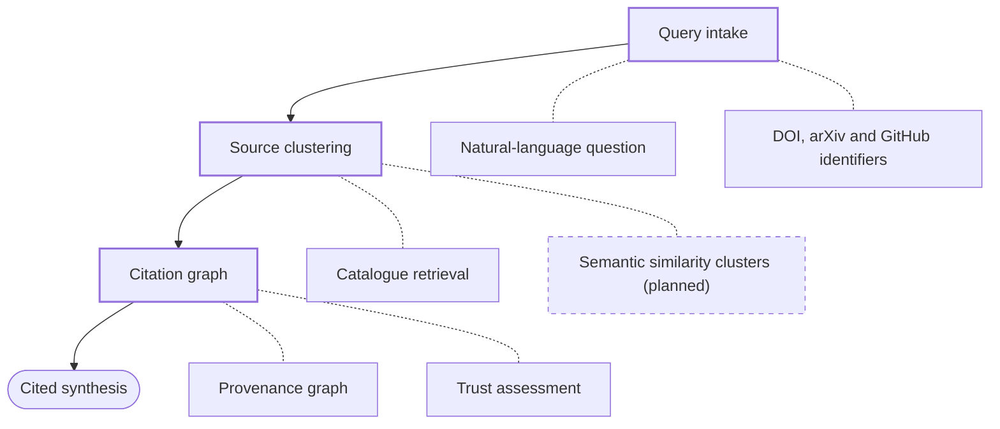
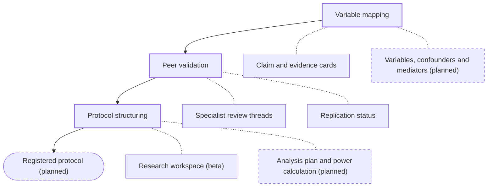
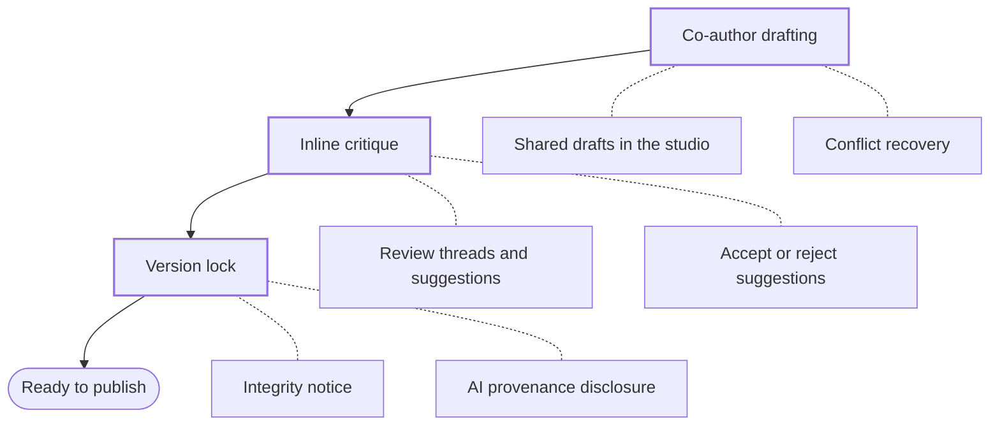
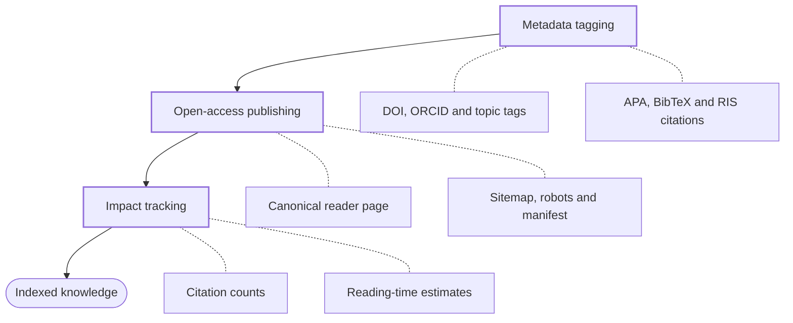

# Research lifecycle workflows

<!-- Generated by `npm run docs:workflows` from lib/workflows/research-workflows.ts. Do not edit by hand. -->

The four lifecycles a piece of research passes through on the platform. The same data renders the
`WorkflowDiagram` / `WorkflowDisclosure` components in the product and the diagrams below.

Every capability is marked **live** (shipped; the implementing component or route is named) or
**planned** (not built yet). The product labels planned capabilities the same way, so a reader is
never told something exists when it does not.

## Discovery and literature synthesis

From a question to a cited answer, with every source traceable.

**Shown on:** `/assistant`

| Stage | Capability | Status | Implemented by | Motion pattern |
|---|---|---|---|---|
| Query intake | Natural-language question | live | `AssistantPanel` | connect |
| Query intake | DOI, arXiv and GitHub identifiers | live | `CitationTool` | connect |
| Source clustering | Catalogue retrieval | live | `/api/research-assistant` | synthesize |
| Source clustering | Semantic similarity clusters | planned | — | synthesize |
| Citation graph | Provenance graph | live | `ProvenanceGraph` | connect |
| Citation graph | Trust assessment | live | `TrustAssessmentSummary` | connect |

**Outcome — Cited synthesis** (live): A summary with inline citations. Uses Gemini when configured, otherwise a deterministic local summary.

## Hypothesis and methodology design

Turn claims and evidence into a protocol a specialist can check.

**Shown on:** `/write`

| Stage | Capability | Status | Implemented by | Motion pattern |
|---|---|---|---|---|
| Variable mapping | Claim and evidence cards | live | `ClaimCard` | connect |
| Variable mapping | Variables, confounders and mediators | planned | — | connect |
| Peer validation | Specialist review threads | live | `ReviewThread` | verify |
| Peer validation | Replication status | live | `TrustAssessmentSummary` | verify |
| Protocol structuring | Research workspace (beta) | live | `ResearchWorkspace` | synthesize |
| Protocol structuring | Analysis plan and power calculation | planned | — | synthesize |

**Outcome — Registered protocol** (planned): A time-stamped protocol attached to the review. Not yet available.

## Collaborative drafting and peer review

Co-authors and reviewers work on one draft without losing either version.

**Shown on:** `/dashboard/comments`, `/dashboard/edit/[id]`

| Stage | Capability | Status | Implemented by | Motion pattern |
|---|---|---|---|---|
| Co-author drafting | Shared drafts in the studio | live | `/dashboard/edit/[id]` | connect |
| Co-author drafting | Conflict recovery | live | `ConflictPanel` | connect |
| Inline critique | Review threads and suggestions | live | `ReviewThread` | connect |
| Inline critique | Accept or reject suggestions | live | `ReviewThread` | connect |
| Version lock | Integrity notice | live | `IntegrityNotice` | verify |
| Version lock | AI provenance disclosure | live | `AIProvenanceDisclosure` | verify |

**Outcome — Ready to publish** (live): An editor-approved draft with its review history attached.

## Publication and knowledge indexing

Publish openly, then keep the record findable and connected.

**Shown on:** `/dashboard/manage`, `/post/[slug]`

| Stage | Capability | Status | Implemented by | Motion pattern |
|---|---|---|---|---|
| Metadata tagging | DOI, ORCID and topic tags | live | `/dashboard/manage` | connect |
| Metadata tagging | APA, BibTeX and RIS citations | live | `CitationTool` | connect |
| Open-access publishing | Canonical reader page | live | `/post/[slug]` | verify |
| Open-access publishing | Sitemap, robots and manifest | live | `app/sitemap.ts` | verify |
| Impact tracking | Citation counts | live | `PapersArchive` | synthesize |
| Impact tracking | Reading-time estimates | live | `ArticleFeed` | synthesize |

**Outcome — Indexed knowledge** (live): The review joins the provenance graph and its trust assessment.
