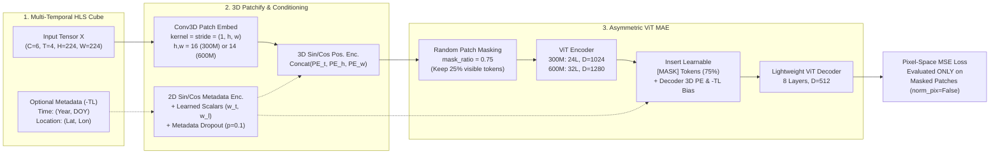
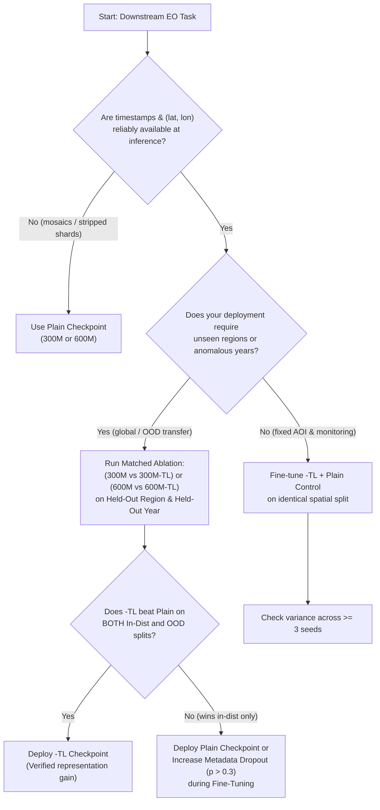

> **<mark>Don’t deploy a 600M-parameter Earth foundation model on an 8% headline alone</mark>—before trusting Prithvi-EO-2.0 in production, you need to know whether it truly reads multi-temporal reflectance or is just memorizing the map and the calendar.**
>
> — **Ashif Ahmed Shuvo**

**Prithvi-EO-2.0** (Szwarcman et al., *IEEE TGRS* 2026 / `arXiv:2412.02732`) is a second-generation, multi-temporal Earth-observation foundation model jointly developed by IBM Research, NASA IMPACT, and the Jülich Supercomputing Centre. Built on 300M (ViT-Large) and 600M (ViT-Huge) Vision Transformer backbones pretrained via masked autoencoding (MAE) on 4.2 million global four-frame samples from NASA’s Harmonized Landsat–Sentinel-2 (HLS v2) archive at 30 m resolution, its `-TL` variants inject optional acquisition-date and geolocation biases into image tokens and report an **8% aggregate GEO-Bench gain** over Prithvi-EO-1.0.

This guide dissects the exact mathematical architecture, verifies the six released Hugging Face checkpoints, audits what the 8% headline gain actually conceals across task families, and provides a reproducible, step-by-step TerraTorch engineering playbook to test whether `-TL` embeddings help or hurt on your own geospatial data.

> **Key Takeaways**
>
> - **Temporal tokenization is decoupled from spatial patching:** Each pretraining sample contains $T = 4$ frames spanning 1–6 months; 3D convolutional patch embedding uses temporal kernel size $t = 1$ (preserving per-frame tokens), while factorized 3D sinusoidal positional encodings span time, height, and width.
> - **Metadata is an additive bias, not an extra spectral band:** `-TL` checkpoints encode acquisition `(year, day_of_year)` and scene center `(lat, lon)` via 2D sinusoidal projections summed onto tokens with learned scalar weights and a $p = 0.1$ metadata dropout rate.
> - **Six checkpoints ship, but only two matched ablation pairs exist:** Hugging Face hosts `tiny-TL` (5M), `100M-TL` (100M), `300M` / `300M-TL`, and `600M` / `600M-TL`. Clean metadata ablations require pairing `300M` vs. `300M-TL` or `600M` vs. `600M-TL` on identical splits.
> - **The 8% GEO-Bench headline is a confounded aggregate:** It reflects simultaneous increases in parameter count ($100\text{M} \rightarrow 600\text{M}$), corpus scale ($250\text{K}$ US $\rightarrow 4.2\text{M}$ global), temporal horizon ($T=3 \rightarrow T=4$), and metadata conditioning. Task-level tables reveal modest margins (e.g., $+0.6$ Water IoU on Sen1Floods11 for `600M-TL` vs. `600M`; $+0.5$ mIoU over U-TAE on PASTIS).
> - **Spatial-temporal OOD testing is mandatory before deployment:** Because `(lat, lon)` and `day_of_year` are strong geographic/phenological priors, fine-tuned `-TL` models must be evaluated on held-out regions and held-out years alongside plain controls.

---

## Agent & Engineering Quick-Spec

For rapid reference—and for automated evaluation or RAG pipelines—the verified tensor contract and checkpoint specifications from the official `ibm-nasa-geospatial` Hugging Face configurations are summarized below:

| Specification Key | Prithvi-EO-2.0-300M / 300M-TL | Prithvi-EO-2.0-600M / 600M-TL |
| --- | --- | --- |
| Backbone Family | ViT-Large (MAE Encoder–Decoder) | ViT-Huge (MAE Encoder–Decoder) |
| Input Tensor Shape | $(B, C=6, T=4, H=224, W=224)$ | $(B, C=6, T=4, H=224, W=224)$ |
| 3D Patch Size $(t, h, w)$ | $(1, 16, 16)$ *(check `config.json` per tag)* | $(1, 14, 14)$ |
| Total Tokens ($N = \frac{T}{t} \cdot \frac{H}{h} \cdot \frac{W}{w}$) | $4 \times 14 \times 14 = 784$ | $4 \times 16 \times 16 = 1{,}024$ |
| Visible Encoder Tokens ($25\%$ at $\rho = 0.75$) | $196$ | $256$ |
| Encoder Hidden Dim ($D_{\text{enc}}$) / Depth / Heads | $1{,}024$ / $24$ / $16$ | $1{,}280$ / $32$ / $16$ |
| Decoder Hidden Dim ($D_{\text{dec}}$) / Depth | $512$ / $8$ | $512$ / $8$ |
| Spectral Band Order ($C=6$) | Blue, Green, Red, Narrow NIR, SWIR 1, SWIR 2 | Blue, Green, Red, Narrow NIR, SWIR 1, SWIR 2 |
| HLS S30 / L30 Band IDs | S30: `B02,B03,B04,B8A,B11,B12` / L30: `B02–B07` | S30: `B02,B03,B04,B8A,B11,B12` / L30: `B02–B07` |
| Pretraining Band Means (reflectance $\times 10^4$) | `[1087.0, 1342.0, 1433.0, 2734.0, 1958.0, 1363.0]` | `[1087.0, 1342.0, 1433.0, 2734.0, 1958.0, 1363.0]` |
| Pretraining Band Stds (reflectance $\times 10^4$) | `[2248.0, 2179.0, 2178.0, 1850.0, 1242.0, 1049.0]` | `[2248.0, 2179.0, 2178.0, 1850.0, 1242.0, 1049.0]` |
| Loss & Masking Ratio | Pixel-space MSE (`norm_pix_loss=false`), $\rho=0.75$ | Pixel-space MSE (`norm_pix_loss=false`), $\rho=0.75$ |
| Metadata Conditioning (`-TL` only) | `["time", "location"]`, dropout $p=0.1$ | `["time", "location"]`, dropout $p=0.1$ |
| Weight License / Code License | Apache-2.0 (HF) / MIT (NASA-IMPACT repo) | Apache-2.0 (HF) / MIT (NASA-IMPACT repo) |

---

## How do time and location enter the model?

Four frames reproduce the paper’s pretraining sequence. Use the interactive controls below to compare shorter temporal horizons ($T \in \{1, 2, 3, 4\}$) and toggle the optional acquisition-date and geolocation metadata used by the `-TL` checkpoints.

> **Visual / Interactive Placeholder:** `[PrithviExplorer]`

---

## What does Prithvi-EO-2.0 actually add mathematically and architecturally?

Prithvi-EO-2.0 extends the VideoMAE / Spatiotemporal MAE paradigm (He et al., 2022; Tong et al., 2022; Feichtenhofer et al., 2022) to multi-spectral satellite time series with two targeted structural changes: **factorized 3D spatiotemporal tokenization** and **learned-weight sinusoidal metadata injection**.



### 1. 3D Patch Tokenization and Factorized 3D Positional Encoding

Given a standardized multi-temporal HLS cube $\mathbf{X} \in \mathbb{R}^{C \times T \times H \times W}$ with $C = 6$ spectral channels and $T = 4$ chronological frames, a single 3D convolution projects non-overlapping spatiotemporal cubes of size $(t, h, w)$ into $D$-dimensional token embeddings:

$$\mathbf{Z}_0 = \operatorname{Conv3D}(\mathbf{X};\, \text{kernel}=(t,h,w),\, \text{stride}=(t,h,w)) \in \mathbb{R}^{N \times D}$$

where the total token count is:

$$N = \frac{T}{t} \cdot \frac{H}{h} \cdot \frac{W}{w}$$

Crucially, Prithvi-EO-2.0 sets **$t = 1$**. That means the convolution **never mixes separate acquisition months inside a single patch token**. Instead, each timestamp produces its own spatial grid of tokens ($14 \times 14 = 196$ tokens/frame for $h=w=16$; $16 \times 16 = 256$ tokens/frame for $h=w=14$), and cross-temporal interactions happen exclusively through multi-head self-attention across the full token sequence.

To inform attention layers of where each token sits inside the 3D cube, the authors generate three independent 1D sinusoidal positional encodings along time ($t$), height ($h$), and width ($w$) and concatenate them into a single vector $\mathbf{E}_{\text{pos}} \in \mathbb{R}^{N \times D}$:

$$\mathbf{E}_{\text{pos}}(n) = \left[\, \mathbf{e}_{t}(n) \;\|\; \mathbf{e}_{h}(n) \;\|\; \mathbf{e}_{w}(n) \,\right]$$

### 2. Optional Time-and-Location (`-TL`) Metadata Fusion

In the `-TL` checkpoints, each sample carries two auxiliary metadata tuples:

- **Temporal coordinates:** $\tau_k = (\text{year}_k,\, \text{DOY}_k)$ for each frame $k \in \{1, \dots, T\}$, where $\text{DOY}_k \in \{1, \dots, 365\}$.
- **Spatial geolocation:** $\ell = (\text{lat},\, \text{lon})$ at the center of the patch.

Both tuples are independently mapped to $\mathbb{R}^{D}$ via fixed 2D sinusoidal encodings, $\phi_{\text{time}}(\tau_k)$ and $\phi_{\text{loc}}(\ell)$, and fused into the token representation via **learned scalar weights** ($w_{\text{time}}, w_{\text{loc}}$—with separate scalar parameters for encoder and decoder) gated by independent Bernoulli dropout masks $m_t, m_\ell \sim \operatorname{Bernoulli}(1 - p_{\text{drop}})$ with $p_{\text{drop}} = 0.1$ during pretraining:

$$\tilde{\mathbf{z}}_{n} = \mathbf{z}_{n} + \mathbf{E}_{\text{pos}}(n) + m_t \cdot w_{\text{time}} \, \phi_{\text{time}}(\tau_{k(n)}) + m_\ell \cdot w_{\text{loc}} \, \phi_{\text{loc}}(\ell)$$

Two engineering consequences follow directly from this equation:

1. **Graceful degradation:** Because $10\%$ of training steps randomly drop time, location, or both, the weights learn to remain calibrated when metadata is absent at inference time.
2. **Global scene context, not pixel geometry:** Every token within frame $k$ receives the *same* $\phi_{\text{time}}(\tau_k)$ and every token in the entire sample receives the *same* $\phi_{\text{loc}}(\ell)$. Metadata acts as a learned scene-level bias, not an additional spatially varying spectral channel.

### 3. Asymmetric Masked Autoencoding Objective

During pretraining, a uniform random subset $\mathcal{M} \subset \{1, \dots, N\}$ containing $\rho = 75\%$ of all tokens is masked out. Only the remaining $25\%$ visible tokens $\mathcal{V} = \{1, \dots, N\} \setminus \mathcal{M}$ pass through the heavy ViT encoder, yielding a roughly $4\times$ reduction in encoder self-attention memory and FLOPs compared to dense encoding. The lightweight 8-layer decoder ($D_{\text{dec}} = 512$) receives the encoded visible tokens interleaved with shared learnable `[MASK]` tokens, re-applies decoder 3D positional and `-TL` embeddings, and predicts raw reflectance pixels. The training loss computes mean squared error (MSE) strictly over masked patches (`norm_pix_loss = false`):

$$\mathcal{L}_{\text{MAE}} = \frac{1}{|\mathcal{M}|} \sum_{i \in \mathcal{M}} \left\| \hat{\mathbf{x}}_i - \mathbf{x}_i \right\|_2^2$$

The pretraining objective is easier to feel than to read. Hide $75\%$ of the patches, pass only the visible tokens through the encoder, and watch the decoder reconstruct what it never saw—the interactive figure below runs that loop on a configurable grid using the exact token counts for a four-frame Prithvi input.

> **Visual / Interactive Placeholder:** `[MaskedPatchReconstructor]`

### Architecture Decision Records (ADRs)

Understanding *why* the authors chose this design clarifies where the model excels and where it breaks:

- **ADR-01: Temporal Patch Size $t = 1$ Instead of Spatiotemporal Tubelets ($t = 2$)**
  - *Context:* VideoMAE typically merges adjacent frames ($t=2$) because consecutive video frames at 30 fps are highly redundant.
  - *Decision:* Keep $t = 1$ for HLS multi-temporal stacks.
  - *Consequence:* Satellite acquisitions are spaced 1–6 months apart; land cover changes dramatically between frames. Keeping $t = 1$ allows seamless adaptation to single-date ($T=1$) or variable-length ($T \in [1, 12]$) downstream tasks without temporal kernel interpolation, at the cost of a $T\times$ longer attention sequence.
- **ADR-02: Additive Learned-Weight Metadata Biases Over Extra Input Channels**
  - *Context:* Appending latitude, longitude, and DOY as extra raster channels forces downstream pipelines to construct dense metadata rasters and breaks when metadata is missing.
  - *Decision:* Encode metadata via sinusoidal embeddings scaled by learned scalars with $p = 0.1$ dropout.
  - *Consequence:* Enables zero-shot fallback when timestamps or coordinates are missing, while introducing a subtle geographic-prior overfitting risk (analyzed below).
- **ADR-03: $14 \times 14$ Spatial Patching on the 600M Backbone**
  - *Context:* Standard ViT-Huge uses $14 \times 14$ patches (`224 / 14 = 16` grid), whereas ViT-Large uses $16 \times 16$ (`224 / 16 = 14` grid).
  - *Decision:* Retain ViT-H/14 geometry at 600M.
  - *Consequence:* Yields finer spatial token granularity ($256$ vs. $196$ patches per $224 \times 224$ frame), but breaks divisibility for standard $512 \times 512$ EO tiles ($512 \bmod 14 = 8$), forcing resizing (e.g., to $448 \times 448$ as done on Sen1Floods11) or explicit reflect-padding in inference pipelines.

---

## What exactly went into pretraining?

The sampling design is as consequential as the transformer architecture: four observations span *months*, not four adjacent days. The authors stratified global HLS tiles from 2014–2023 across land-cover types, filtered out excessive clouds and no-data pixels, and enforced geographic separation between training and validation footprints to avoid spatial leakage.

Drag the timeline below to inspect what a four-date sample actually captures: the same agricultural parcel at $T_1$ and $T_3$ is not a shifted camera frame—it is a fundamentally different phenological state. The scrubber is illustrative rather than raw HLS telemetry, but it mirrors the 1–6 month spacing reported in the paper.

> **Visual / Interactive Placeholder:** `[SeasonScrubber]`

| Pretraining Dimension | Reported Prithvi-EO-2.0 Setup | Prithvi-EO-1.0 Baseline (for contrast) |
| --- | --- | --- |
| Source Product | NASA/USGS HLS v2 (L30 + S30), 30 m | NASA/USGS HLS v2, 30 m |
| Geographic Scope | Global (stratified across land cover) | Contiguous United States (CONUS) only |
| Temporal Coverage & Cadence | 2014–2023; $T=4$ frames, 1–6 months apart | 2017–2022; $T=3$ frames |
| Spectral Input | 6 bands: Blue, Green, Red, Narrow NIR, SWIR 1, SWIR 2 | Same 6 bands |
| Patch & Crop Geometry | $256 \times 256$ patches; random crop to $4 \times 224 \times 224$ | $3 \times 224 \times 224$ |
| Corpus Size | $4.2\text{M}$ train patches / $46\text{K}$ validation patches | $\sim 250\text{K}$ train patches ($>1\text{ TB}$) |
| Objective & Schedule | Pixel-space MAE ($\rho = 0.75$), 400 epochs | Pixel-space MAE ($\rho = 0.75$) |
| Pretraining Compute | 300M: 80 A100 GPUs ($\sim 21\text{K}$ GPU-h); 600M: 240 A100 GPUs ($\sim 58\text{K}$ GPU-h) | Significantly smaller CONUS run |

*Source:* Szwarcman et al. ([Section III-A & III-B](https://arxiv.org/html/2412.02732#S3.SS1)), Jakubik et al. (2023), and the [Prithvi-EO-2.0-600M-TL model card](https://huggingface.co/ibm-nasa-geospatial/Prithvi-EO-2.0-600M-TL). Note that in the paper’s headline comparison against Prithvi-EO-1.0, **backbone scale ($3\times\text{–}6\times$), corpus size ($\sim 17\times$), global coverage, temporal length, and metadata conditioning all change simultaneously**. It is a system-level generational upgrade, not an isolated architecture ablation.

---

## Which checkpoints actually ship?

The Hugging Face release contains **six** checkpoints spanning four parameter counts ($5\text{M}, 100\text{M}, 300\text{M}, 600\text{M}$). Crucially, the release is **asymmetric**: the `tiny` and `100M` sizes ship *only* as `-TL` variants, while matched plain vs. `-TL` control pairs exist exclusively at `300M` and `600M`.

| Hugging Face Checkpoint | Parameters | Backbone | Metadata (`-TL`) | Matched Plain Control? | Primary Engineering Role |
| --- | ---: | --- | :---: | :---: | --- |
| [`Prithvi-EO-2.0-tiny-TL`](https://huggingface.co/ibm-nasa-geospatial/Prithvi-EO-2.0-tiny-TL) | 5M | ViT-Tiny | Yes | No | CI smoke tests, edge/on-orbit distillation baselines |
| [`Prithvi-EO-2.0-100M-TL`](https://huggingface.co/ibm-nasa-geospatial/Prithvi-EO-2.0-100M-TL) | 100M | ViT-Base | Yes | No | Parameter-matched upgrade over Prithvi-EO-1.0 |
| [`Prithvi-EO-2.0-300M`](https://huggingface.co/ibm-nasa-geospatial/Prithvi-EO-2.0-300M) | 300M | ViT-Large | No | **Control** | Matched visual-only baseline for 300M-TL |
| [`Prithvi-EO-2.0-300M-TL`](https://huggingface.co/ibm-nasa-geospatial/Prithvi-EO-2.0-300M-TL) | 300M | ViT-Large | Yes | `300M` | Best accuracy-to-VRAM trade-off for single-GPU work |
| [`Prithvi-EO-2.0-600M`](https://huggingface.co/ibm-nasa-geospatial/Prithvi-EO-2.0-600M) | 600M | ViT-Huge | No | **Control** | Matched visual-only baseline for 600M-TL |
| [`Prithvi-EO-2.0-600M-TL`](https://huggingface.co/ibm-nasa-geospatial/Prithvi-EO-2.0-600M-TL) | 600M | ViT-Huge | Yes | `600M` | Flagship checkpoint; highest reported benchmark scores |

Compare the release ladder below to inspect checkpoint scale, metadata support, and pretraining compute side by side.

> **Visual / Interactive Placeholder:** `[CheckpointLadder]`

---

## Does the 8% GEO-Bench gain survive a peer-review audit?

The paper evaluates Prithvi-EO-2.0 on **GEO-Bench** (Lacoste et al., 2023): six classification datasets and six semantic-segmentation datasets spanning spatial resolutions from $0.1\text{ m}$ to $15\text{ m}$, using 10 Bayesian hyperparameter optimization (HPO) trials per dataset (via TerraTorch Iterate) followed by 10 repeated runs with distinct random seeds. The headline result is that `Prithvi-EO-2.0-600M-TL` outperforms `Prithvi-EO-1.0` by **8%** across the benchmark and ranks first overall against six competing geospatial foundation models (`MoCo`, `DINO`, `DeCUR`, `Scale-MAE`, `DOFA`, and `Satlas`).

A strict methodological audit surfaces four caveats that every practitioner should weigh before citing that 8% number:

1. **Task-family divergence is hidden inside the aggregate:** In the paper’s own GEO-Bench breakdown (Section IV-A), **DOFA** (Xiong et al., 2024)—pretrained on multi-sensor imagery spanning NAIP, Sentinel-1, Sentinel-2, EnMAP, Gaofen, and Landsat—**ranks first on classification**, with `Prithvi-EO-2.0-600M-TL` second and `600M` third. Prithvi-EO-2.0’s overall lead is driven primarily by **semantic segmentation**, where `600M-TL` and `600M` top the leaderboard ahead of `DeCUR` and `DINO` ResNet-50 baselines.
2. **Aggregation ambiguity in the abstract:** GEO-Bench normalizes heterogeneous task metrics (accuracy, F1, mIoU) and typically aggregates via interquartile mean (IQM) with bootstrap confidence intervals (Agarwal et al., 2021). The abstract’s single "8%" figure does not distinguish absolute percentage points from relative lift or expose per-task variance; individual task tables are far more reliable decision tools.
3. **Confounded pretraining variables:** Comparing `Prithvi-EO-2.0-600M-TL` to `Prithvi-EO-1.0-100M` mixes $6\times$ parameter scaling, $17\times$ corpus expansion, global vs. CONUS geography, $T=4$ vs. $T=3$ temporal inputs, and `-TL` metadata.
4. **Resolution transfer works surprisingly well—with a caveat:** Strong performance on $0.1\text{ m}\text{–}15\text{ m}$ tasks despite strictly $30\text{ m}$ pretraining shows that ViT MAE features transfer across spatial scales, yet domain-specific multi-sensor models (e.g., SAR-native or hyperspectral models) remain competitive when spectral modalities diverge from optical HLS.

---

## What do the downstream task tables actually show?

Moving from normalized aggregates to raw task metrics reveals a clearer, more grounded picture: **consistent, reproducible gains that are often modest in absolute points over strong baselines and plain controls**.

### 1. Flood Segmentation: Sen1Floods11 (Single-Date Optical Transfer)

Sen1Floods11 (Bonafilia et al., 2020) tests binary flood-water segmentation on $446$ Sentinel-2 scenes (resized from $512 \times 512$ to $448 \times 448$ so all models share identical inputs divisible by the 600M backbone’s $14 \times 14$ patch size). Values below are test-set percentages with standard deviations across repeated runs in parentheses; `Water IoU` isolates the minority flood class rather than diluting it with background pixels.

| Model | mIoU ($\text{SD}$) | mF1 ($\text{SD}$) | Water IoU ($\text{SD}$) | $\Delta$ Water IoU vs. v1.0 |
| --- | ---: | ---: | ---: | ---: |
| Prithvi-EO-1.0-100M | $88.3\;(0.3)$ | $97.3\;(0.1)$ | $79.6\;(0.5)$ | — |
| Prithvi-EO-2.0-300M | $89.7\;(0.3)$ | $97.6\;(0.1)$ | $82.2\;(0.6)$ | $+2.6$ |
| Prithvi-EO-2.0-300M-TL | $90.0\;(0.2)$ | $97.7\;(0.1)$ | $82.6\;(0.3)$ | $+3.0$ |
| Prithvi-EO-2.0-600M | $89.9\;(0.6)$ | $97.6\;(0.2)$ | $82.5\;(1.0)$ | $+2.9$ |
| Prithvi-EO-2.0-600M-TL | **$90.3\;(0.3)$** | **$97.7\;(0.1)$** | **$83.1\;(0.5)$** | **$+3.5$** |

*Source:* Szwarcman et al., [Table IV](https://arxiv.org/html/2412.02732#S4.T4). Look closely at the matched control pairs: upgrading from v1.0 to v2.0-300M accounts for $+2.6$ Water IoU points, whereas adding `-TL` metadata yields $+0.4$ points at 300M ($82.2 \rightarrow 82.6$) and $+0.6$ points at 600M ($82.5 \rightarrow 83.1$)—inside or just above one standard deviation of the plain 600M run ($\text{SD} = 1.0$).

Switch between overall mIoU, mean F1, and Water IoU below. The chart enforces an untruncated $0\text{–}100\%$ y-axis so sub-percentage differences are visually honest rather than artificially amplified.

> **Visual / Interactive Placeholder:** `[FloodResultsChart]`

### 2. Multi-Temporal Crop Segmentation: PASTIS (Data-Efficiency Regime)

PASTIS (Sainte Fare Garnot & Landrieu, 2021) is an ideal stress test for a multi-temporal foundation model because crop classification depends heavily on seasonal phenology. The table compares `Prithvi-EO-2.0` against other GFMs (`DOFA`, `Satlas`, `Presto`) and the specialized temporal-attention baseline `U-TAE` under both full supervision ($100\%$) and a low-label regime ($10\%$, roughly 200 images).

| Model | PASTIS mIoU ($10\%$ train data) | PASTIS mIoU ($100\%$ train data) | $\Delta$ vs. U-TAE ($100\%$) |
| --- | ---: | ---: | ---: |
| DOFA | $20.4$ | $37.0$ | $-15.9$ |
| Satlas | $15.8$ | $31.5$ | $-21.4$ |
| Presto | $20.1$ | $28.1$ | $-24.8$ |
| U-TAE (task-specific baseline) | $36.9$ | $52.9$ | $0.0$ |
| Prithvi-EO-2.0-300M | $36.3$ | $51.6$ | $-1.3$ |
| Prithvi-EO-2.0-600M | **$37.4$** | **$53.4$** | **$+0.5$** |

*Source:* Szwarcman et al., [Table XII](https://arxiv.org/html/2412.02732#S4.T12). Two takeaways jump out: first, single-date GFMs (`DOFA`, `Satlas`) collapse on multi-temporal phenology relative to native multi-temporal models; second, `Prithvi-EO-2.0-600M` beats the lightweight, purpose-built `U-TAE` baseline by a real but narrow $+0.5$ mIoU in both data regimes (while `300M` trails `U-TAE` by $0.6\text{–}1.3$ points).

Toggle between the $10\%$ and $100\%$ training regimes below to inspect the gap between single-date GFMs, `U-TAE`, and Prithvi-EO-2.0.

> **Visual / Interactive Placeholder:** `[PastisResultsChart]`

### 3. Multi-Modal Ecosystem Dynamics: Gross Primary Productivity (GPP)

In a separate flux-tower regression benchmark, the authors fused HLS imagery with MERRA-2 meteorological variables across 37 globally distributed flux towers ($975$ samples) using leave-one-year-out cross-validation. `Prithvi-EO-2.0-600M-TL` achieved held-out $R^2$ scores of **$0.88$ (2018), $0.80$ (2019), $0.83$ (2020), and $0.74$ (2021)**—averaging **$0.81$** versus **$0.75$** for a ResNet-18 baseline ([Table XV](https://arxiv.org/html/2412.02732#S4.T15)). Notice the inter-annual variance ($0.88 \rightarrow 0.74$): temporal distribution shift remains non-trivial even with a 600M-parameter backbone.

---

## Where do the metadata embeddings help, and where could they hurt?

Optional metadata is smart systems engineering. Real Earth-observation pipelines routinely lose exact acquisition dates during cloud-free compositing and drop coordinate tags when tiles are shuffled into web-dataset shards. Treating time and location as droppable hints makes the model far more resilient than architectures that hard-wire coordinates into input channels.

However, the same mechanism introduces a classic **shortcut-learning failure mode**:

- **Geographic memorization:** Center `(lat, lon)` encodes biome, climate zone, and regional agricultural policy. A fine-tuned `-TL` model can score well on an in-distribution test split by learning *"this latitude/longitude usually grows maize in July"* rather than extracting generalizable canopy reflectance signatures.
- **Phenological brittleness under climate anomalies:** When drought, late planting, or El Niño shifts a growing season by 4–6 weeks, a model over-reliant on `day_of_year` biases can misclassify healthy delayed crops or misjudge burn-scar recovery.
- **Consortium-assembled evaluation bias:** Involving remote-sensing subject-matter experts (SMEs) in benchmark curation increases operational realism, yet end-user-designed splits still predominantly test expected seasonal and regional regimes unless explicitly partitioned for out-of-distribution (OOD) generalization.

### Diagnostic Decision Tree: Should You Ship Plain or `-TL`?



---

## Step-by-Step Reproducible Engineering Playbook (TerraTorch)

Pretraining is out of reach for most labs (21K–58K A100 GPU-hours), but **fine-tuning is explicitly engineered for a single GPU** via [TerraTorch](https://github.com/IBM/terratorch) (Gomes et al., 2025). Below is a complete, reproducible workflow—from environment pinning to a matched plain vs. `-TL` OOD ablation.

### Step 1: Pin Your Environment and Verify GPU Precision

Never track `main` on fast-moving geospatial toolkits; configuration schemas in TerraTorch evolve across minor releases. Pin versions explicitly and verify BF16/FP16 support:

```bash
python -m venv .venv-prithvi && source .venv-prithvi/bin/activate

# Pin torch + TerraTorch + raster stack for reproducibility
pip install "torch>=2.3,<2.6" "lightning>=2.2" "terratorch==1.0.*" \
            "rasterio>=1.3" "albumentations>=1.4" "huggingface_hub>=0.25"

python -c "import torch, terratorch; print(torch.__version__, terratorch.__version__, torch.cuda.is_bf16_supported())"
```

### Step 2: Enforce the Exact HLS Band Order, Units, and Divisibility

Most silent failures in Prithvi fine-tuning come from band permutation (e.g., passing Sentinel-2 `B08` broad NIR instead of `B8A` narrow NIR, or feeding scaled `0–1` floats against `0–10000` normalization constants). Validate your input tensor before touching a training loop:

```python
import numpy as np
import torch
from terratorch.registry import BACKBONE_REGISTRY

# Exact pretraining statistics from ibm-nasa-geospatial/Prithvi-EO-2.0-600M-TL config.json
# Band order: [Blue, Green, Red, Narrow NIR, SWIR 1, SWIR 2]
HLS_MEAN = torch.tensor([1087.0, 1342.0, 1433.0, 2734.0, 1958.0, 1363.0]).view(1, 6, 1, 1, 1)
HLS_STD  = torch.tensor([2248.0, 2179.0, 2178.0, 1850.0, 1242.0, 1049.0]).view(1, 6, 1, 1, 1)

def prepare_hls_cube(raw_cube: np.ndarray, patch_size: int = 14) -> torch.Tensor:
    """
    raw_cube: shape (C=6, T, H, W) in HLS reflectance * 10_000 units (int16/float32).
    Validates channel count and spatial divisibility by backbone patch_size.
    """
    assert raw_cube.ndim == 4 and raw_cube.shape[0] == 6, f"Expected (6, T, H, W), got {raw_cube.shape}"
    _, t, h, w = raw_cube.shape
    assert h % patch_size == 0 and w % patch_size == 0, (
        f"Spatial dims ({h}, {w}) must be divisible by patch_size={patch_size} "
        f"(e.g., 224 or 448 for 600M ViT-H/14)."
    )
    x = torch.from_numpy(raw_cube).float().unsqueeze(0)  # (1, 6, T, H, W)
    return (x - HLS_MEAN) / HLS_STD

# Load matched backbone pair from TerraTorch registry
backbone_tl = BACKBONE_REGISTRY.build(
    "prithvi_eo_v2_600_tl",
    pretrained=True,
    num_frames=4,
    coords_encoding=["time", "location"],
)
backbone_plain = BACKBONE_REGISTRY.build(
    "prithvi_eo_v2_600",
    pretrained=True,
    num_frames=4,
)

# Smoke-test forward pass with explicit metadata tensors
dummy_x = torch.randn(1, 6, 4, 224, 224)
# temporal_coords: (B, T, 2) -> [year, day_of_year]
temporal_coords = torch.tensor([[[2023, 45], [2023, 120], [2023, 200], [2023, 290]]], dtype=torch.float32)
# location_coords: (B, 2) -> [lat, lon]
location_coords = torch.tensor([[42.03, -93.63]], dtype=torch.float32)

with torch.no_grad():
    feats_tl = backbone_tl(dummy_x, temporal_coords=temporal_coords, location_coords=location_coords)
    feats_plain = backbone_plain(dummy_x)

print("Feature pyramid stages:", [f.shape for f in feats_tl])
```

### Step 3: Run the Masked-Reconstruction Sanity Check First

Before training a downstream decoder, download the official `inference.py` from the checkpoint’s Hugging Face repository and run a 75%-masked reconstruction on four chronological HLS GeoTIFFs from your own Area of Interest (AOI). If the reconstructed RGB/SWIR composite shows inverted colors, saturated highlights, or spatial tearing, you have caught a band-order, nodata, or scaling bug in two minutes instead of after a 12-hour fine-tune.

```bash
python inference.py \
  --data_files aoi_t1.tif aoi_t2.tif aoi_t3.tif aoi_t4.tif \
  --input_indices 0 1 2 3 4 5 \
  --mask_ratio 0.75 \
  --output_dir ./sanity_check_recon
```

### Step 4: Configure a Matched Plain vs. `-TL` Fine-Tuning Experiment in TerraTorch

Below is a clean, reproducible TerraTorch semantic-segmentation config template (patterned after Sen1Floods11 / multi-temporal HLS segmentation). To run a strict ablation, hold **every single line constant**—including `seed_everything`, split manifests, learning rate, and decoder—and toggle only `backbone` (`prithvi_eo_v2_300` vs. `prithvi_eo_v2_300_tl`) and `coords_encoding`.

```yaml
# configs/prithvi_v2_ablation_template.yaml
seed_everything: 42
trainer:
  accelerator: gpu
  devices: 1
  precision: bf16-mixed
  max_epochs: 50
  gradient_clip_val: 1.0
  callbacks:
    - class_path: lightning.pytorch.callbacks.ModelCheckpoint
      init_args:
        monitor: val/Multiclass_Jaccard_Index
        mode: max
        save_top_k: 1
    - class_path: lightning.pytorch.callbacks.EarlyStopping
      init_args:
        monitor: val/Multiclass_Jaccard_Index
        patience: 10
        mode: max

model:
  class_path: terratorch.tasks.SemanticSegmentationTask
  init_args:
    model_factory: EncoderDecoderFactory
    model_args:
      # Swap to "prithvi_eo_v2_300" (and remove coords_encoding) for matched plain control
      backbone: prithvi_eo_v2_300_tl
      backbone_pretrained: true
      backbone_num_frames: 4
      backbone_bands: [BLUE, GREEN, RED, NIR_NARROW, SWIR_1, SWIR_2]
      backbone_coords_encoding: [time, location]
      necks:
        - name: SelectIndices
          indices: [5, 11, 17, 23]   # For 600M (depth=32), use [7, 15, 23, 31]
        - name: ReshapeTokensToImage
          effective_time_dim: 4
        - name: LearnedInterpolateToPyramidal
      decoder: UNetDecoder
      decoder_channels: [512, 256, 128, 64]
      head_dropout: 0.1
      num_classes: 2
    loss: ce
    ignore_index: -1
    freeze_backbone: false
    optimizer: AdamW
    lr: 1.0e-4
    scheduler: CosineAnnealingLR
    scheduler_hparams:
      T_max: 50
      eta_min: 1.0e-6
```

Run across at least three fixed seeds (or automate 10 HPO trials + 10 seeds using `terratorch-iterate`) and log both **in-distribution test metrics** and **spatial/temporal OOD holdout metrics**:

```bash
for SEED in 42 1337 2026; do
  terratorch fit -c configs/prithvi_v2_ablation_template.yaml \
    --seed_everything $SEED \
    --trainer.default_root_dir runs/300m_tl_seed_${SEED}
done
```

### Recommended Order of Evaluation Benchmarks

If you are validating Prithvi-EO-2.0 for a production EO stack, sequence your experiments from cheapest to most diagnostic:

1. **Sen1Floods11 (Single-date binary segmentation):** Small ($446$ tiles), public, and fast enough to run multi-seed sweeps in under an hour. Validates band handling, normalization, and patch-size resizing ($448 \times 448$).
2. **HLS Burn Scars (Single/multi-temporal HLS domain match):** Closest to the pretraining sensor and radiometry; the NASA-IMPACT repository ships working reference configs.
3. **PASTIS or US Multi-Temporal Crop Segmentation:** Directly tests temporal attention and phenology—the single best arena for a matched `300M` vs. `300M-TL` ablation with a held-out geographic fold and held-out year.
4. **BioMassters or Landslide4Sense:** Stress-tests continuous regression (above-ground biomass) or multi-sensor fusion (Sentinel-1 SAR + Sentinel-2 optical), revealing where a 6-band optical MAE hits its modality ceiling.

---

## What do the authors emphasize?

The architecture section draws a sharp conceptual boundary between internal token geometry and external geospatial context. Quoted verbatim from the paper’s full author group:

> “Note that the metadata encodings are designed to inform the model about the sample’s general location (center coordinates) and corresponding timestamp, while only the 3D positional encodings are responsible for conveying the positions of the tokens within the sample.”
>
> — Szwarcman et al., [Model Architecture Section (III-B)](https://arxiv.org/html/2412.02732#S3.SS2)

The abstract pairs that technical framing with an institutional claim about open research governance:

> “The project exemplifies the Trusted Open Science approach embraced by all involved organizations.”
>
> — Szwarcman et al., [Paper Abstract](https://arxiv.org/abs/2412.02732)

The first quote is an essential architectural insight: geolocation and acquisition dates are scene-level priors, not spatial coordinates inside the image grid. The second describes a development philosophy rather than independent validation—which is why inspecting the released configs, exact data splits, and multi-seed test tables matters more than taking any summary headline at face value.

---

## Pre-Deployment Audit Checklist

Before pointing Prithvi-EO-2.0 at operational satellite imagery, verify every item below:

- [ ] **Band order & radiometric units:** Confirm six reflectance bands in strict model-card order (`Blue`, `Green`, `Red`, `Narrow NIR [B8A/B05]`, `SWIR 1`, `SWIR 2`), scaled identically to the checkpoint’s `mean`/`std` config (`0–10000` reflectance scale).
- [ ] **Patch-size divisibility:** Verify `config.json` for your exact checkpoint (`16` vs. `14`). For `600M` / `600M-TL` ($14 \times 14$ patches), use tiled sliding-window inference with window sizes divisible by 14 (e.g., $224 \times 224$ or $448 \times 448$) and overlap blending.
- [ ] **Chronological frame ordering:** Keep multi-temporal frames strictly sorted oldest-to-newest and co-registered to the exact same geographic footprint.
- [ ] **Matched metadata ablation:** Never compare `100M-TL` to `300M` and attribute the delta to metadata. Pair `300M` vs. `300M-TL` or `600M` vs. `600M-TL` on frozen spatial and temporal OOD splits.
- [ ] **NoData & cloud masking policy:** Confirm how masked/cloud fill values (e.g., `-9999` in HLS) are handled prior to standardization so extreme negative sentinels do not explode layer-norm statistics.
- [ ] **License compliance:** Verify MIT (NASA-IMPACT repo) vs. Apache-2.0 (TerraTorch & Hugging Face weight cards) for every artifact bundled into your container.
- [ ] **Reconstruction sanity check:** Run `inference.py` on a known AOI scene before interpreting downstream task metrics.

---

## Verdict: What does this release get right—and what remains hidden?

**What it gets right:** Prithvi-EO-2.0 sets a high bar for inspectability in geospatial AI. Public Apache-2.0 weights across six checkpoints, matched plain/`-TL` ablation pairs at 300M and 600M, native TerraTorch integration, explicit multi-seed GEO-Bench protocols, and transparent task-level tables make it unusually straightforward to audit and fine-tune on a single GPU.

**What it hides:** Two gaps remain. First, the exact **4.2M-patch pretraining manifest** is not distributed alongside the weights—you can reproduce downstream fine-tuning cleanly, but you cannot audit potential geographic overlap between the pretraining corpus and arbitrary downstream test regions without recreating the HLS sampling pipeline. Second, the headline **8% GEO-Bench figure** compresses distinct classification and segmentation behaviors (and a $6\times$ model + $17\times$ data scale-up) into a single number. Treat Prithvi-EO-2.0 as a strong, well-engineered multi-temporal optical backbone—then let your own matched plain vs. `-TL` OOD experiment decide whether it earns a slot in production.

For how this site reviews papers and repositories, see the [about page](/about), browse the [archive](/blog), read the [welcome post](/blog/welcome-to-the-new-researchwithme), or use [search](/search).

---

## References

1. **Szwarcman, D., Roy, S., Fraccaro, P., Gíslason, Þ. E., Blumenstiel, B., Ghosal, R., de Oliveira, P. H., Almeida, J. L. d. S., Sedona, R., Kang, Y., Chakraborty, S., et al. (2026).** *Prithvi-EO-2.0: A Versatile Multitemporal Foundation Model for Earth Observation Applications.* IEEE Transactions on Geoscience and Remote Sensing, Vol. 64, Art. no. 4400120, pp. 1–20. DOI: [10.1109/TGRS.2025.3642610](https://doi.org/10.1109/TGRS.2025.3642610) | Preprint: [arXiv:2412.02732](https://arxiv.org/abs/2412.02732) (v1 Dec 2024; v3 Mar 2026).
2. **Jakubik, J., Roy, S., Phillips, C. E., Fraccaro, P., Godwin, D., Zadrozny, B., Szwarcman, D., Gomes, C., Nyirjesy, G., Edwards, B., et al. (2023).** *Foundation Models for Generalist Geospatial Artificial Intelligence (Prithvi-EO-1.0).* [arXiv:2310.18660](https://arxiv.org/abs/2310.18660).
3. **Gomes, C., Blumenstiel, B., Almeida, J. L. d. S., de Oliveira, P. H., Fraccaro, P., Roy, S., Szwarcman, D., et al. (2025).** *TerraTorch: The Geospatial Foundation Models Toolkit.* IEEE IGARSS 2025 / [arXiv:2503.20563](https://arxiv.org/abs/2503.20563). Repository: [github.com/IBM/terratorch](https://github.com/IBM/terratorch).
4. **Lacoste, A., Lehmann, N., Rodriguez, P., Sherwin, E. D., Kerner, H., Lütjens, B., Irvin, J. A., Dao, D., Alemohammad, H., Drouin, A., et al. (2023).** *GEO-Bench: Toward Foundation Models for Earth Monitoring.* Advances in Neural Information Processing Systems (NeurIPS 2023), Datasets and Benchmarks Track, Vol. 36. [arXiv:2306.03831](https://arxiv.org/abs/2306.03831) | Repository: [github.com/ServiceNow/geo-bench](https://github.com/ServiceNow/geo-bench).
5. **He, K., Chen, X., Xie, S., Li, Y., Dollár, P., & Girshick, R. (2022).** *Masked Autoencoders Are Scalable Vision Learners.* Proceedings of the IEEE/CVF Conference on Computer Vision and Pattern Recognition (CVPR 2022), pp. 16000–16009. [arXiv:2111.06377](https://arxiv.org/abs/2111.06377).
6. **Tong, Z., Song, Y., Wang, J., & Wang, L. (2022).** *VideoMAE: Masked Autoencoders Are Data-Efficient Learners for Self-Supervised Video Pre-Training.* Advances in Neural Information Processing Systems (NeurIPS 2022), Vol. 35. [arXiv:2203.12602](https://arxiv.org/abs/2203.12602).
7. **Feichtenhofer, C., Fan, H., Li, Y., & He, K. (2022).** *Masked Autoencoders As Spatiotemporal Learners.* Advances in Neural Information Processing Systems (NeurIPS 2022), Vol. 35. [arXiv:2205.09113](https://arxiv.org/abs/2205.09113).
8. **Claverie, M., Ju, J., Masek, J. G., Dungan, J. L., Vermote, E. F., Roger, J.-C., Skakun, S. V., & Justice, C. (2018).** *The Harmonized Landsat and Sentinel-2 Surface Reflectance Data Set.* Remote Sensing of Environment, Vol. 219, pp. 145–161. DOI: [10.1016/j.rse.2018.09.002](https://doi.org/10.1016/j.rse.2018.09.002).
9. **Bonafilia, D., Tellman, B., Anderson, T., & Issenberg, E. (2020).** *Sen1Floods11: A Georeferenced Dataset to Train and Test Deep Learning Flood Algorithms for Sentinel-1.* Proceedings of the IEEE/CVF Conference on Computer Vision and Pattern Recognition Workshops (CVPRW 2020), pp. 210–211.
10. **Sainte Fare Garnot, V., & Landrieu, L. (2021).** *Panoptic Segmentation of Satellite Image Time Series with Convolutional Temporal Attention Networks (PASTIS & U-TAE).* Proceedings of the IEEE/CVF International Conference on Computer Vision (ICCV 2021), pp. 4872–4881. [arXiv:2107.07933](https://arxiv.org/abs/2107.07933).
11. **Xiong, Z., Wang, Y., Zhang, F., Stewart, A. J., Hanna, J., Borth, D., Papoutsis, I., Le Saux, B., Camps-Valls, G., & Zhu, X. X. (2024).** *Neural Plasticity-Inspired Multimodal Foundation Model for Earth Observation (DOFA).* [arXiv:2403.15356](https://arxiv.org/abs/2403.15356).
12. **Bastani, F., Wolters, P., Gupta, R., Ferdinando, J., & Kembhavi, A. (2023).** *SatlasPretrain: A Large-Scale Dataset for Remote Sensing Image Understanding.* Proceedings of the IEEE/CVF International Conference on Computer Vision (ICCV 2023), pp. 16772–16782. [arXiv:2211.15660](https://arxiv.org/abs/2211.15660).
13. **Tseng, G., Cartuyvels, R., Zvonkov, I., Purohit, M., Rolnick, D., & Kerner, H. (2023).** *Lightweight, Pre-trained Transformers for Remote Sensing Timeseries (Presto).* [arXiv:2304.14065](https://arxiv.org/abs/2304.14065).
14. **Wang, Y., Braham, N. A. A., Xiong, Z., Liu, C., Albrecht, C. M., & Zhu, X. X. (2023).** *SSL4EO-S12: A Large-Scale Multimodal, Multitemporal Dataset for Self-Supervised Learning in Earth Observation.* IEEE Geoscience and Remote Sensing Magazine, Vol. 11, No. 3, pp. 98–106.
15. **Wang, Y., Albrecht, C. M., Braham, N. A. A., Liu, C., Xiong, Z., & Zhu, X. X. (2024).** *DeCUR: Decoupling Common & Unique Representations for Multimodal Self-Supervision.* European Conference on Computer Vision (ECCV 2024). [arXiv:2309.05300](https://arxiv.org/abs/2309.05300).
16. **Reed, C. J., Gupta, R., Li, S., Brockman, S., Funk, C., Clipp, B., Keutzer, K., Candido, S., Uyttendaele, M., & Darrell, T. (2023).** *Scale-MAE: A Scale-Aware Masked Autoencoder for Multiscale Geospatial Representation Learning.* Proceedings of the IEEE/CVF International Conference on Computer Vision (ICCV 2023), pp. 4088–4099.
17. **Agarwal, R., Schwarzer, M., Castro, P. S., Courville, A. C., & Bellemare, M. G. (2021).** *Deep Reinforcement Learning at the Edge of the Statistical Precipice.* Advances in Neural Information Processing Systems (NeurIPS 2021), Vol. 34, pp. 29304–29320.
18. **IBM–NASA Geospatial Model Cards & Code Repositories (2024–2026).** Hugging Face Collection: [ibm-nasa-geospatial/Prithvi-EO-2.0-600M-TL](https://huggingface.co/ibm-nasa-geospatial/Prithvi-EO-2.0-600M-TL) (Apache-2.0); Code & Examples: [github.com/NASA-IMPACT/Prithvi-EO-2.0](https://github.com/NASA-IMPACT/Prithvi-EO-2.0) (MIT).

### Citation (BibTeX)

```bibtex
@article{szwarcman2026prithvi2,
  title     = {Prithvi-EO-2.0: A Versatile Multitemporal Foundation Model for Earth Observation Applications},
  author    = {Szwarcman, Daniela and Roy, Sujit and Fraccaro, Paolo and G{\'i}slason, {\TH}orsteinn El{\'i} and Blumenstiel, Benedikt and Ghosal, Rinki and de Oliveira, Pedro Henrique and de Sousa Almeida, Jo{\~a}o Lucas and Sedona, Rocco and Kang, Yanghui and Chakraborty, Srija and others},
  journal   = {IEEE Transactions on Geoscience and Remote Sensing},
  volume    = {64},
  pages     = {1--20},
  year      = {2026},
  doi       = {10.1109/TGRS.2025.3642610},
  eprint    = {2412.02732},
  archivePrefix = {arXiv},
  primaryClass  = {cs.CV}
}
```