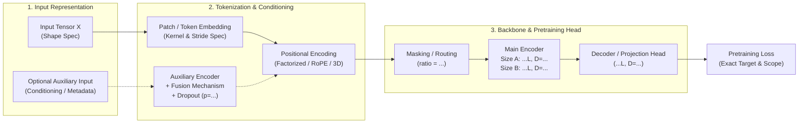
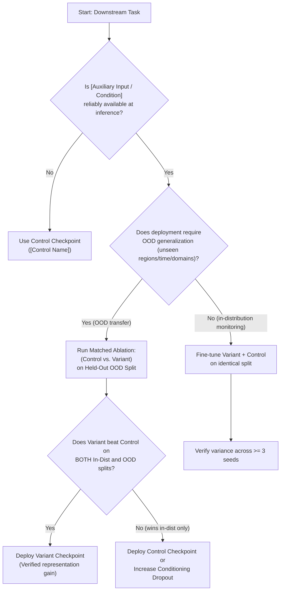

---
# === SEO, AEO & GEO Frontmatter ===
title: "[Model/Paper Name]: Architecture, Benchmarks, and Reproducing [Core Contribution]"
description: "An advanced technical breakdown of [Model Name] ([Venue Year] / arXiv:[ID]): [key architectural mechanism], [number] released checkpoints, [Primary Benchmark] and downstream audits, and a step-by-step [Framework] fine-tuning playbook."
date: "YYYY-MM-DD"
updated: "YYYY-MM-DD"
slug: "model-name-technical-deep-dive"
tags:
  - "primary-domain"
  - "foundation-models"
  - "reproducibility"
  - "architecture-review"
  - "framework-name"
keywords:
  - "[Model Name]"
  - "[Flagship Checkpoint Name]"
  - "[Domain] foundation model"
  - "[Pretraining Dataset]"
  - "[Primary Benchmark]"
  - "[Framework] fine-tuning"
  - "[Downstream Dataset 1]"
  - "[Downstream Dataset 2]"
schemaType: "TechArticle"
difficulty: "Advanced"
readingTime: "15-20 min"
cover: "/images/[slug-cover].jpeg"
coverAlt: "Editorial illustration of [describe visual metaphor tied to the architecture]."
coverStyle: hero
toc: true
entities:
  - "[Model Name]"
  - "[Organization 1]"
  - "[Organization 2]"
  - "[Pretraining Dataset]"
  - "[Primary Framework]"
  - "[Primary Benchmark]"
faq:
  - question: "Is [Model Name] open source, and what licenses apply?"
    answer: "[Clarify any split between code repo license (e.g., MIT/Apache-2.0), toolkit license, and Hugging Face weight cards. Remind readers to verify per-checkpoint terms.]"
  - question: "What dataset and input format was [Model Name] pretrained on?"
    answer: "[Report sample counts, train/val split, temporal/spatial scope, resolution, and exact channel/modality ordering.]"
  - question: "Can I fine-tune [Model Name] on a single GPU?"
    answer: "[Contrast downstream fine-tuning requirements (e.g., single GPU with framework X) against pretraining compute (GPU count, hardware type, total GPU-hours).]"
  - question: "How does [Model Name] differ from [Predecessor / Baseline]?"
    answer: "[Summarize parameter scale, corpus shift, input geometry changes, new conditioning mechanisms, and the headline benchmark claim.]"
  - question: "What is the biggest gotcha or input constraint when running inference?"
    answer: "[Highlight a concrete engineering constraint—e.g., patch divisibility, normalization scaling, context-length limit, or band/channel ordering.]"
  - question: "When should I choose [Plain/Control Variant] over [Flagship/Conditioned Variant]?"
    answer: "[State when the matched control is safer—e.g., OOD evaluation, missing auxiliary metadata, or tighter latency/VRAM budgets.]"
---

<!-- ==========================================================================
     HOOK: Author Punchline
     Goal: Capture the core tension between the paper's headline claim and what
     practitioners must verify before shipping to production.
     ========================================================================== -->

> **<mark>[Sharp 1-sentence warning or thesis against trusting the headline metric blindly]</mark>—before trusting [Model Name] in production, you need to know whether it truly [core capability] or is just [key shortcut / failure mode].**
>
> — **Ashif Ahmed Shuvo**

<!-- ==========================================================================
     LEAD: 2-Paragraph Executive Overview
     Paragraph 1: Who built it, venue/arXiv ID, backbone scale, pretraining data,
                  key architectural twist, and headline benchmark claim.
     Paragraph 2: Exactly what this post audits and delivers to the reader.
     ========================================================================== -->

**[Model Name]** ([First Author] et al., *[Venue]* [Year] / `arXiv:[ID]`) is a [generation/category] [domain] foundation model developed by [Organizations]. Built on [Parameter Sizes] ([Backbone Families]) pretrained via [Pretraining Objective] on [Corpus Size & Source] at [Resolution / Input Spec], its `[Variant Suffix]` variants introduce [Key Conditioning / Architectural Feature] and report a **[Headline Gain]% [Primary Benchmark] gain** over [Predecessor/Baseline].

This guide dissects the exact mathematical architecture, verifies the [N] released [Hub] checkpoints, audits what the [Headline Gain]% headline actually conceals across task families, and provides a reproducible, step-by-step [Framework] engineering playbook to test whether [Key Feature] helps or hurts on your own data.

> **Key Takeaways**
>
> - **[Core Architectural Mechanics]:** [1-2 sentences with exact dimensions/math, e.g., input shape, kernel/patch size, positional encoding.]
> - **[Secondary Feature / Conditioning Mechanism]:** [1-2 sentences explaining how auxiliary signals or conditioning enter the model and how dropout/fallback works.]
> - **[Release & Checkpoint Asymmetry]:** [List all shipped checkpoint sizes and explicitly state which matched control pairs exist for clean ablations.]
> - **[Headline Benchmark Reality Check]:** [Decompose the confounded variables behind the abstract's headline number and cite 1-2 sober task-level margins.]
> - **[Mandatory Pre-Deployment Test]:** [State the exact out-of-distribution (OOD) or matched-control check practitioners should run first.]

---

## Agent & Engineering Quick-Spec

<!-- ==========================================================================
     AI/Agent-Ready Spec Table
     Goal: Give engineers and RAG/coding agents the exact verified tensor
     contract from official config.json / model cards in one scannable table.
     ========================================================================== -->

For rapid reference—and for automated evaluation or RAG pipelines—the verified tensor contract and checkpoint specifications from the official `[org-name]` Hugging Face configurations are summarized below:

| Specification Key | [Model Name]-[Size A] / [Size A-Variant] | [Model Name]-[Size B] / [Size B-Variant] |
| --- | --- | --- |
| Backbone Family | [e.g., ViT-Large (MAE Encoder–Decoder)] | [e.g., ViT-Huge (MAE Encoder–Decoder)] |
| Input Tensor Shape | $(B, C=\dots, T=\dots, H=\dots, W=\dots)$ | $(B, C=\dots, T=\dots, H=\dots, W=\dots)$ |
| Patch / Tokenization Size | $(t, h, w)$ *(verify `config.json` per tag)* | $(t, h, w)$ |
| Total Tokens ($N$) | $[\text{Formula} = \text{Total}]$ | $[\text{Formula} = \text{Total}]$ |
| Active / Visible Tokens | $[\text{Count at ratio } \rho]$ | $[\text{Count at ratio } \rho]$ |
| Encoder Hidden Dim ($D_{\text{enc}}$) / Depth / Heads | $[\dots]$ / $[\dots]$ / $[\dots]$ | $[\dots]$ / $[\dots]$ / $[\dots]$ |
| Decoder Hidden Dim ($D_{\text{dec}}$) / Depth | $[\dots]$ / $[\dots]$ | $[\dots]$ / $[\dots]$ |
| Channel / Input Ordering | `[Ordered list of channels/modalities]` | `[Ordered list of channels/modalities]` |
| Normalization Means | `[m_1, m_2, ...]` | `[m_1, m_2, ...]` |
| Normalization Stds | `[s_1, s_2, ...]` | `[s_1, s_2, ...]` |
| Pretraining Objective & Loss | `[Loss name, hyperparams]` | `[Loss name, hyperparams]` |
| Auxiliary Conditioning (`[Variant]` only) | `[Conditioning keys, dropout p]` | `[Conditioning keys, dropout p]` |
| Weight License / Code License | `[Weight License]` / `[Code License]` | `[Weight License]` / `[Code License]` |

---

## How do [Core Signals / Inputs] enter the model?

<!-- Optional visual or interactive explorer demonstrating input structure -->

[1-2 sentences orienting the reader to the visual/interactive figure below—what default configuration reproduces pretraining and what sliders/toggles compare.]

> **Visual / Interactive Placeholder:** `[ModelInputExplorer]`

---

## What does [Model Name] actually add mathematically and architecturally?

[Model Name] extends the [Foundational Paradigm] ([Author A], [Year]; [Author B], [Year]) to [Target Domain] with two targeted structural changes: **[Change 1]** and **[Change 2]**.



### 1. [Tokenization / Input Embedding & Positional Encoding]

Given a standardized input $\mathbf{X} \in \mathbb{R}^{\dots}$, [describe projection operator]:

$$\mathbf{Z}_0 = \operatorname{Embed}(\mathbf{X};\, \theta_{\text{proj}}) \in \mathbb{R}^{N \times D}$$

where the total token count is:

$$N = [\text{closed-form expression}]$$

[Explain the critical design nuance—what does this operator explicitly *not* mix or compress, and where do cross-dimension interactions actually happen?]

To encode token coordinates, the authors construct $\mathbf{E}_{\text{pos}} \in \mathbb{R}^{N \times D}$ as:

$$\mathbf{E}_{\text{pos}}(n) = [\text{positional encoding formula}]$$

### 2. [Secondary Architectural Change / Auxiliary Fusion]

In the `[Variant]` checkpoints, each sample carries auxiliary inputs:

- **[Auxiliary Signal 1]:** [Formal symbol, domain, and range.]
- **[Auxiliary Signal 2]:** [Formal symbol, domain, and range.]

These signals are mapped into $\mathbb{R}^{D}$ via $\phi_{1}(\cdot)$ and $\phi_{2}(\cdot)$ and fused with token embeddings as:

$$\tilde{\mathbf{z}}_{n} = \mathbf{z}_{n} + \mathbf{E}_{\text{pos}}(n) + [\text{fusion equation with gating/weights}]$$

Two engineering consequences follow directly from this equation:

1. **[Operational Property 1, e.g., Graceful degradation]:** [Explain behavior when auxiliary signals are missing or noisy.]
2. **[Operational Property 2, e.g., Scope of conditioning]:** [Clarify whether the signal acts globally per sample or locally per token.]

### 3. [Pretraining Objective & Loss Function]

During pretraining, [describe masking, contrastive pairing, or autoregressive setup, compute savings, and target space]. The training loss is:

$$\mathcal{L} = [\text{exact mathematical loss formulation}]$$

[1-2 sentences introducing the interactive objective visualizer below.]

> **Visual / Interactive Placeholder:** `[ObjectiveVisualizer]`

### Architecture Decision Records (ADRs)

Understanding *why* the authors chose this design clarifies where the model excels and where it breaks:

- **ADR-01: [Key Design Choice 1] Instead of [Common Alternative]**
  - *Context:* [Why the standard alternative works in another domain.]
  - *Decision:* [What this paper chose instead.]
  - *Consequence:* [Concrete downstream benefit AND compute/memory trade-off.]
- **ADR-02: [Key Design Choice 2] Over [Alternative]**
  - *Context:* [Pipeline failure mode or engineering constraint.]
  - *Decision:* [Architectural mechanism selected.]
  - *Consequence:* [Deployment upside AND hidden statistical/generalization risk.]
- **ADR-03: [Key Design Choice 3, e.g., Patch Size / Context Window / Precision]**
  - *Context:* [Standard backbone convention vs. domain data dimensions.]
  - *Decision:* [Exact parameter retained.]
  - *Consequence:* [Downstream preprocessing requirement—e.g., resizing, padding, or tiling—engineers must handle.]

---

## What exactly went into pretraining?

[2-3 sentences explaining why data curation, sampling cadence, filtering, and split hygiene matter as much as the model architecture.]

[1-2 sentences framing the interactive data scrubber/explorer below, clarifying if it is illustrative vs. raw telemetry.]

> **Visual / Interactive Placeholder:** `[DataScrubber]`

| Pretraining Dimension | Reported [Model Name] Setup | [Predecessor / Baseline] (for contrast) |
| --- | --- | --- |
| Source Product / Corpus | [Dataset source, version, resolution] | [Baseline source] |
| Coverage / Domain Scope | [Geographic / domain distribution] | [Baseline scope] |
| Cadence / Sequence Spec | [Length, spacing, time window] | [Baseline cadence] |
| Input Modalities / Channels | [Exact channels/tokens] | [Baseline channels] |
| Sample Geometry & Crops | [Raw patch size $\rightarrow$ training crop] | [Baseline geometry] |
| Corpus Size | [Train split / Val split] | [Baseline size] |
| Objective & Schedule | [Objective, epochs/steps, batch size] | [Baseline schedule] |
| Pretraining Compute | [Size A: GPUs, GPU-h; Size B: GPUs, GPU-h] | [Baseline compute] |

*Source:* [First Author] et al. ([Section Link](https://arxiv.org/html/[ID])) and the [[Flagship Model Card]](https://huggingface.co/[org]/[model]). Note that in the paper’s headline comparison against [Predecessor], **[list all variables that changed simultaneously—parameter scale, corpus size, coverage, sequence length, metadata]**. It is a system-level generational upgrade, not an isolated architecture ablation.

---

## Which checkpoints actually ship?

The [Hugging Face / GitHub] release contains **[N]** checkpoints spanning [K] parameter counts ($[\text{list sizes}]$). Crucially, note any **asymmetry**: [state which sizes lack plain/control pairs and which exact pairs enable valid ablations].

| Hugging Face Checkpoint | Parameters | Backbone | [Key Feature] | Matched Control? | Primary Engineering Role |
| --- | ---: | --- | :---: | :---: | --- |
| [`[Checkpoint-1]`](https://huggingface.co/[org]/[ckpt-1]) | [Size] | [Arch] | [Yes/No] | [No / Name] | [CI smoke tests / edge baseline] |
| [`[Checkpoint-2]`](https://huggingface.co/[org]/[ckpt-2]) | [Size] | [Arch] | [Yes/No] | **Control** | [Matched baseline for Variant] |
| [`[Checkpoint-3]`](https://huggingface.co/[org]/[ckpt-3]) | [Size] | [Arch] | [Yes/No] | `[Control]` | [Best accuracy-to-VRAM trade-off] |
| [`[Checkpoint-4]`](https://huggingface.co/[org]/[ckpt-4]) | [Size] | [Arch] | [Yes/No] | `[Control]` | [Flagship checkpoint] |

[1 sentence introducing the interactive checkpoint comparison component.]

> **Visual / Interactive Placeholder:** `[CheckpointLadder]`

---

## Does the [Headline Metric] gain survive a peer-review audit?

The paper evaluates [Model Name] on **[Primary Benchmark]** ([Citation]): [number & types of tasks, input scales, HPO protocol, number of random seeds]. The headline result is that `[Flagship Checkpoint]` outperforms `[Predecessor]` by **[Headline Gain]%** and ranks [Rank] against [N] competing foundation models (`[Model 1]`, `[Model 2]`, `[Model 3]`).

A strict methodological audit surfaces four caveats that every practitioner should weigh before citing that headline number:

1. **Task-family divergence is hidden inside the aggregate:** [Cite where a competing model actually beats this model on a sub-family, and identify which sub-family drives the overall lead.]
2. **Aggregation ambiguity in the abstract:** [Note whether the aggregate mixes heterogeneous metrics, uses mean vs. IQM, or omits per-task variance/confidence intervals.]
3. **Confounded pretraining variables:** [Remind the reader which scale/data/architecture deltas are bundled into the headline comparison.]
4. **Domain or modality transfer limits:** [State where the model transfers surprisingly well—and where specialist or multi-modal baselines still win.]

---

## What do the downstream task tables actually show?

Moving from normalized aggregates to raw task metrics reveals a clearer, more grounded picture: **[1-sentence summary of the true empirical pattern—e.g., consistent gains, narrow margins over controls, or strong few-shot behavior]**.

### 1. [Task Family 1]: [Dataset 1] ([Evaluation Regime])

[Dataset 1] ([Citation]) tests [task definition, sample count, and any preprocessing/resizing required for patch compatibility]. Values below are test-set [units] with standard deviations across repeated runs in parentheses; `[Target Metric]` isolates [minority/critical class].

| Model | [Metric 1] ($\text{SD}$) | [Metric 2] ($\text{SD}$) | [Target Metric] ($\text{SD}$) | $\Delta$ vs. [Baseline] |
| --- | ---: | ---: | ---: | ---: |
| [Predecessor] | $00.0\;(0.0)$ | $00.0\;(0.0)$ | $00.0\;(0.0)$ | — |
| [Control Size A] | $00.0\;(0.0)$ | $00.0\;(0.0)$ | $00.0\;(0.0)$ | $+0.0$ |
| [Variant Size A] | $00.0\;(0.0)$ | $00.0\;(0.0)$ | $00.0\;(0.0)$ | $+0.0$ |
| [Control Size B] | $00.0\;(0.0)$ | $00.0\;(0.0)$ | $00.0\;(0.0)$ | $+0.0$ |
| [Variant Size B] | **$00.0\;(0.0)$** | **$00.0\;(0.0)$** | **$00.0\;(0.0)$** | **$+0.0$** |

*Source:* [First Author] et al., [Table X](https://arxiv.org/html/[ID]). [2 sentences analyzing the matched control pair delta relative to the reported standard deviation.]

[1 sentence explaining the chart toggle and noting untruncated axes for honest visual comparison.]

> **Visual / Interactive Placeholder:** `[Task1ResultsChart]`

### 2. [Task Family 2]: [Dataset 2] ([Data-Efficiency / Core Differentiator Regime])

[Dataset 2] ([Citation]) is an ideal stress test for [core model property] because [domain reason]. The table compares `[Model Name]` against competing foundation models and a strong task-specific baseline under both full supervision ($100\%$) and a low-label regime ($[X]\%$).

| Model | [Dataset 2 Metric] ($[X]\%$ train data) | [Dataset 2 Metric] ($100\%$ train data) | $\Delta$ vs. [Specialist Baseline] ($100\%$) |
| --- | ---: | ---: | ---: |
| [Competing GFM 1] | $00.0$ | $00.0$ | $-0.0$ |
| [Competing GFM 2] | $00.0$ | $00.0$ | $-0.0$ |
| [Specialist Baseline] | $00.0$ | $00.0$ | $0.0$ |
| [Model Size A] | $00.0$ | $00.0$ | $-0.0$ |
| [Model Size B] | **$00.0$** | **$00.0$** | **$+0.0$** |

*Source:* [First Author] et al., [Table Y](https://arxiv.org/html/[ID]). [2 concise takeaways contrasting competing GFMs, the task-specific baseline, and the reviewed model.]

[1 sentence framing the interactive regime-switching chart.]

> **Visual / Interactive Placeholder:** `[Task2ResultsChart]`

### 3. [Task Family 3]: [Cross-Modal / Regression / OOD Benchmark]

In a separate [task type] experiment, the authors evaluated [dataset size, cross-validation protocol—e.g., leave-one-year-out or leave-one-region-out]. `[Flagship Checkpoint]` achieved held-out [metric] scores of **$[v_1], [v_2], [v_3], [v_4]$**—averaging **$[\text{avg}]$** versus **$[\text{baseline}]$** for [Baseline] ([Table Z](https://arxiv.org/html/[ID])). [1 sentence highlighting variance across held-out folds/years.]

---

## Where does [Key Feature / Mechanism] help, and where could it hurt?

[1 paragraph praising the genuine systems-engineering upside of the feature in messy production pipelines.]

However, the same mechanism introduces concrete **failure modes**:

- **[Failure Mode 1, e.g., Shortcut Learning / Memorization]:** [Explain how the model can exploit spurious correlations in-distribution.]
- **[Failure Mode 2, e.g., Distribution Shift Brittleness]:** [Explain what breaks under temporal, geographic, sensor, or domain shift.]
- **[Failure Mode 3, e.g., Evaluation / Consortium Bias]:** [Explain structural blind spots in how benchmarks were constructed or selected.]

### Diagnostic Decision Tree: Should You Ship [Control] or [Variant]?



---

## Step-by-Step Reproducible Engineering Playbook ([Framework Name])

Pretraining requires [Compute Scale], but **fine-tuning runs on [Accessible Hardware, e.g., a single GPU]** via [[Framework Name]](https://github.com/[org]/[framework]) ([Citation]). Below is a complete, reproducible workflow—from environment pinning to a matched control vs. variant OOD ablation.

### Step 1: Pin Your Environment and Verify Hardware Precision

Never track `main` on fast-moving research toolkits; configuration keys shift across minor releases. Pin versions explicitly and check precision support:

```bash
python -m venv .venv-[model-slug] && source .venv-[model-slug]/bin/activate

# Pin core dependencies for reproducibility
pip install "torch>=[min],<[max]" "[framework]==[pinned-version]" \
            "[domain-io-lib]>=[min]" "huggingface_hub>=[min]"

python -c "import torch, [framework]; print(torch.__version__, [framework].__version__, torch.cuda.is_bf16_supported())"
```

### Step 2: Enforce the Exact Input Schema, Normalization, and Shape Contracts

Most silent bugs in fine-tuning come from [channel permutation, unit mismatch, or patch-divisibility errors]. Validate your input tensor before launching a training loop:

```python
import numpy as np
import torch
# from [framework] import [BACKBONE_REGISTRY]

# Exact pretraining statistics from [org]/[checkpoint] config.json
MEAN = torch.tensor([...]).view(1, -1, 1, 1, 1)
STD  = torch.tensor([...]).view(1, -1, 1, 1, 1)

def prepare_input(raw_array: np.ndarray, patch_size: int = 14) -> torch.Tensor:
    """
    Validates channel count, value scale, and spatial divisibility by patch_size.
    """
    assert raw_array.ndim == 4 and raw_array.shape[0] == MEAN.shape[1], (
        f"Unexpected input shape: {raw_array.shape}"
    )
    _, _, h, w = raw_array.shape
    assert h % patch_size == 0 and w % patch_size == 0, (
        f"Spatial dims ({h}, {w}) must be divisible by patch_size={patch_size}."
    )
    x = torch.from_numpy(raw_array).float().unsqueeze(0)
    return (x - MEAN) / STD

# Build matched control and variant backbones & run a dummy forward pass
# backbone_variant = BACKBONE_REGISTRY.build("[variant_id]", pretrained=True)
# backbone_control = BACKBONE_REGISTRY.build("[control_id]", pretrained=True)
```

### Step 3: Run a Zero-Training Sanity Check First

Before training a downstream head, run the checkpoint’s official reconstruction / zero-shot `inference.py` script on a known sample from your own dataset. Catching a channel-order, nodata-sentinel, or scaling bug takes two minutes here versus twelve hours inside a training sweep.

```bash
python inference.py \
  --input_files [sample_inputs] \
  --output_dir ./sanity_check_output
```

### Step 4: Configure a Matched Control vs. Variant Fine-Tuning Experiment

Hold **every single hyperparameter constant**—seed, frozen split manifests, optimizer, scheduler, and decoder—and toggle only the backbone identifier and conditioning keys:

```yaml
# configs/[model_slug]_ablation_template.yaml
seed_everything: 42
trainer:
  accelerator: gpu
  devices: 1
  precision: bf16-mixed
  max_epochs: 50
  gradient_clip_val: 1.0

model:
  backbone: "[variant_backbone_id]"   # Swap to "[control_backbone_id]" for matched control
  backbone_pretrained: true
  # conditioning_keys: [...]          # Remove for matched control
  decoder: "[DecoderClass]"
  optimizer: AdamW
  lr: 1.0e-4
  scheduler: CosineAnnealingLR
```

Run across at least three fixed seeds and log both **in-distribution** and **OOD holdout** metrics:

```bash
for SEED in 42 1337 2026; do
  [framework-cli] fit -c configs/[model_slug]_ablation_template.yaml \
    --seed_everything $SEED \
    --trainer.default_root_dir runs/variant_seed_${SEED}
done
```

### Recommended Order of Evaluation Benchmarks

Sequence your internal validation from cheapest to most diagnostic:

1. **[Fast Public Smoke-Test Benchmark]:** Small, fast, multi-seed-friendly. Validates preprocessing, normalization, and shape handling before investing compute.
2. **[In-Domain Pretraining-Matched Benchmark]:** Closest to the pretraining sensor/modality distribution; verifies reference config parity.
3. **[Core Differentiator Benchmark]:** The task where `[Key Feature]` should matter most—ideal for a matched control vs. variant OOD ablation.
4. **[Hard Modality / Task Stress-Test]:** Tests regression, unseen modalities, or severe domain shift to expose the backbone’s ceiling.

---

## What do the authors emphasize?

[1-2 sentences setting up the first verbatim quote that clarifies an easily misunderstood technical claim.]

> “[Verbatim technical quote from the paper.]”
>
> — [First Author] et al., [[Section Name & Number]](https://arxiv.org/html/[ID])

[1 sentence setting up a second verbatim quote covering project claims, scope, or governance.]

> “[Verbatim project-level or evaluation claim from the abstract/conclusion.]”
>
> — [First Author] et al., [[Paper Abstract / Conclusion]](https://arxiv.org/abs/[ID])

[2-3 sentences interpreting both quotes critically—separating architectural facts from process claims that still require independent empirical verification.]

---

## Pre-Deployment Audit Checklist

Before pointing [Model Name] at operational data, verify every item below:

- [ ] **Channel order & units:** Confirm exact input ordering and radiometric/numerical scaling match `config.json`.
- [ ] **Shape & patch divisibility:** Verify `patch_size` / context-window constraints for your exact checkpoint tag; implement overlap tiling or explicit padding where needed.
- [ ] **Sequence / temporal ordering:** Confirm strict ordering and alignment across frames/tokens.
- [ ] **Matched control ablation:** Pair same-sized control and variant checkpoints on frozen in-distribution and OOD splits.
- [ ] **Missing data / sentinel handling:** Verify how NoData, clouds, or masked sentinels are scrubbed before normalization.
- [ ] **License compliance:** Audit code, toolkit, and weight-card licenses independently before commercial redistribution.
- [ ] **Zero-training sanity check:** Run official reconstruction/inference verification on a known domain sample before interpreting downstream scores.

---

## Verdict: What does this release get right—and what remains hidden?

**What it gets right:** [3-4 sentences summarizing genuine engineering strengths: weight availability, matched controls, toolkit support, multi-seed reporting, and practical single-GPU fine-tuning.]

**What it hides:** [3-4 sentences summarizing remaining reproducibility gaps, missing pretraining manifests, confounded headline metrics, or unverified OOD regimes—ending with an actionable takeaway.]

For how this site reviews papers and repositories, see the [about page](/about), browse the [archive](/blog), read the [welcome post](/blog/welcome-to-the-new-researchwithme), or use [search](/search).

---

## References

<!-- ==========================================================================
     Citation Order Convention:
     1. Primary paper (peer-reviewed venue + DOI + arXiv)
     2. Direct predecessor model
     3. Fine-tuning / evaluation toolkit
     4. Primary benchmark suite
     5-7. Core architectural/methodological predecessors
     8-10. Pretraining & downstream datasets
     11-15. Competing foundation models & baselines
     16. Statistical evaluation methodology (e.g., Agarwal et al. IQM)
     17. Official Hugging Face model cards & GitHub repositories with licenses
     ========================================================================== -->

1. **[Authors] ([Year]).** *[Primary Paper Title].* [Journal / Conference], Vol. [X], pp. [Y–Z]. DOI: [[DOI]](https://doi.org/[DOI]) | Preprint: [arXiv:[ID]](https://arxiv.org/abs/[ID]).
2. **[Authors] ([Year]).** *[Predecessor Model Paper].* [Venue / arXiv].
3. **[Authors] ([Year]).** *[Framework / Toolkit Paper].* [Venue / arXiv]. Repository: [github.com/[org]/[repo]](https://github.com/[org]/[repo]).
4. **[Authors] ([Year]).** *[Primary Benchmark Paper].* [Venue / arXiv] | Repository: [github.com/[org]/[bench]](https://github.com/[org]/[bench]).
5. **[Authors] ([Year]).** *[Foundational Architecture / Pretraining Method Paper].* [Venue].
6. **[Authors] ([Year]).** *[Pretraining Dataset Paper].* [Journal], DOI: [[DOI]](https://doi.org/[DOI]).
7. **[Authors] ([Year]).** *[Downstream Dataset 1 Paper].* [Venue].
8. **[Authors] ([Year]).** *[Downstream Dataset 2 Paper].* [Venue].
9. **[Authors] ([Year]).** *[Competing Baseline Model Paper].* [Venue].
10. **[Organization] Model Cards & Code Repositories ([Year]).** Hugging Face: [[org]/[model]](https://huggingface.co/[org]/[model]) ([License]); Code: [github.com/[org]/[repo]](https://github.com/[org]/[repo]) ([License]).

### Citation (BibTeX)

```bibtex
@article{firstauthorYYYYmodel,
  title         = {[Exact Paper Title]},
  author        = {[Last, First and Last, First and others]},
  journal       = {[Journal or Conference Name]},
  volume        = {[Vol]},
  pages         = {[Pages]},
  year          = {[YYYY]},
  doi           = {[DOI]},
  eprint        = {[arXiv ID]},
  archivePrefix = {arXiv},
  primaryClass  = {[cs.CV / cs.LG / etc.]}
}
```